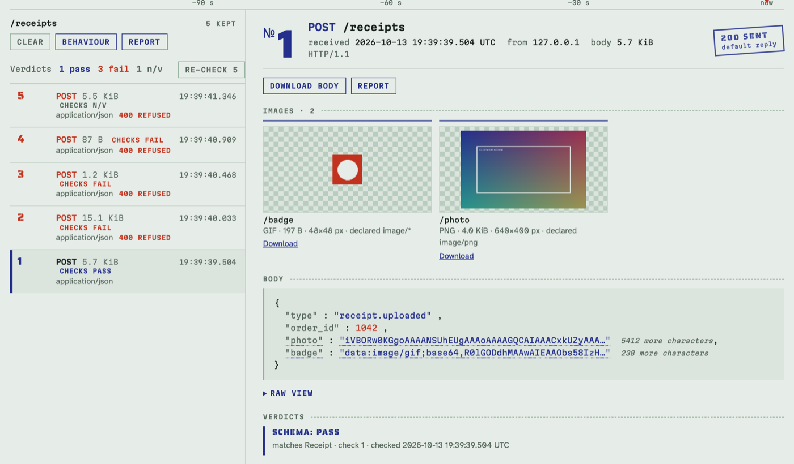
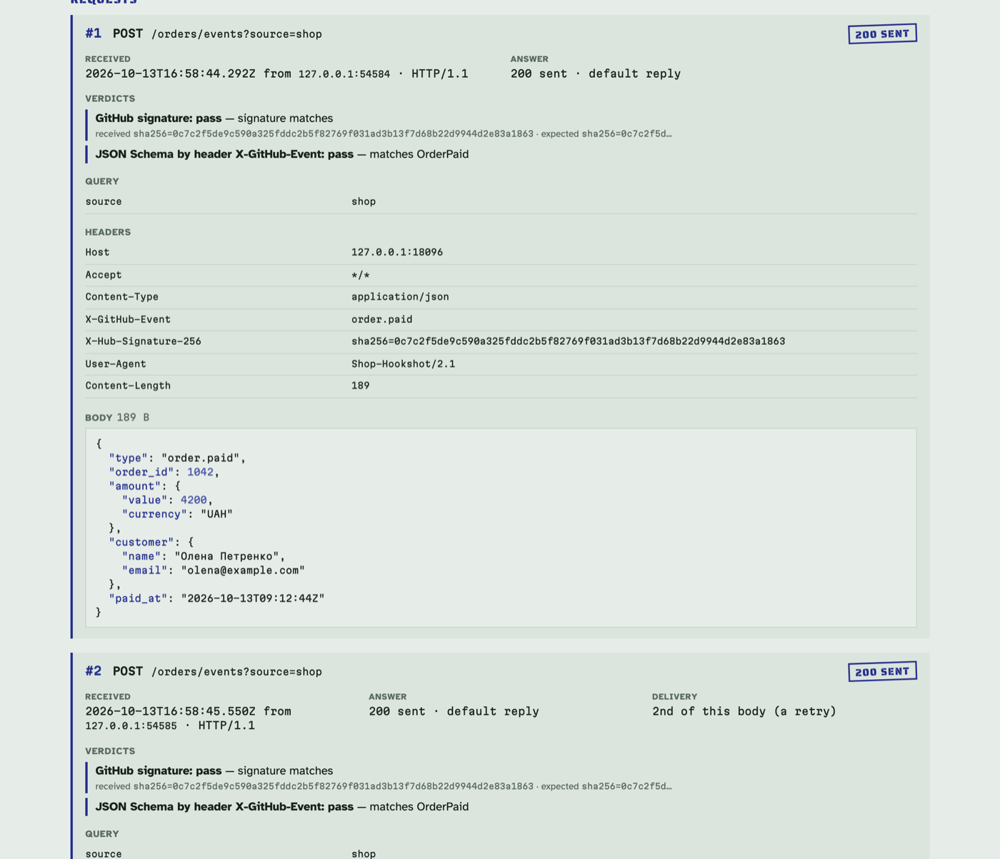

# Hookwitness

Catch webhooks, get a verdict, attach the evidence. Self-hosted, single binary,
MCP-ready.

**Status: early development.** Catch endpoints with a live view, scripted
responses, authorization and JSON Schema verdicts, reports (Markdown, HTML,
PDF) and the REST API work; the MCP server comes next.

## What it is for

You send webhooks to someone else's endpoint and need to prove they actually
left your side, correctly signed and shaped. Hookwitness gives you catch
endpoints with a live view, scriptable responses (status, delay, timeout,
dropped connection, every Nth request failing), pass/fail verdicts for
signatures and JSON Schema, and a report you can attach to a ticket. A REST
API and an MCP server let tests and AI agents drive it.

## Quick start

```sh
make build
bin/hookwitness serve
```

1. Open <http://127.0.0.1:8080/admin/> and create an endpoint, say
   `/stripe/webhooks` (leave the path empty for a random one).
2. Send it a request, or point the real sender at it:

   ```sh
   curl -X POST http://127.0.0.1:8080/stripe/webhooks \
     -H 'Content-Type: application/json' \
     -d '{"type":"invoice.paid","id":"evt_1"}'
   ```

3. Watch it arrive on the endpoint's page without a reload: method, path,
   query, headers in the order they were sent, and the body (pretty JSON, raw
   text, or a hex view for binary), with the raw body to download.

An endpoint is an exact path: `/a` and `/a/` are different endpoints, the
query string is ignored. Any other path is answered `404` and kept in the
**Unmatched** register, so a typo in a sender's URL shows up at once.
Endpoints answer `200` with an empty body until you script them (below); a
body over the limit gets `413` and is recorded without its body. Each endpoint keeps its newest requests up
to the retention limit. The same body delivered again is marked as a retry.

## Docker

```sh
docker run -d --name hookwitness -p 127.0.0.1:8080:8080 -v hookwitness:/data \
  ghcr.io/petroladkin/hookwitness:edge
```

The UI is at <http://localhost:8080/admin/>; webhooks go to any other path of
port 8080. `:edge` follows the development branch; released versions are
tagged `:X.Y.Z`, `:X.Y` and `:latest`. Images are built for linux/amd64 and
linux/arm64.

- **Data** lives in the `/data` volume: the database and, unless you set
  `HOOKWITNESS_SECRET_KEY`, the key that seals the endpoints' secrets
  (`/data/hookwitness.db.key`). Back them up together; a database restored
  without its key keeps the requests but loses the secrets. With a host
  directory instead of a named volume, give it to the image user
  (`chown 65532:65532 <dir>`) or run with `--user "$(id -u):$(id -g)"`.
- **Settings** are the `HOOKWITNESS_*` variables (see
  [Build from source](#build-from-source)), e.g. `-e HOOKWITNESS_RETENTION=5000`.
- **Reaching it from other machines:** `127.0.0.1:` above keeps it on this
  host. Publish wider with `-p 8080:8080`, or put a reverse proxy in front;
  the UI answers only to IP addresses and localhost, so add the proxy's host
  name with `-e HOOKWITNESS_ADMIN_HOSTS=hooks.example.com`. The UI has no login
  yet: where strangers can reach the server, publish only the catch paths, not
  `/admin`.
- **Hardening:** the image runs as a non-root user without a shell and works
  with `--read-only --tmpfs /tmp`.
- **Health:** the image has a health check (`hookwitness health`, which asks
  `/healthz`); `docker ps` shows it.
- **Provenance:** every published image carries a signed build provenance and
  an SBOM: `gh attestation verify oci://ghcr.io/petroladkin/hookwitness:edge --owner petroladkin`.

Compose:

```yaml
services:
  hookwitness:
    image: ghcr.io/petroladkin/hookwitness:edge
    ports: ["127.0.0.1:8080:8080"]
    volumes: ["hookwitness:/data"]
    restart: unless-stopped
volumes:
  hookwitness:
```

Build the image yourself with `make image`; `make image-smoke` runs the
scenario CI runs against it.

## Response emulation

Senders have to cope with receivers that are slow, time out, crash or fail now
and then. Each endpoint's **Behaviour** page sets how it answers, one tab per
part (checks, rules, default reply, variables, secrets):

- **Checks** run first. A required header (present, equal to a value, or
  matching a regular expression) refuses a request that lacks it, with a `400`
  naming the header or with your own reply.
- **Rules** come next, in order; the first whose condition holds decides.
  Conditions: every Nth request, the first N requests since the counter was
  reset, or at random with a probability. Actions: a reply (status, headers,
  body, delay with jitter), a timeout (hold the connection and never answer,
  until the sender gives up or `-max-wait` passes), or a drop (reset the
  connection, as a crashed receiver would).
- The **default reply** answers the rest. It starts as `200` with an empty body.
- **Variables** (`NAME=value`) are test values for templates, shown in plain
  text: never put real secrets there.

Requests refused by a check do not count towards the rules. Every request
records what was done with it: the rule or the default, the status and headers
sent, the measured delay, how long a timed-out sender waited. A sender that
gives up during a reply's delay never got that reply: it is recorded as
**sender left** (nothing sent, the status it would have had kept for
reference) and counted as a timeout, not as a success.

Header values and bodies are Go templates over the request:
`{{.Header "X-Request-Id"}}`, `{{.Query "name"}}`, `{{.JSON "event.items.0.id"}}`
(a field of a JSON body), `{{.Var.TOKEN}}`, `{{.N}}` (the request's number
since the counter reset), `{{.Method}}`, `{{.Path}}`, `{{.Body}}`, with `if`,
`with` and the standard functions; `range` and sub-templates are not
supported, and rendering is capped at 1 MiB and one second.

Examples:

| To test | Set up |
|---|---|
| Fail every 3rd delivery | rule: every 3rd → reply `500` |
| Fail the first two, then recover (retries with backoff) | rule: first 2 → reply `503`, header `Retry-After: 2`; reset the counter to run it again |
| A slow receiver | default reply: delay `4000` ms, jitter `2000` ms |
| A receiver that hangs | rule: at random 10% → time out |
| A crashing receiver | rule: every 5th → drop |
| Echo a URL-verification challenge (Slack-style) | default reply: header `Content-Type: application/json`, body `{"challenge":"{{.JSON "challenge"}}"}` |
| Demand a header like the real client | check: header `X-Api-Key` equals `key_test`, own reply `401` with a JSON error body |

Response headers go out as net/http writes them (sorted by name; repeated
headers keep their order). `Content-Length`, `Transfer-Encoding` and
`Connection` are the server's and cannot be set.

Everything except `/healthz` and the admin prefix is caught, so senders can be
pointed at their real paths. To expose the catch endpoints but not the UI,
publish everything except `/admin` through your reverse proxy. The UI itself
has no login: keep it on localhost or behind the proxy. It answers only when
opened by IP address or `localhost` (so a hostile web page cannot reach it by
pointing its own domain at your server); allow other host names with
`-admin-hosts`.

## Authorization checks

Is this webhook correctly signed? An authorization check answers it on every
request with a verdict: **pass**, **fail** with a one-line reason, or **n/v**
(not verifiable: the body was over the size limit and not kept, or the
secret cannot be decrypted). Add checks on the Behaviour page's Checks tab:

| Check | What it verifies |
|---|---|
| GitHub signature | `X-Hub-Signature-256: sha256=<hex HMAC-SHA256 of the raw body>` |
| Stripe signature | `Stripe-Signature: t=<unix>,v1=<hex HMAC-SHA256 of "<t>.<body>">`; any `v1` may match; the timestamp within a tolerance |
| Standard Webhooks / Svix | `webhook-id`, `webhook-timestamp`, `webhook-signature` (or `svix-…`): `v1,<base64 HMAC-SHA256 of "<id>.<timestamp>.<body>">` under the `whsec_` base64 key; the timestamp within a tolerance |
| Generic HMAC | any header: sha1, sha256 or sha512, hex or base64, an optional prefix (`sha1=` covers GitHub's legacy `X-Hub-Signature`), signed content as a template (the raw body by default, or e.g. `{{.Header "X-Id"}}.{{.Body}}`) |
| Bearer token | `Authorization: Bearer <token>` |
| Basic credentials | `Authorization: Basic base64(user:password)` |

A check records its verdict and lets the request through (the reply is the
usual one). Switch on **enforce** and a request that does not pass is refused
before the rules (and not counted) — also when the check cannot verify it,
e.g. its secret cannot be decrypted: `401` with the reason, `WWW-Authenticate` for bearer
and basic, or your own reply. A failed signature shows the signature received
in full and the first 8 characters of the expected one, enough to tell a
wrong secret from wrong content, not enough to forge a signature. Signed
timestamps are judged against the time the request arrived (default
tolerance 300 s; it can be ignored for replayed captures).

The register shows pass / fail / n/v counts, each row its verdict and the
strip a red bar under failed ones. After changing a secret, **Re-check**
recomputes the verdicts of every kept request; their replies stay as they
were sent.

**Secrets** have their own tab and are write-only: once saved, a value is
never shown again, only a fingerprint. Signing keys are stored encrypted
(AES-256-GCM); tokens and passwords only as salted PBKDF2 hashes. The key
is `HOOKWITNESS_SECRET_KEY` (32 bytes in base64: `openssl rand -base64 32`)
or, when that is not set, a key file created next to the database
(`hookwitness.db.key`, mode 0600). A copy of the database without the key
reveals no secret; keep the key file with the database when you move it.
Use test and staging secrets only: whoever can open the admin UI can make
the server verify with them. Note that a caught request keeps its headers as
evidence, so a bearer token or basic password a sender sent is visible in
that request.

Examples, against an endpoint `/hooks` (create it, add the secret and the
check on its Behaviour page, then run the pair):

```sh
H=http://127.0.0.1:8080/hooks
BODY='{"action":"opened","number":7}'

# GitHub — secret GH_SECRET (signing key) = gh_test_secret; check: GitHub signature
SIG=$(printf '%s' "$BODY" | openssl dgst -sha256 -hmac gh_test_secret | awk '{print $2}')
curl -s -d "$BODY" -H "X-Hub-Signature-256: sha256=$SIG" $H                  # pass
curl -s -d "$BODY" -H "X-Hub-Signature-256: sha256=$(printf '0%.0s' {1..64})" $H  # fail: signature does not match

# Stripe — secret STRIPE_SECRET (signing key) = whsec_test_stripe; check: Stripe signature
T=$(date +%s)
V1=$(printf '%s.%s' "$T" "$BODY" | openssl dgst -sha256 -hmac whsec_test_stripe | awk '{print $2}')
curl -s -d "$BODY" -H "Stripe-Signature: t=$T,v1=$V1" $H                       # pass
OLD=$((T-600)); V0=$(printf '%s.%s' "$OLD" "$BODY" | openssl dgst -sha256 -hmac whsec_test_stripe | awk '{print $2}')
curl -s -d "$BODY" -H "Stripe-Signature: t=$OLD,v1=$V0" $H                     # fail: timestamp 600 s old (tolerance 300 s)

# Standard Webhooks — secret SW_SECRET (signing key) = whsec_MfKQ9r8GKYqrTwjUPD8ILPZIo2LaLaSw
KEY=$(printf 'MfKQ9r8GKYqrTwjUPD8ILPZIo2LaLaSw' | base64 -d | xxd -p | tr -d '\n')
SW=$(printf 'msg_1.%s.%s' "$T" "$BODY" | openssl dgst -sha256 -mac HMAC -macopt hexkey:$KEY -binary | base64)
curl -s -d "$BODY" -H "webhook-id: msg_1" -H "webhook-timestamp: $T" -H "webhook-signature: v1,$SW" $H   # pass
curl -s -d "$BODY" -H "webhook-id: msg_2" -H "webhook-timestamp: $T" -H "webhook-signature: v1,$SW" $H   # fail: signature does not match

# Generic HMAC — secret HMAC_KEY (signing key) = hmac_test_key; check: header X-Signature, sha512, base64
X=$(printf '%s' "$BODY" | openssl dgst -sha512 -hmac hmac_test_key -binary | base64)
curl -s -d "$BODY" -H "X-Signature: $X" $H                                     # pass
curl -s -d "$BODY" -H "X-Signature: not-base64!" $H                            # fail: signature is not base64

# Bearer — secret API_TOKEN (token or password) = tok_test_123; check: Bearer token
curl -s -d "$BODY" -H 'Authorization: Bearer tok_test_123' $H                  # pass
curl -s -d "$BODY" -H 'Authorization: Basic dTpw' $H                           # fail: scheme is Basic, not Bearer

# Basic — secret QA_PASSWORD (token or password) = pw_test; check: Basic credentials, user qa
curl -s -d "$BODY" -u qa:pw_test $H                                            # pass
curl -s -d "$BODY" -u qa:wrong $H                                              # fail: user or password does not match
```

## JSON Schema checks

Does the event keep its contract? A JSON Schema check validates each request's
body and records a verdict next to the authorization ones: **pass**, **fail**
with up to 20 problems (each a JSON pointer into the body, the failing keyword
and a message), **n/v** when the body was not kept, or **n/c** (not checked)
when no schema applies to the event.

- Paste or upload schemas on the Behaviour page's **Schemas** tab. Drafts
  follow `$schema` (draft-04 to 2020-12; 2020-12 when it is absent). An
  invalid schema is refused at save with the reason.
- Schemas refer to each other by name: `{"$ref": "Address"}`. Nothing is ever
  fetched: a reference to any other URL or a file is refused at save.
- `format` is asserted: a `date-time` of `"yesterday"` fails.
- A check uses one schema, or picks it by a discriminator — a JSON pointer
  into the body (`/type`) or a header (`X-GitHub-Event`) — with a mapping
  `order.paid = OrderPaid`. A value without a mapping gets **n/c** and is
  never refused.
- A body that is not JSON fails with the parse error and its byte offset; an
  empty body fails as such.
- **Images in the payload:** a string declared
  `{"type":"string","contentEncoding":"base64","contentMediaType":"image/png"}`
  (also `image/jpeg`, `image/gif`, `image/webp`, or `image/*` for any; a
  `data:image/...;base64,` URL is accepted too) must really be such an image:
  it is decoded completely, so a truncated or mislabelled picture, text or an
  SVG fails at its path. Up to 40 megapixels; HEIC and AVIF are recognised but
  cannot be decoded here, so their verdict is n/v (an enforced check refuses
  them, as it refuses anything it could not verify). The request's page shows
  the images under the body — declared ones, `data:image` strings and a body
  that is itself an image — with a full-size viewer and a download; reports
  carry them too.


- **Enforce** refuses a failing body with `400` listing the problems (or your
  own reply) before the rules, so it is not counted.
- The request's page stamps the verdict (`Schema: fail, 3 errors`), lists the
  problems and marks the offending places in the body. After editing a
  schema, **Re-check** recomputes the verdicts of every kept request.

Example: schema `OrderPaid` and a check that picks it by `/type`:

```json
{"type":"object","required":["order_id","amount"],
 "properties":{"order_id":{"type":"integer"},"amount":{"type":"integer","minimum":1},
               "paid_at":{"type":"string","format":"date-time"}}}
```

```sh
H=http://127.0.0.1:8080/orders/events
curl -s -d '{"type":"order.paid","order_id":42,"amount":1999,"paid_at":"2026-10-12T17:28:07Z"}' $H  # pass
curl -s -d '{"type":"order.paid","order_id":"42","paid_at":"yesterday"}' $H
# fail, 3 errors: (body) required: missing property 'amount'
#                 /order_id type: got string, want integer
#                 /paid_at format: 'yesterday' is not valid date-time: …
curl -s -d '{"type":"order.created","order_id":43}' $H                                              # n/c: no schema for /type "order.created"
```

## Reports

Attach the evidence to a ticket: **Report** on an endpoint's page (or on one
request) downloads its caught requests as **Markdown**, one self-contained
**HTML** file or an A4 **PDF**:

- **What:** all kept requests, those received in a time range (UTC), or picked
  by number (`3, 5-9`); from a request's page, that request.
- **On top:** the endpoint, the range, when and by which version it was
  written; answers by class (2xx, 4xx, 5xx, timeout, drop, refused by a
  check), verdicts per check (pass, fail, not checked, not verifiable), the
  bodies delivered more than once with the gaps between deliveries, and the
  recorder strip of the range.
- **Each request:** number, time, method, path and query, sender, headers,
  the body (pretty JSON; binary as size and SHA-256; cut at 64 KiB with its
  full size and SHA-256), what Hookwitness answered, every verdict with its
  reason and schema problems.
- **Masking** is off by default (test values). Tick `Authorization`,
  `Cookie`, `Set-Cookie`, the signature headers of the endpoint's checks or
  name others: their values become `•••• 71 chars`, signatures taken from
  them in verdicts too, and the report says which headers were masked.
- Times are UTC with milliseconds. The HTML report embeds its fonts and makes
  no network requests; it follows the light or dark setting and prints
  cleanly. The PDF is drawn by the server (no browser), with a running header
  and page numbers; a request is never split before the end of its headers.
- The same requests and options always give the same Markdown and HTML,
  apart from the generation time.



An excerpt of the Markdown report, which renders in GitHub and GitLab
issues:

````markdown
## Summary

**Answers**

| 2xx | 4xx | 5xx | timeout | drop | refused by a check |
|---:|---:|---:|---:|---:|---:|
| 5 | 1 | 0 | 2 | 1 | 1 |

**Verdicts**

| Check | pass | fail | not checked | not verifiable |
|---|---:|---:|---:|---:|
| 1 · GitHub signature | 6 | 3 | 0 | 1 |
| 2 · JSON Schema by header X-GitHub-Event | 5 | 1 | 3 | 1 |

### #4 · POST `/orders/events?source=shop`

| | |
|---|---|
| Received | 2026-10-13T16:58:47.468Z from `203.0.113.5:54587` · HTTP/1.1 |
| Answer | 400 refused · check 2: JSON Schema by header X-GitHub-Event: 3 errors against OrderPaid |
````

## REST API

Tests and AI agents drive hookwitness through a JSON API under
`/admin/api/v1`: create endpoints, script their behaviour, set write-only
secrets, wait for webhooks and read them with their verdicts. One session —
require Basic credentials, send a JSON event, wait for it, read its verdict:

```sh
API=http://localhost:8080/admin/api/v1
ID=$(curl -s -X POST $API/endpoints -H 'Content-Type: application/json' -d '{"path":"/orders/events"}' | jq .id)
curl -s -X PUT $API/endpoints/$ID/secrets/ORDERS_PASSWORD -H 'Content-Type: application/json' \
  -d '{"kind":"token","value":"test-password"}'
TAG=$(curl -sI $API/endpoints/$ID/behaviour | tr -d '\r' | awk 'tolower($1)=="etag:"{print $2}')
curl -s -X PUT $API/endpoints/$ID/behaviour -H 'Content-Type: application/json' -H "If-Match: $TAG" \
  -d '{"checks":[{"kind":"basic","secret":"ORDERS_PASSWORD","user":"orders","enforce":true}]}'

curl -s -u orders:test-password -H 'Content-Type: application/json' -d '{"order":42}' \
  http://localhost:8080/orders/events                      # the sender under test: 200

curl -s "$API/endpoints/$ID/requests?after=0&wait=30s" | jq -c '.requests[] | {id, status, verdict}'
# {"id":1,"status":200,"verdict":"pass"}
```

`wait` holds the call until a request arrives (up to 60 s), so a test needs
no polling loop. The API has the UI's access rules: it answers on IP
addresses, `localhost` and `-admin-hosts` names, and writes must be JSON.
The API also changes and deletes endpoints, clears them, filters requests by
verdict and status, re-checks, downloads reports and raw bodies, and
describes itself at `/admin/api/v1/openapi.json` (OpenAPI 3.1). Every route,
the behaviour document, errors and more recipes: [docs/api.md](docs/api.md). A Claude Code skill that teaches an agent to test
a webhook sender with hookwitness in Docker:
[skills/hookwitness](skills/hookwitness/SKILL.md).

## Build from source

Requires Go 1.27 or newer. `make check` also needs a C compiler for the
race detector (`build-essential` on Debian/Ubuntu, Xcode command line tools
on macOS); the binary itself is built without cgo.

```sh
make build                    # writes bin/hookwitness, a single static binary
bin/hookwitness version
bin/hookwitness serve         # listens on 127.0.0.1:8080, database ./hookwitness.db
curl http://127.0.0.1:8080/healthz
# {"status":"ok","version":"dev"}
```

Settings come from flags or environment variables; a flag wins over the
variable.

| Flag | Variable | Default |
|---|---|---|
| `-addr` | `HOOKWITNESS_ADDR` | `127.0.0.1:8080` |
| `-db` | `HOOKWITNESS_DB` | `hookwitness.db` |
| `-log-format` | `HOOKWITNESS_LOG_FORMAT` | `text` (or `json`) |
| `-max-body` | `HOOKWITNESS_MAX_BODY` | `10MiB` (bytes, or with `KiB`, `MiB`, `GiB`) |
| `-retention` | `HOOKWITNESS_RETENTION` | `1000` requests per endpoint |
| `-admin-prefix` | `HOOKWITNESS_ADMIN_PREFIX` | `/admin` |
| `-admin-hosts` | `HOOKWITNESS_ADMIN_HOSTS` | none: host names, comma-separated |
| `-max-wait` | `HOOKWITNESS_MAX_WAIT` | `5m`: longest reply delay or timeout hold (1s to 1h) |
| — | `HOOKWITNESS_SECRET_KEY` | none: then the key file `<db>.key` (created, mode 0600). Environment only, so it does not show in the process list |

Ctrl-C or SIGTERM stops the server gracefully. `make check` runs the templ
check, the build, `go vet`, the gofmt check, staticcheck and the tests. The
HTML components are [templ](https://templ.guide) files; after editing one, run
`make generate` and commit the generated `*_templ.go` with it.

## Security

Report vulnerabilities privately, as [SECURITY.md](SECURITY.md) describes.

## License

[Apache License 2.0](LICENSE). Third-party licenses of the modules compiled
into the binary and of the bundled assets (htmx, fonts) are in
[THIRD-PARTY-NOTICES.md](THIRD-PARTY-NOTICES.md).
