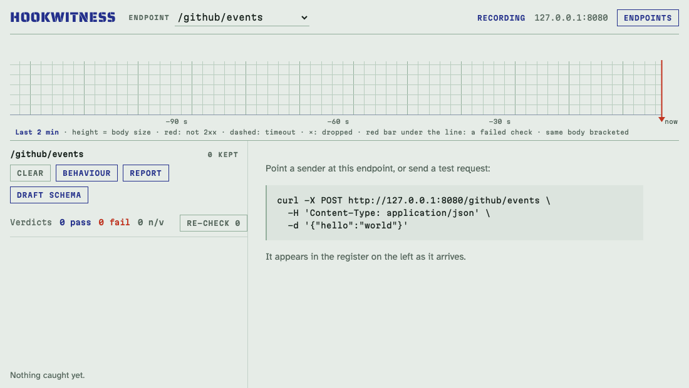
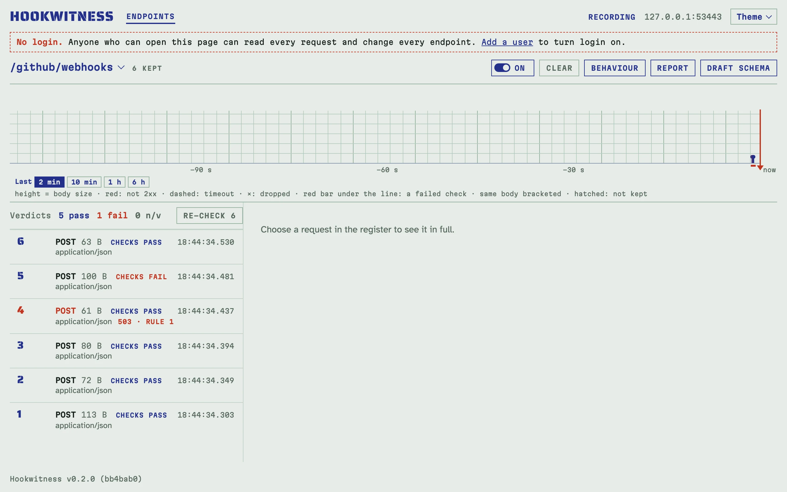
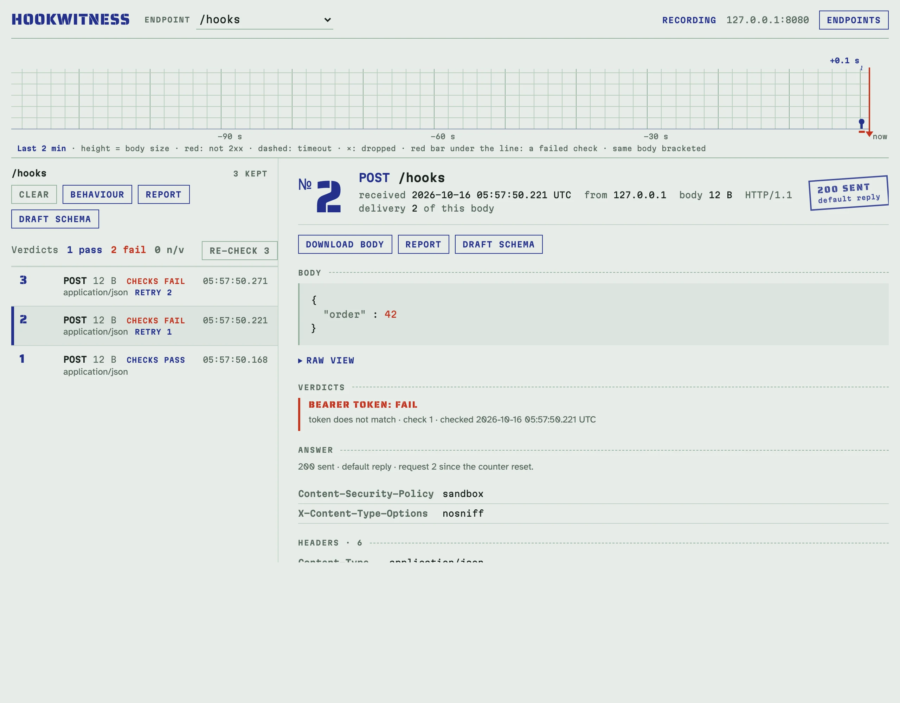
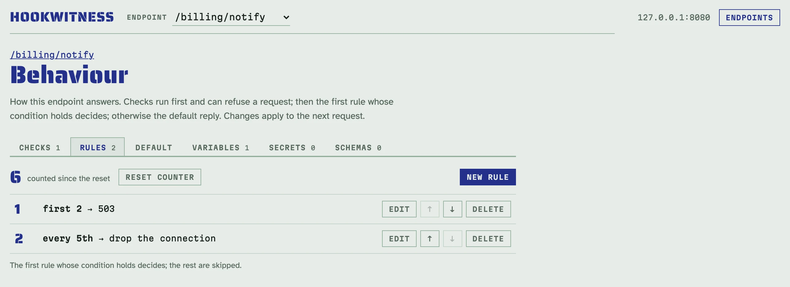
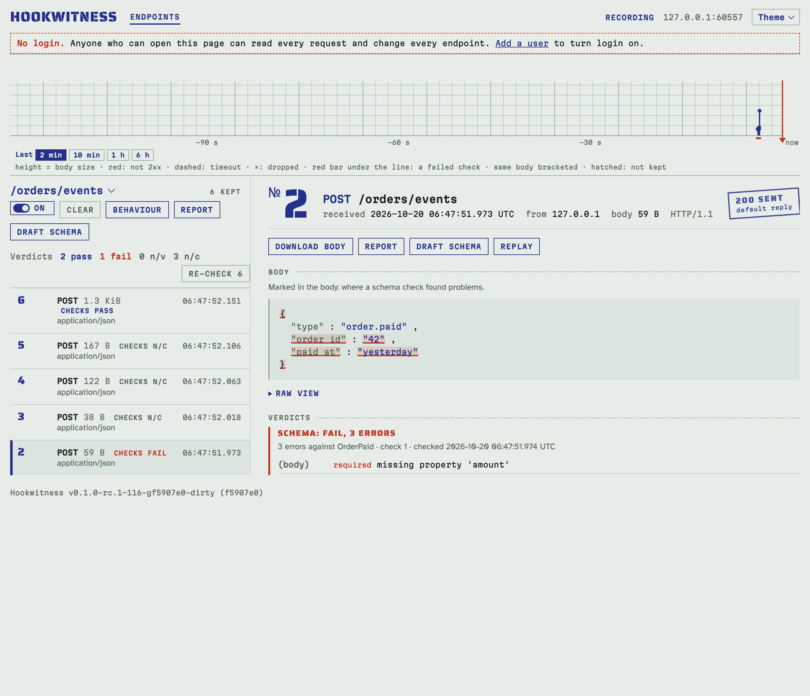

# Hookwitness

Catch webhooks, get a verdict, attach the evidence.

[](https://github.com/petroladkin/hookwitness/actions/workflows/ci.yml)
[](LICENSE)
[](go.mod)
[](https://github.com/petroladkin/hookwitness/pkgs/container/hookwitness)

<!-- docs-check: skip: starts a long-running container; scripts/docker-smoke.sh runs this command in CI -->
```sh
docker run -d --name hookwitness -p 127.0.0.1:8080:8080 -v hookwitness:/data \
  ghcr.io/petroladkin/hookwitness:0.1
```



- **A verdict for every request.** Signatures (GitHub, Stripe, Standard
  Webhooks, any HMAC), bearer tokens, Basic credentials and JSON Schema, each
  pass or fail with the reason.
- **Faults on purpose.** Fail every Nth delivery or the first N, answer late,
  hang, reset the connection, and watch the sender's retries on the strip.
- **Evidence for the ticket.** A Markdown, HTML or PDF report of what arrived
  and what was answered.

Self-hosted: a container image, or one binary
([download](docs/deployment.md#download-a-binary) for Linux or macOS, or
build it from source). **Status: 0.1, the first release.** The catcher,
scripted replies, verdicts, reports, the REST API and the MCP server work;
until 1.0, a minor version (0.2) may change the API or the flags, and the
[changelog](CHANGELOG.md) says how.

## A short tour

| | |
|---|---|
|  |  |
| **The register.** Requests arrive live, with their answer and verdict; the strip shows the last two minutes, or up to six hours. | **A request in full.** Headers in the order sent, the body, the answer, and why a check failed. |
|  |  |
| **Behaviour.** Checks, rules, the default reply, variables, secrets and schemas, one tab each. | **JSON Schema.** The problems listed and marked in the body. |

## Quick start

With the container above running:

1. Open <http://127.0.0.1:8080/admin/>, click **New endpoint** and create
   `/stripe/webhooks`.
2. Send it a request, or point the real sender at it:

   <!-- docs-check: setup: stripe_endpoint -->
   ```sh
   curl -s -X POST http://127.0.0.1:8080/stripe/webhooks \
     -H 'Content-Type: application/json' \
     -d '{"type":"invoice.paid","id":"evt_1"}'   # 200
   ```

3. Click the endpoint to open its register and watch the request arrive
   without a reload: method, path, query, headers in the order they were sent,
   the body and what Hookwitness answered.

Keep `-v hookwitness:/data`: it holds your endpoints, secrets and requests
across container upgrades. Or build from source with Go 1.27+: `go install
github.com/petroladkin/hookwitness/cmd/hookwitness@latest`, or `make build &&
bin/hookwitness serve` in a clone. [Getting started](docs/getting-started.md)
walks through it.

The UI, the API and MCP share port 8080 under `/admin` by default; to give
them their own port and publish only the catch port, see [the admin on its
own port](docs/deployment.md#the-admin-on-its-own-port). Until you add a
user the admin has no login; add one before others can reach it ([users,
login and tokens](docs/access.md)).

## What it does

- **[Endpoints and the register](docs/endpoints.md)**: exact paths, a live
  register with a recorder strip, an Unmatched register for typos, retries
  marked.
- **[Scripted replies](docs/replies.md)**: fail every Nth delivery, the first
  N or at random; delay, hang, drop the connection; templated bodies.
- **[Authorization checks](docs/authorization.md)**: GitHub, Stripe, Standard
  Webhooks (Svix), generic HMAC, bearer, basic; a verdict per request, enforced
  if you want; write-only secrets.
- **[JSON Schema checks](docs/schemas.md)**: the body against one schema, any
  of several, or one picked by the event's type; problems marked in the body;
  schemas drafted from caught bodies; images in the payload decoded.
- **[Reports](docs/reports.md)**: the evidence as Markdown, one HTML file or a
  PDF, with a summary and optional header masking.
- **[REST API](docs/api.md)** and **[MCP server](docs/agents.md#mcp)**:
  everything the UI does, plus long-poll waits and an `expect` assertion for
  agents; an [agent skill](docs/agents.md) for testing senders with Claude
  Code.
- **[Users and tokens](docs/access.md)**: login for a shared server, two
  roles, personal tokens for scripts, CI and MCP.
- **[Replay](docs/replay.md)**: send a caught request byte for byte to your
  own handler and keep its answer, to tell a verification bug from bytes
  changed on the way.

## How it compares

What each tool's own documentation says, checked on 2026-10-14. Every cell
links to its source.

| | Self-hosted | Signature and credential verdicts | Fault scenarios | Reports | MCP server |
|---|---|---|---|---|---|
| **Hookwitness** | [a container image, or one binary built from source](docs/deployment.md) | [GitHub, Stripe, Standard Webhooks, generic HMAC, bearer, Basic; JSON Schema](docs/authorization.md) | [status, delay, timeout, connection reset; every Nth, first N, random](docs/replies.md) | [Markdown, HTML, PDF](docs/reports.md) | [built in: Streamable HTTP, and stdio through a bridge](docs/agents.md#mcp) |
| **[webhook.site](https://webhook.site)** | [open-source edition with Docker Compose](https://docs.webhook.site/open-source.html) | [none built in; paid Custom Actions can compute an HMAC in a script](https://docs.webhook.site/webhookscript/functions/string.html) | [status; delay up to 30 s (10 s in the open-source edition)](https://docs.webhook.site/api/tokens.html) | [CSV export on paid plans; JSON API](https://docs.webhook.site/api/requests.html) | [user-contributed servers](https://docs.webhook.site/api/about.html#mcp-servers) |
| **[webhook-tester](https://github.com/tarampampam/webhook-tester)** | [container image, binaries, Helm chart](https://github.com/tarampampam/webhook-tester#readme) | [not in its documentation](https://github.com/tarampampam/webhook-tester#readme) | [status, headers, body; delay up to 30 s](https://github.com/tarampampam/webhook-tester/blob/master/api/openapi.yml) | [JSON API](https://github.com/tarampampam/webhook-tester/blob/master/api/openapi.yml) | not in its documentation |
| **[WireMock](https://wiremock.org)** | [container image, JAR, Java library](https://wiremock.org/docs/download-and-installation/) | [request matching on headers and Basic credentials picks a stub; no verdict](https://wiremock.org/docs/request-matching/#basic-authentication) | [status; fixed and random delays; connection reset, empty and malformed responses](https://wiremock.org/docs/simulating-faults/) | [JSON request journal](https://wiremock.org/docs/verifying/#getting-all-requests) | [WireMock Cloud only](https://docs.wiremock.io/ai-mcp/mcp-installation) |

## Documentation

- English: [docs/](docs/README.md)
- Українською: [docs/uk/](docs/uk/README.md)

[Configuration and deployment](docs/deployment.md) covers Docker, the
settings, the secret key and reverse proxies;
[Troubleshooting](docs/troubleshooting.md) the usual surprises.

## Security

Report vulnerabilities privately, as [SECURITY.md](SECURITY.md) describes.

## License

[Apache License 2.0](LICENSE). Third-party licences of the modules compiled
into the binary and of the bundled assets (htmx, fonts) are in
[THIRD-PARTY-NOTICES.md](THIRD-PARTY-NOTICES.md).
