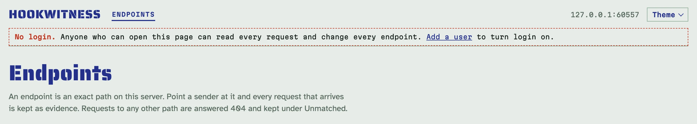
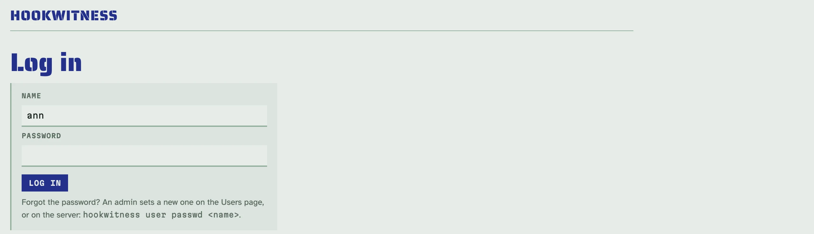
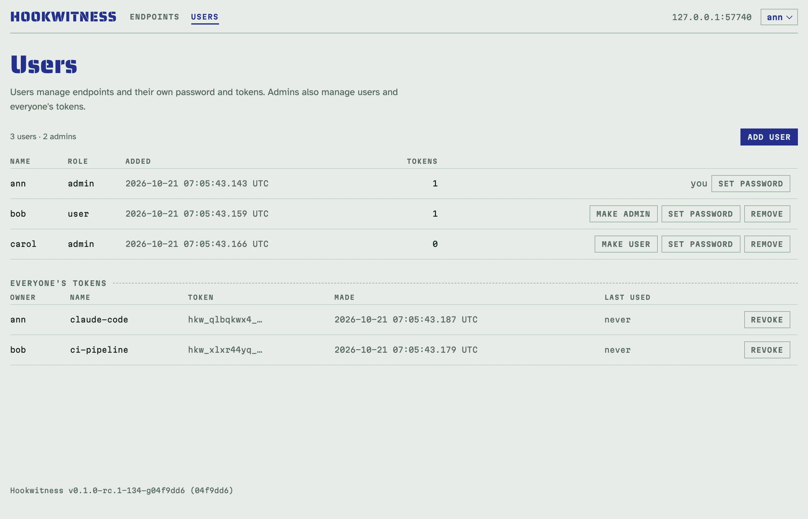
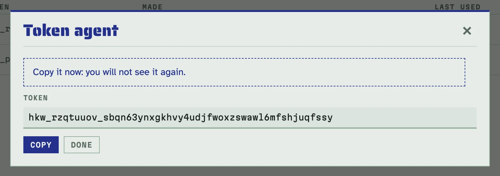

# Users, login and tokens

Out of the box Hookwitness has no users and no login: whoever can open the
admin (the web UI, the REST API, MCP) can read every caught request and
change every endpoint. That is fine on your own machine. On a team server,
in Docker on a network, or anywhere strangers might reach the admin, turn
login on by adding a user. Catch endpoints and `/healthz` stay open to
senders either way.

## Login is off until the first user

While there are no users, every admin page says so in a dashed line under
the header, and the server warns at start when the admin listens on more
than loopback.



The first user turns login on for the web UI, the REST API and MCP. It is
always an admin (otherwise nobody could manage users). There are four ways
to add it; pick by how the server runs:

- **The Users page**, when you can open the admin yourself first (on your
  machine, or through an SSH tunnel). Click *Add a user* in that dashed
  line, give a name and a password of at least 12 characters, and log in
  with them.
- **The environment**, for Docker and compose, so that the admin is never
  open, not even for a minute: `HOOKWITNESS_ADMIN_USER` and
  `HOOKWITNESS_ADMIN_PASSWORD_FILE` create the first admin at start, but
  only on a database without users. A restart or a redeploy creates nothing
  and logs that it skipped; editing the password file later changes nothing
  (change the password on the account page or with the command below).
  The server reads the file at every start while the variable is set and
  stops if it cannot, so the image's user (uid 65532) must be able to read
  it: `sudo chown 65532 admin_password.txt`, or mode 644.

  ```yaml
  services:
    hookwitness:
      image: ghcr.io/petroladkin/hookwitness:0.2
      ports: ["8080:8080"]
      volumes: ["hookwitness:/data"]
      environment:
        HOOKWITNESS_ADMIN_USER: ann
        HOOKWITNESS_ADMIN_PASSWORD_FILE: /run/secrets/admin_password
      secrets: [admin_password]
  secrets:
    admin_password:
      file: ./admin_password.txt   # one line, at least 12 characters
  volumes:
    hookwitness:
  ```

  [Setting up a shared server](server.md) builds a whole server this way.

- **The command line**, on the server's database (the server may be
  running), for a server you reach by SSH:

  <!-- docs-check: skip: works on the server's own database -->
  ```sh
  hookwitness user add ann --admin            # asks for the password twice
  docker exec -it hookwitness /hookwitness user add ann --admin
  ```

- **The API**, from a script that sets up a fresh server, while login is
  still off:

  ```sh
  curl -s -X POST http://127.0.0.1:8080/admin/api/v1/users -H 'Content-Type: application/json' \
    -d '{"name":"ann","role":"admin","password":"correct-horse-battery"}' | jq -r '.name + " " + .role'
  # ann admin
  ```

## Logging in

From then on the admin asks for a name and a password. A page you opened
before logging in comes back after it.



- A login lasts until you log out (*Log out* in the menu under your name), or a day
  without activity, or a week at most. An open register counts as activity.
- Ten failed logins from one address in 15 minutes pause logins from that
  address for the rest of the 15 minutes. An IPv6 address counts with its
  whole /64, the block one host is given, so a client cannot spread its
  guesses over its own addresses.
- Changing your password ends your other logins; an admin's reset of
  someone's password, a change of their role, and removing them end all of
  theirs at once.

## Roles

There are two, and no other permissions:

- **user**: does everything with endpoints (create, behaviour, secrets,
  reports, clear, delete), changes their own password and manages their own
  tokens;
- **admin**: also adds, changes and removes users, sees and revokes
  everyone's tokens on the **Users** page, and sends
  [replays](replay.md#which-targets), which reach the server's own network.



The last admin can be neither removed nor demoted: make another user an
admin first. An admin can neither make themselves a user nor remove
themselves either: another admin can.

## Tokens for scripts and agents

Scripts, CI jobs and AI agents use the REST API and MCP with a personal
token instead of a password. Make one on your account page (click your name
in the header, *Account and tokens*, then *New token*). It is shown once: copy it then.



A token acts as you, with your role as it is now: demote or remove a user and
their tokens follow at once. Revoke one on the account page (admins also on
the Users page); whatever uses it is refused from its next request, a register
open with it reloads onto the login page within 25 seconds, an MCP wait ends
within 30 seconds, and its MCP sessions are closed. Tokens do
not expire; each shows when it was last used. A token cannot make tokens or
manage users: that needs a login.

Send it as `Authorization: Bearer <token>`. The whole flow with curl, from a
login to a call with the token:

```sh
curl -s -c hw.cookies -o /dev/null -w '%{http_code}\n' http://127.0.0.1:8080/admin/login \
  --data-urlencode name=ann --data-urlencode password=correct-horse-battery
# 303
TOKEN=$(curl -s -b hw.cookies -X POST http://127.0.0.1:8080/admin/api/v1/me/tokens \
  -H 'Content-Type: application/json' -d '{"name":"ci"}' | jq -r .token)
curl -s -o /dev/null -w '%{http_code}\n' http://127.0.0.1:8080/admin/api/v1/endpoints
# 401
curl -s -H "Authorization: Bearer $TOKEN" http://127.0.0.1:8080/admin/api/v1/me | jq -c '{login, name, role, via}'
# {"login":true,"name":"ann","role":"admin","via":"token"}
```

Tokens look like `hkw_` followed by 8 and 40 characters
(`hkw_[a-z2-7]{8}_[a-z2-7]{40}`). Add that pattern to your secret scanner
(for GitHub: a custom pattern in secret scanning) to catch one committed by
mistake.

A request with a valid token is answered whatever host name it used: the
host-name rule ([deployment](deployment.md#reaching-it-from-other-machines))
guards browsers, and a browser does not send tokens.

### MCP with a token

With login on, `/admin/mcp` needs a token too. Give it to Claude Code as a
header, or to the stdio bridge as a file:

<!-- docs-check: skip: adds the server to your Claude Code configuration -->
```sh
claude mcp add --transport http hookwitness http://127.0.0.1:8080/admin/mcp \
  --header "Authorization: Bearer $(cat ~/.config/hookwitness/token)"
claude mcp add hookwitness -- hookwitness mcp -url http://127.0.0.1:8080 -token-file ~/.config/hookwitness/token
```

### A machine token

For a CI job that starts Hookwitness itself, `HOOKWITNESS_API_TOKEN_FILE`
names a file with a token of your choosing (one line, at least 32
characters, for example `hkw_machine_$(openssl rand -hex 24)`). It is read at
start and has the user role. Setting it closes the API and MCP even while
there are no users (only the token gets in); the web UI then stays open,
with the "no login" line, until the first user exists.

## Signing in with Google, Microsoft Entra ID or another provider

People can sign in through an OpenID Connect provider (Google Workspace,
Microsoft Entra ID, Keycloak, Authentik, GitLab, any provider with
discovery), next to their passwords.

**Who gets in.** Only people an admin added, by default: give them an email
on the Users page (or `hookwitness user add pat -email pat@example.com
-no-password`). At their first sign-in the provider's verified address
links them to that user; from then on the provider's identity (its issuer
and subject) decides, so a changed address at the provider stays the same
account. A provider may also let anyone of your email domains in
(`_ALLOWED_DOMAINS`): a new address of such a domain becomes a user with
the role `user`, named after the address, without a password. Roles stay
local: an admin changes them on the Users page. Provider sign-in starts only
once a first admin exists.

Check emails as you type them: a provider that confirms an address hands
the account with that address to whoever owns it. Allow only domains you
control (never `gmail.com`), and only at providers that verify addresses.

**Settings.** One name per provider in `HOOKWITNESS_OIDC_PROVIDERS`, then
for each name (upper-cased) its issuer, client id and a file holding the
client secret; these are environment variables only:

<!-- docs-check: skip: needs an OpenID Connect provider -->
```sh
docker run -d --name hookwitness -p 127.0.0.1:8080:8080 -v hookwitness:/data \
  -v ./google-secret.txt:/run/secrets/google:ro \
  -e HOOKWITNESS_ADMIN_URL=https://hooks.example.com \
  -e HOOKWITNESS_OIDC_PROVIDERS=google \
  -e HOOKWITNESS_OIDC_GOOGLE_ISSUER=https://accounts.google.com \
  -e HOOKWITNESS_OIDC_GOOGLE_CLIENT_ID=1234-abc.apps.googleusercontent.com \
  -e HOOKWITNESS_OIDC_GOOGLE_CLIENT_SECRET_FILE=/run/secrets/google \
  -e HOOKWITNESS_OIDC_GOOGLE_ALLOWED_DOMAINS=example.com \
  ghcr.io/petroladkin/hookwitness:0.2
```

| Variable | Meaning |
|---|---|
| `HOOKWITNESS_OIDC_PROVIDERS` | names, comma-separated, each `a-z0-9`, e.g. `google,entra` |
| `HOOKWITNESS_OIDC_<NAME>_ISSUER` | the issuer, exactly as the provider's discovery document states it (`https://`; `http://` only on a loopback host) |
| `HOOKWITNESS_OIDC_<NAME>_CLIENT_ID` | the client id the provider gave |
| `HOOKWITNESS_OIDC_<NAME>_CLIENT_SECRET_FILE` | a file holding the client secret, one line; read once at start, never stored or logged |
| `HOOKWITNESS_OIDC_<NAME>_LABEL` | the button's text after "Sign in with" (default: the name, capitalised) |
| `HOOKWITNESS_OIDC_<NAME>_ALLOWED_DOMAINS` | email domains whose new people become users, comma-separated; none: only users an admin added |

**The redirect URI.** The provider sends people back to
`<admin URL><prefix>/oidc/<name>/callback`. The admin URL is `-admin-url`
(`HOOKWITNESS_ADMIN_URL`), or `-public-url` when the admin shares its port
and that URL has no path; the server refuses to start with providers and
neither. The start log prints each provider's exact redirect URI: paste it
into the provider's console. A sign-in starts on that address: a button
pressed on another address of the server sends you there first.

**Google.** In the Google Cloud console, create an OAuth client of type
*Web application* with the redirect URI from the start log; for a
Workspace, set the consent screen to *Internal*, so that only your
organisation's accounts can sign in. Issuer: `https://accounts.google.com`.

**Microsoft Entra ID.** Register an application for *this organisational
directory only* (single tenant), add a *Web* redirect URI from the start
log, make a client secret, and in *Token configuration* add the optional
claims `email` and `xms_edov` (Entra sends no `email_verified`; `xms_edov`
says the domain owns the address). Issuer:
`https://login.microsoftonline.com/<tenant id>/v2.0`, never `common`. A new
app registration gives everyone new identities: unlink the old ones first,
or their sign-ins are refused as linked elsewhere.

**Another provider.** Keycloak (`https://<host>/realms/<realm>`), Authentik
(`https://<host>/application/o/<slug>/`), GitLab (`https://gitlab.com`) or
any provider with discovery: a confidential client with the authorization
code flow and PKCE, the scopes `openid email profile`, and the redirect URI
from the start log. Configure only providers that confirm email addresses.

**Users without a password** sign in through a provider only; the Users
page says so. They can set a first password on their account page within
10 minutes of signing in; an admin can set one any time, and so can
`hookwitness user passwd` on the server. A user's identities show on their
account page and on the Users page; **Unlink** removes one and ends that
user's logins (nobody unlinks their own last way in).

**Logging out** ends the login here only: signing in again may pass
through the provider without a prompt. Someone disabled at the provider
keeps an open login until it ends (a day idle, a week at most): remove or
unlink them here to end it now. When a provider is down, passwords still
work; keep the first admin's password for that (`HOOKWITNESS_ADMIN_USER`
with `HOOKWITNESS_ADMIN_EMAIL` gives it an email too).

## Behind a reverse proxy

- The login cookie is marked *Secure* when the browser reached the admin
  over TLS: the request came over TLS, a proxy named in `-trusted-proxies`
  says so in `X-Forwarded-Proto`, or `-public-url` /
  `HOOKWITNESS_PUBLIC_URL` is `https://…` and the admin shares the catch
  port (behind a TLS proxy, set it). With the admin on [its own
  port](deployment.md#the-admin-on-its-own-port), an `https://` public URL
  counts only when the admin is opened by a name of `-admin-hosts`: opened
  by an address over plain HTTP (an SSH tunnel, the LAN), the cookie is not
  *Secure*, since a browser would drop it there.
- The login limit counts failures per client address (for IPv6, per /64).
  Behind a proxy every
  login comes from the proxy's address, so they would share one limit.
  `-trusted-proxies` / `HOOKWITNESS_TRUSTED_PROXIES` (addresses or CIDRs,
  comma-separated) names your proxies; from them, the client is the
  rightmost address in `X-Forwarded-For` that is not a proxy. List only your
  own proxy: anyone else could write that header.

## Lost the admin password

On the server, set a new one; every login of that user ends:

<!-- docs-check: skip: works on the server's own database -->
```sh
hookwitness user passwd ann
hookwitness user list
```

`hookwitness user` reads the database and the secret key the way `serve`
does (`-db` / `HOOKWITNESS_DB`, `HOOKWITNESS_SECRET_KEY` or the `.key` file
next to the database). Its exit codes, for scripts: `0` done, `1` failed
(database, key), `2` usage (a bad name, a short password), `3` no such user,
`4` refused (the name or the email is taken, or the last admin). `user add`
without `--admin` cannot make the first user. With providers: `user add
<name> -email <address> [-no-password]`, `user email <name> [<address>]`
(none clears it), `user unlink <name> <provider or issuer>`; `user list`
shows each user's email and ways in.

## What is never shown

Passwords and tokens are kept only as salted hashes made with the server's
secret key; a login keeps only a hash of its id. None of them appear in logs,
API answers or pages; the logs name who made each change (`user=ann`, or
`machine` for the machine token).

Cookies ignore ports, so a browser logged in to an admin on another port of
the same host sends its login cookie to catch paths too. Hookwitness never
keeps it: in a caught request's `Cookie` header the value of
`hookwitness_session` (and of a provider sign-in's `hookwitness_oidc`) reads
`[hookwitness session]`, and nothing else is changed. Nothing a provider
hands out (codes, tokens) is kept or logged; a provider's client secret is
read from its file and kept in memory only.

## Turning login off again

Once on, login stays on: the last admin cannot be removed. To open the admin
again, stop the server and delete the users from its database with their
logins and tokens (`sqlite3 hookwitness.db 'PRAGMA foreign_keys=ON; DELETE
FROM users'`), or start with a new database.
