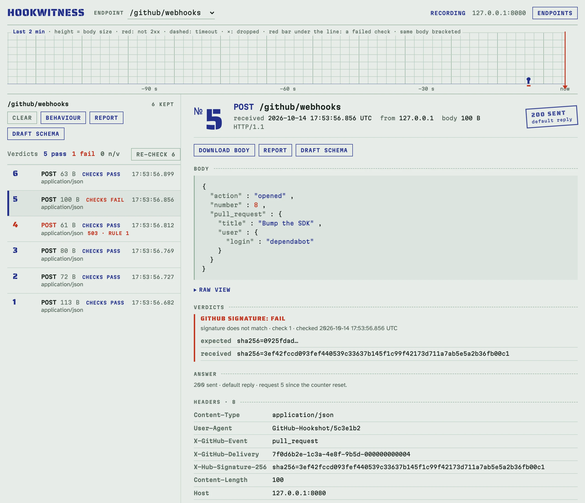

# Authorization checks and secrets

Is this webhook correctly signed, does it carry the right token? An
authorization check answers that on every request with a **verdict**:

- **pass**;
- **fail**, with a one-line reason (`signature does not match`, `timestamp
  601 s old (tolerance 300 s)`, `header Authorization missing`);
- **n/v**, not verifiable: the body was over the size limit and not kept,
  or the secret cannot be decrypted (see [Troubleshooting](troubleshooting.md)).

A check needs two things on the endpoint's **Behaviour** page: a **secret** (the
signing key or the token) on the **Secrets** tab, and the **check** that uses it
on the **Checks** tab. A secret alone does nothing.

## Protect an endpoint with a token, step by step

The sender sends `Authorization: Bearer tok_test_123`; you want to see a
verdict for each request.

1. Open the endpoint's **Behaviour** page and its **Secrets** tab. Click
   **New secret**.
2. Name it `API_TOKEN`, choose **token or password (bearer, basic)**, paste
   `tok_test_123` and save. From now on the value is never shown again, only
   its fingerprint.

   

3. Open the **Checks** tab and click **New check**. Choose the kind **Bearer
   token** and the secret `API_TOKEN`. Leave **Enforce** off to only record
   verdicts, or switch it on to refuse requests that do not pass.

   

4. Click **Save check**. The next request gets a verdict:

<!-- docs-check: setup: bearer -->
```sh
H=http://127.0.0.1:8080/hooks
curl -s -d '{"order":42}' -H 'Authorization: Bearer tok_test_123' $H   # pass
curl -s -d '{"order":42}' -H 'Authorization: Bearer wrong' $H          # fail: token does not match
curl -s -d '{"order":42}' $H                                           # fail: header Authorization missing
```

The register counts the verdicts, each row shows its own, and the strip draws
a red bar under failed requests. The request's page gives the reason.



## The checks

| Check | What it verifies |
|---|---|
| **GitHub signature** | `X-Hub-Signature-256: sha256=<hex HMAC-SHA256 of the raw body>` |
| **Stripe signature** | `Stripe-Signature: t=<unix>,v1=<hex HMAC-SHA256 of "<t>.<body>">`; any `v1` may match; the timestamp within a tolerance |
| **Standard Webhooks / Svix** | `webhook-id`, `webhook-timestamp`, `webhook-signature` (or `svix-…`): `v1,<base64 HMAC-SHA256 of "<id>.<timestamp>.<body>">` under the `whsec_` base64 key; the timestamp within a tolerance |
| **Generic HMAC** | any header: sha1, sha256 or sha512, hex or base64, an optional prefix (`sha1=` covers GitHub's legacy `X-Hub-Signature`), the signed content as a template (the raw body by default, or e.g. `{{.Header "X-Id"}}.{{.Body}}`) |
| **Bearer token** | `Authorization: Bearer <token>` |
| **Basic credentials** | `Authorization: Basic base64(user:password)`, with the user name set on the check |

Signatures need a **signing key** secret; bearer and basic need a **token or
password** secret.


### Reading a failed signature

A failed signature shows the signature received in full and the first 8
characters of the one expected: enough to tell a wrong secret (every request
fails, the expected one stays the same for the same body) from wrong content
(a sender that re-serialises the JSON before signing), not enough to forge a
signature.

### Timestamps

Stripe and Standard Webhooks sign a timestamp. Hookwitness judges it against
the time the request arrived, with a tolerance of 300 s by default. When you
replay captured requests, tick **Accept any timestamp (replayed captures)**.

## Enforce

With **Enforce** off, a check only records its verdict and the request gets
the usual reply. With **Enforce** on, a request that does not pass is refused
before the rules, and not counted: `401` with the reason (with
`WWW-Authenticate` for bearer and basic), or your own reply. A request the
check cannot verify (n/v) is refused too.

<!-- docs-check: setup: basic_enforced -->
```sh
H=http://127.0.0.1:8080/hooks
curl -s -o /dev/null -d '{}' -u qa:pw_test $H   # 200
curl -s -o /dev/null -d '{}' -u qa:wrong $H     # 401 refused
```

## Re-check

Fixed a secret? **Re-check** on the register verifies every kept request again
with the current checks and secrets. Only the verdicts change; the replies
stay as they were sent.

## Secrets

The **Secrets** tab lists the endpoint's secrets: name, kind, fingerprint and
the checks that use it.


- **Write-only.** Once saved, a value is never shown again, in the UI, the
  API, logs or reports; only an 8-character fingerprint, so you can tell
  whether two endpoints have the same secret. **Replace** sets a new value.
- **Stored safely.** Signing keys are encrypted (AES-256-GCM); tokens and
  passwords are kept only as salted PBKDF2 hashes. The encryption key is
  `HOOKWITNESS_SECRET_KEY`, or a key file created next to the database (see
  [Configuration and deployment](deployment.md#the-secret-key)). A copy of the
  database without the key reveals no secret.
- **Test and staging secrets only.** Whoever can open the admin UI can make
  the server verify signatures with them.
- A caught request keeps its headers as evidence, so a bearer token or a
  Basic password the sender sent is visible in that request. Reports can mask
  such headers ([Reports](reports.md)).

## Examples for every check

Each block below assumes an endpoint `/hooks` with the secret and the check
named in its first comment. They run against a fresh server in
`make docs-check`.

**GitHub.** Secret `GH_SECRET`, a signing key, `gh_test_secret`; check
**GitHub signature**.

<!-- docs-check: setup: github -->
```sh
H=http://127.0.0.1:8080/hooks
BODY='{"action":"opened","number":7}'
SIG=$(printf '%s' "$BODY" | openssl dgst -sha256 -hmac gh_test_secret | awk '{print $2}')
curl -s -d "$BODY" -H "X-Hub-Signature-256: sha256=$SIG" $H                         # pass
curl -s -d "$BODY" -H "X-Hub-Signature-256: sha256=$(printf '0%.0s' {1..64})" $H   # fail: signature does not match
```

**Stripe.** Secret `STRIPE_SECRET`, a signing key, `whsec_test_stripe`; check
**Stripe signature**.

<!-- docs-check: setup: stripe -->
```sh
H=http://127.0.0.1:8080/hooks
BODY='{"id":"evt_1","type":"invoice.paid"}'
T=$(date +%s)
V1=$(printf '%s.%s' "$T" "$BODY" | openssl dgst -sha256 -hmac whsec_test_stripe | awk '{print $2}')
curl -s -d "$BODY" -H "Stripe-Signature: t=$T,v1=$V1" $H     # pass
OLD=$((T-600))
V0=$(printf '%s.%s' "$OLD" "$BODY" | openssl dgst -sha256 -hmac whsec_test_stripe | awk '{print $2}')
curl -s -d "$BODY" -H "Stripe-Signature: t=$OLD,v1=$V0" $H   # fail: timestamp
```

**Standard Webhooks / Svix.** Secret `SW_SECRET`, a signing key,
`whsec_MfKQ9r8GKYqrTwjUPD8ILPZIo2LaLaSw`; check **Standard Webhooks**.

<!-- docs-check: setup: standard -->
```sh
H=http://127.0.0.1:8080/hooks
BODY='{"type":"user.created"}'
T=$(date +%s)
KEY=$(printf 'MfKQ9r8GKYqrTwjUPD8ILPZIo2LaLaSw' | base64 -d | xxd -p | tr -d '\n')
SW=$(printf 'msg_1.%s.%s' "$T" "$BODY" | openssl dgst -sha256 -mac HMAC -macopt hexkey:$KEY -binary | base64)
curl -s -d "$BODY" -H "webhook-id: msg_1" -H "webhook-timestamp: $T" -H "webhook-signature: v1,$SW" $H   # pass
curl -s -d "$BODY" -H "webhook-id: msg_2" -H "webhook-timestamp: $T" -H "webhook-signature: v1,$SW" $H   # fail: signature does not match
```

**Generic HMAC.** Secret `HMAC_KEY`, a signing key, `hmac_test_key`; check
**Generic HMAC** with header `X-Signature`, sha512, base64.

<!-- docs-check: setup: hmac -->
```sh
H=http://127.0.0.1:8080/hooks
BODY='{"event":"ping"}'
X=$(printf '%s' "$BODY" | openssl dgst -sha512 -hmac hmac_test_key -binary | base64)
curl -s -d "$BODY" -H "X-Signature: $X" $H            # pass
curl -s -d "$BODY" -H "X-Signature: not-base64!" $H   # fail: not base64
```

**Basic.** Secret `QA_PASSWORD`, a token or password, `pw_test`; check
**Basic credentials** with user `qa`.

<!-- docs-check: setup: basic -->
```sh
H=http://127.0.0.1:8080/hooks
curl -s -d '{}' -u qa:pw_test $H                      # pass
curl -s -d '{}' -u qa:wrong $H                        # fail: user or password does not match
curl -s -d '{}' -H 'Authorization: Bearer x' $H       # fail: scheme is Bearer, not Basic
```

## With the API

Secrets: `PUT /endpoints/{id}/secrets/{name}`; checks are part of the
behaviour document. See the [API reference](api.md#secrets) and its recipes
[Require Basic credentials](api.md#require-basic-credentials) and
[Require a GitHub signature](api.md#require-a-github-signature).
