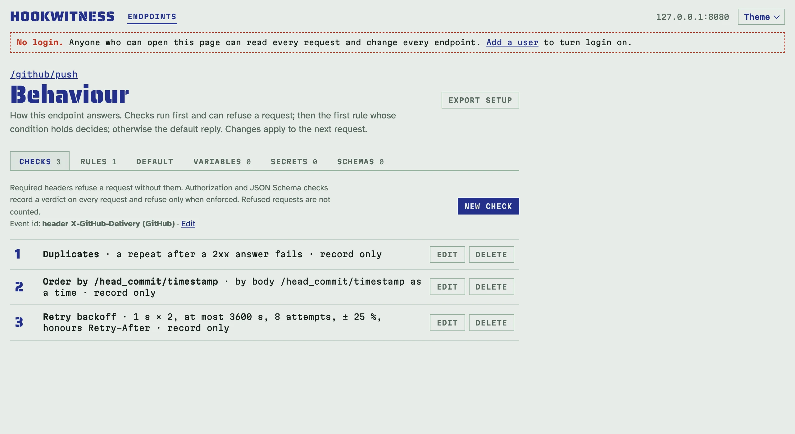
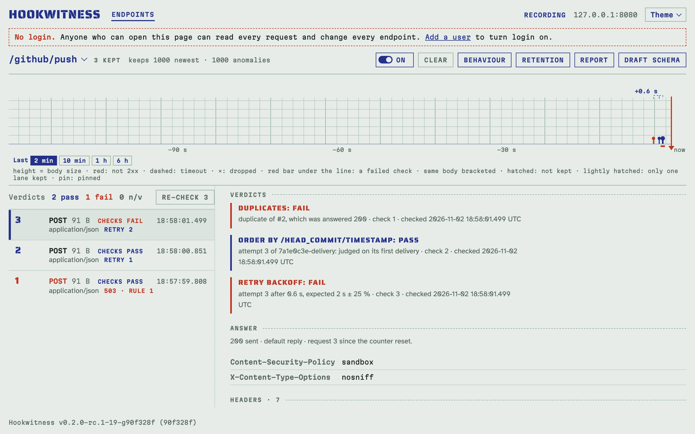

# Testing a sender's retries, duplicates and order

Senders retry, deliver twice and reorder events, and none of it shows until
production. Three checks judge how a sender delivers, request by request,
against the earlier requests the endpoint keeps:

- **Duplicates**: a repeat of an event after it was answered 2xx fails: the
  receiver had already taken it. A retry after a failure, a timeout or a
  dropped connection passes: that is the sender doing its job.
- **Order**: a sequence number or a time lower than another event's earlier
  one fails.
- **Retry backoff**: each retry's gap against the sender's documented
  schedule, and against the `Retry-After` the previous answer asked for.

They give verdicts like the other checks (in the register, on the request,
in reports, in the `verdict=` filter) and never refuse a request: what the
receiver answers to a duplicate is the [rules'](replies.md) job.

## Name the event id

A sender keeps an id on every retry of an event. On the **Checks** tab, the
line **Event id** above the checks says where the endpoint takes it from;
**Edit** offers the providers' places, or one of your own:

| Sender | Event id |
|---|---|
| GitHub | header `X-GitHub-Delivery` |
| Stripe | body `/id` |
| Standard Webhooks | header `webhook-id` |
| Svix | header `svix-id` |

When the endpoint already checks GitHub's, Stripe's or Standard Webhooks'
signature, the dialog starts on that provider's place; nothing changes until
you save it.



With an event id, attempts, the register's **retry** chips, the strip's
brackets and the report's retry groups follow it, so a sender that changes a
field on every attempt (a counter, a timestamp in the body) still shows as
one event retried. A request's page says, for example, `attempt 2 of event
d-1`. Without an event id the same body is the same event, as before. A
request whose event id is missing gets n/v from the duplicates and backoff
checks.

Attempts count the kept requests: after older ones were pruned, the oldest
kept attempt is attempt 1 (see [Keeping requests](keeping.md)).

## Duplicates

A GitHub-style sender whose first delivery is answered `503`, and a retry
that is then delivered a third time:

<!-- docs-check: setup: duplicates -->
```sh
H='X-GitHub-Delivery: 7a1e0c3e-delivery'
curl -s -o /dev/null -w '%{http_code}\n' -X POST http://127.0.0.1:8080/github/push -H "$H" -d '{"ref":"main"}'
# 503
curl -s -o /dev/null -w '%{http_code}\n' -X POST http://127.0.0.1:8080/github/push -H "$H" -d '{"ref":"main"}'   # pass
# 200
curl -s -o /dev/null -X POST http://127.0.0.1:8080/github/push -H "$H" -d '{"ref":"main"}'   # fail: duplicate of #2, which was answered 200
```



## Order

**Order by** a value in the body or a header, read as a sequence number or a
time (RFC 3339, or unix seconds). **Within each value of** judges the order
per object, for example Stripe's `/data/object/id`. A value lower than
another event's earlier one fails, naming it; ties pass; a retry of an
earlier event is judged on its first delivery.

## Retry backoff

**First gap**, **Factor** and **Longest gap** describe the sender's
schedule: attempt *k* is expected first gap × factor<sup>k−2</sup> after the
previous one ended, at most the longest gap, within the **Tolerance** (25 %
by default); attempts beyond **At most attempts** fail. A gap is measured
from the end of the previous attempt: its arrival plus the reply's delay, or
how long a hold kept it, since senders start their backoff when an attempt
fails.

A retry that comes before the `Retry-After` the previous answer carried
fails, whatever the schedule, and a `Retry-After` longer than the schedule's
gap is the gap to keep. A number of seconds is kept exactly: a retry 1 s
after `Retry-After: 2` fails. An HTTP date has whole seconds, so a retry up
to a second before it still passes. With no first gap the check judges
`Retry-After` only. Rules that answer `429` or `503` with `Retry-After`, such
as a [rate limit](replies.md#rate-limited-with-retry-after), are in
[Scripted replies](replies.md).

## With the API and MCP

The behaviour takes `event` (`{"from": "header", "key": "X-GitHub-Delivery"}`)
and the checks `{"kind": "duplicates"}`, `{"kind": "order", "order": {"from",
"key", "as"}, "group": {…}}` and `{"kind": "backoff", "first_s", "factor",
"max_s", "max_attempts", "tolerance_pct", "retry_after"}`. A request carries
`event` and `attempt`, and `?event=<id>` lists every attempt of an event:

<!-- docs-check: setup: duplicates -->
```sh
api=http://127.0.0.1:8080/admin/api/v1
id=$(curl -s "$api/endpoints?path=/github/push" | jq '.endpoints[0].id')
curl -s "$api/endpoints/$id/requests?event=7a1e0c3e-delivery" | jq -c '[.requests[] | {no, attempt, status, verdict}]'
# [{"no":3,"attempt":3,"status":200,"verdict":"fail"},{"no":2,"attempt":2,"status":200,"verdict":"pass"},{"no":1,"attempt":1,"status":503,"verdict":"pass"}]
```

An agent asks the same with MCP: `expect` with `event` and `count: 3`
asserts three attempts of one event within a time; see [Testing a sender
with an AI agent](agents.md). The checks travel in [setup files](sharing.md)
(format 2).
