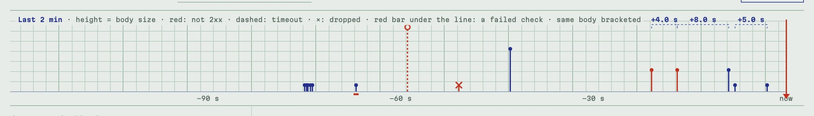

# Endpoints and the register

## Endpoints

An endpoint is an **exact path** on the server, such as `/github/webhooks`.
Every request to it is kept as evidence and answered the way the endpoint is
scripted (`200` with an empty body until you script it).

- `/a` and `/a/` are different endpoints. The query string is not part of
  the path: `/a?x=1` reaches `/a`.
- Paths are made of letters, digits and `. _ ~ -` between slashes. Leave the
  path empty in **New endpoint** for a random one. That helps when strangers
  should not guess the address.
- `/healthz` and the admin prefix (`/admin` by default) belong to
  Hookwitness. Any other path can be an endpoint, so a sender can keep its
  real paths.

The **Endpoints** page lists them with their catch URL, how many requests
are kept and when the last one arrived. **Behaviour** opens an endpoint's
[scripted replies](replies.md) and checks. **Clear** deletes its requests,
and **Delete** deletes the endpoint with its requests.

## Unmatched requests

A request to a path that is not an endpoint is answered `404` and kept in
the **Unmatched** register, linked at the top of the Endpoints page. A typo
in the sender's URL, a missing or extra trailing slash or a forgotten
`/webhooks` suffix shows up there at once instead of disappearing. Any
client that reaches the server can send there, so it keeps the first 64 KiB
of a body (and its whole size), enough to recognise the request.

<!-- docs-check: setup: stripe_endpoint -->
```sh
curl -s -X POST http://127.0.0.1:8080/stripe/webhook -d '{}'   # 404: kept under Unmatched
```


## The register

Click an endpoint to open its register: the endpoint's requests, newest on
top. It is live. New requests appear without a reload, and **RECORDING** in
the header says the feed is connected.


- Each row shows the request's number, method, body size, content type and
  time (UTC, to the millisecond). A row is red when the answer was not 2xx.
  When the answer was not a plain default reply, a note says how it was
  answered (`503 · rule 1`, `401 refused`, `timeout`, `dropped`,
  `sender left`).
- With checks configured, each row carries its verdict (`CHECKS PASS`,
  `CHECKS FAIL`) and the register counts them.
- A body delivered again is marked `RETRY 1`, `RETRY 2`… on its row.
- **Show older** loads more rows. **Clear** deletes the endpoint's requests.
- The number is the request's place since the endpoint was created. It is
  never reused, so "request 7" stays request 7 in a report.

### The strip

Above the register, the strip draws the last two minutes like a recorder's
paper. Each request is one mark, and its height is the body size. A red mark
was not answered 2xx, a dashed one timed out, and a cross was dropped. A red
bar under the line means a check failed. The same body delivered more than
once is bracketed, with the gap between the deliveries above the bracket. A
sender's retry pattern (backoff, bursts, duplicates) is visible at a glance.

The shot below is a minute of a payments sender. It starts with a burst of
five small events. Then come a request that failed its check, a timeout, a
dropped connection and a large body. At the end, one body was answered `503`
twice and delivered again after 4 s and 8 s, and another body arrived twice,
5 s apart.



### Retries

The same body delivered again is a retry. The request's page says
`delivery 2 of this body`, the strip brackets the deliveries, and reports
group them with the gaps between deliveries. So you can check a sender's
backoff.

## A request in full

Click a row to open it on the right. From the top:

- **The stamp** says what was answered and what decided it, for example
  `200 sent · default reply`, `503 sent · rule 1 · every 4th` or
  `401 refused · check 1: Bearer token`. It says `timeout`, `dropped` or
  `sender left` when nothing was answered. "Sender left" means the sender
  gave up during a reply's delay, so it never got the reply.
- **Images** that the body carries come first, with a full-size viewer (see
  [JSON Schema checks](schemas.md#images-in-the-payload)).
- **Body**. JSON is pretty-printed, other text is shown as is, and binary as
  a hex dump. **Raw view** shows it byte for byte, and **Download body**
  saves it. A body over the size limit (10 MiB by default) is answered `413`
  and kept without its body.
- **Verdicts** of the endpoint's checks, with their reasons.
- **Answer** says what Hookwitness sent, which rule or the default reply
  decided, and the measured delay.
- **Headers** in the order and case the sender wrote them, repeated ones
  kept. One value is never kept: the admin's own login cookie
  (`hookwitness_session`), which a browser logged in on another port of the
  same host sends along, reads `[hookwitness session]`.
- **Query**, the query string as name and value pairs.

**Report** (on the request or on the register) exports the evidence, see
[Reports](reports.md). **Draft schema** drafts a JSON Schema from the body,
see [JSON Schema checks](schemas.md#draft-a-schema-from-what-was-caught).

## Verdicts and re-checking

The verdicts a request can get:

- **pass**: the check passed;
- **fail**: it failed, with a one-line reason;
- **n/v**, not verifiable: the check needs something the request does not
  have. Usually the body was over the size limit and was not kept, or a
  secret cannot be decrypted (see [Troubleshooting](troubleshooting.md));
- **n/c**, not checked: the check does not apply to this request (a JSON
  Schema check with no schema for the event).

A verdict is computed when the request arrives. After you change a secret or
a schema, click **Re-check** on the register (its label counts the kept
requests, for example **Re-check 6**). It verifies every kept request again
with the current checks, secrets and schemas. Only the verdicts change; the
replies stay as they were sent.

## How many requests are kept

Each endpoint keeps its newest 1000 requests (`-retention`), and so does the
Unmatched register. Older ones are deleted as new ones arrive. See
[Configuration and deployment](deployment.md).
