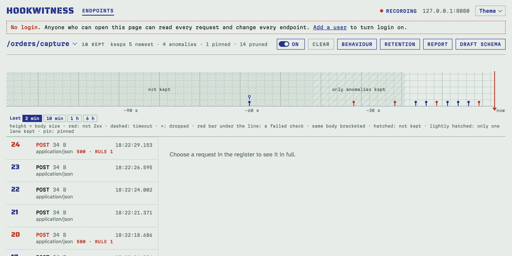
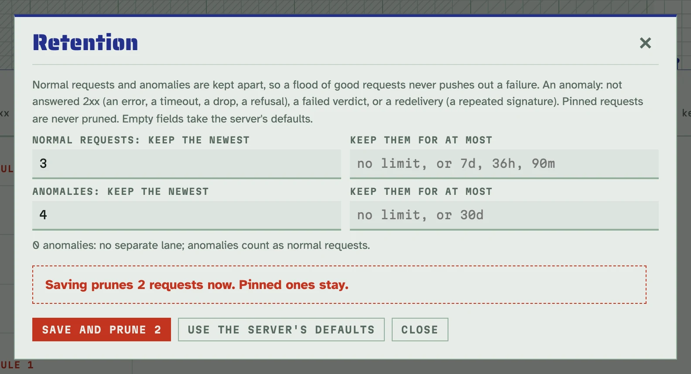
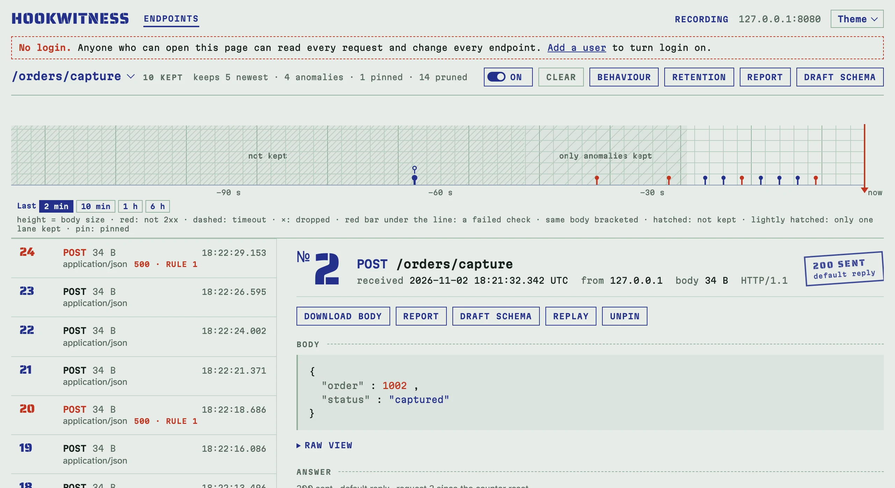

# Keeping requests

A capture that runs for days must neither fill the disk nor lose the one
request that matters. Each register keeps its requests in two lanes, each
pruned oldest first on its own:

- **normal requests**: answered 2xx, every check passed or gave no verdict;
- **anomalies**: not answered 2xx (an error status, a timeout, a dropped
  connection, a refused check, a body over the limit), a failed verdict, or a
  redelivery, a request whose signature an earlier kept request already
  carried (both deliveries count).

So thousands of good deliveries never push out a failure. **Pinned**
requests are in neither lane: retention never prunes them.

## What a register keeps

The register's header says it, for example
`keeps 1000 newest · 1000 anomalies · 2 pinned · 41 208 pruned`. By default
every endpoint keeps the newest 1000 normal requests (`-retention`) and the
newest 1000 anomalies (`-retention-anomalies`); the Unmatched register keeps
the newest 1000 requests in one lane.



The strip shows what retention removed. Before the newest pruned request of
both lanes nothing is kept but pinned requests: hatched and labelled **not
kept**. Where only normal requests were pruned, the anomalies of that time
are still drawn, over a lighter hatch labelled **only anomalies kept**.

## Set an endpoint's own limits

Click **Retention** on the register. Each lane has a count (keep the newest
this many) and an age (nothing older than it: `90m`, `36h`, `7d`, from 1 h
to 3650 d). An empty field takes the server's default. **0** anomalies
means no separate lane: anomalies then count as normal requests, as before
lanes existed.



A lower limit applies at once, so the dialog asks first, for example
**Saving prunes 2 requests now**, with **Save and prune 2**. An age limit is applied by the
minute's housekeeping, so a request may stay up to a minute past its age.
**Use the server's defaults** drops the endpoint's own limits.

Through the API: `PATCH /endpoints/{id}` with `retention` (or `null` for
the defaults); the answer's `to_prune` says how many requests went. A long
capture of `/orders/capture`, whose Rules tab answers every 4th request
`500`, keeping the newest 3 normal requests and 2 anomalies:

<!-- docs-check: setup: capture -->
```sh
api=http://127.0.0.1:8080/admin/api/v1
id=$(curl -s "$api/endpoints?path=/orders/capture" | jq '.endpoints[0].id')
curl -s -X PATCH "$api/endpoints/$id" -H 'Content-Type: application/json' \
  -d '{"retention":{"normal":{"count":3},"anomalies":{"count":2}}}' | jq -c .retention_effective
# {"normal":{"count":3,"max_age":null},"anomalies":{"count":2,"max_age":null}}
for i in $(seq 12); do curl -s -o /dev/null -X POST http://127.0.0.1:8080/orders/capture -d "{\"order\":$i}"; done
curl -s "$api/endpoints/$id" | jq -c '{kept, pruned: .pruned.count}'
# {"kept":{"normal":3,"anomalies":2,"pinned":0},"pruned":7}
curl -s "$api/endpoints/$id/requests?anomaly=true" | jq -c '[.requests[] | {no, status}]'
# [{"no":12,"status":500},{"no":8,"status":500}]
```

Twelve deliveries: nine answered 200 and three answered 500. The register
keeps the newest three of the first kind and the newest two of the second:
#4 went with the six oldest 200s, and #8 stays however many 200s come next.

The Unmatched register has one lane: `PATCH /unmatched` with
`{"retention": {"normal": {"count": 200, "max_age": "7d"}}}`.

## Pin the request that matters

**Pin** on a request's page keeps it whatever comes: retention never prunes
it, and the register row says `pinned`. **Unpin** returns it to its lane,
where the next request or the minute's housekeeping applies the limits.



Through the API, `PUT /requests/{id}/pin` and `DELETE /requests/{id}/pin`
(both with `Content-Type: application/json`), and `?pinned=true` lists the
pinned ones:

<!-- docs-check: setup: capture -->
```sh
api=http://127.0.0.1:8080/admin/api/v1
id=$(curl -s "$api/endpoints?path=/orders/capture" | jq '.endpoints[0].id')
oldest=$(curl -s "$api/endpoints/$id/requests" | jq '[.requests[] | select(.anomaly | not)] | last | .id')
curl -s -o /dev/null -w '%{http_code}\n' -X PUT "$api/requests/$oldest/pin" -H 'Content-Type: application/json'
# 204
for i in $(seq 13 24); do curl -s -o /dev/null -X POST http://127.0.0.1:8080/orders/capture -d "{\"order\":$i}"; done
curl -s "$api/endpoints/$id/requests?pinned=true" | jq -c '[.requests[] | .no]'
# [9]
```

Clearing the register removes pinned requests too, and its confirmation
says how many; deleting the endpoint removes them with it.

## In reports, setup files and MCP

- A report whose range lost requests to retention says so in its summary,
  and marks pinned requests.
- An endpoint's own retention travels in its setup file (`retention`, file
  format 2; a file without it takes the defaults of the server it is
  imported into). A replace that lowers a limit prunes at once, and the
  import's review says how many requests go. See [Sharing an endpoint's
  setup](sharing.md).
- Agents use the MCP tools `set_retention` and `pin_request`; see [Testing
  a sender with an AI agent](agents.md).

The size of the database follows from the limits: see [Configuration and
deployment](deployment.md#settings).
