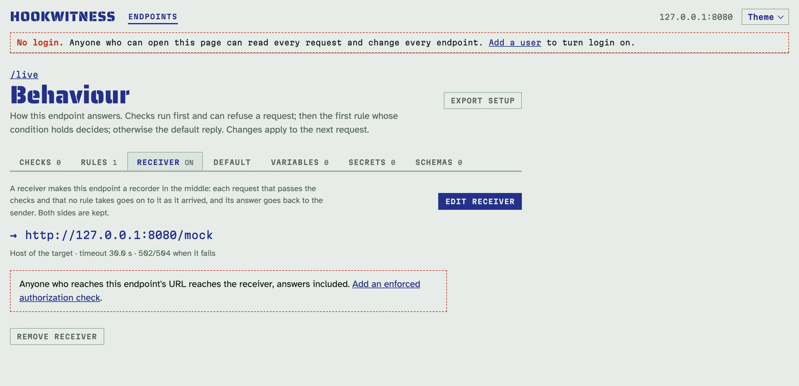
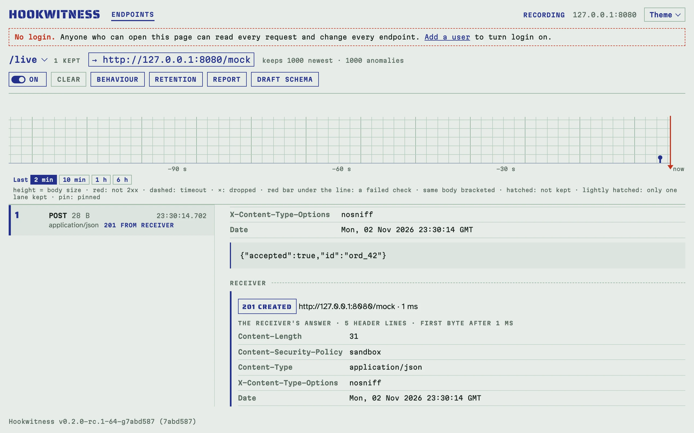

# Recording a live integration

Some bugs only show in a live integration: an event lost once a night, a
signature that fails one time in a thousand, a receiver that is sometimes
slower than its sender's timeout. A mock cannot catch them: the sender must
be served by the real receiver, day after day, while the evidence of both
sides is kept. Put Hookwitness in the middle. Every request is recorded with
its verdicts, passed on to the real receiver as it arrived, and the
receiver's answer goes back to the sender and is kept with the request.

## Put Hookwitness in the middle

1. On the endpoint's **Behaviour** page, open the **Receiver** tab and click
   **Set receiver**.
2. Type the receiver's URL, such as `https://api.example.com/webhooks`, and
   save.
3. Point the sender at the endpoint's catch URL instead of the receiver.

From then on, each request that passes the endpoint's checks and that no
rule takes goes on to the receiver. The endpoint carries a **→ receiver**
badge on the Endpoints page and above its register, so it is plain that its
traffic leaves the server.



To try it without a receiver of your own, let `/live` forward to a second
endpoint of the same server, `/mock`, which answers `201` by itself:

<!-- docs-check: setup: recorder -->
```sh
H=http://127.0.0.1:8080
curl -s -o /dev/null -w '%{http_code}\n' -d '{"order":42}' $H/live
# 201
curl -s "$H/admin/api/v1/endpoints?path=/live" | jq '.endpoints[0].id' |
  xargs -I{} curl -s "$H/admin/api/v1/endpoints/{}/requests?limit=1" | jq -c '.requests[0].forward | {status, target}'
# {"status":201,"target":"http://127.0.0.1:8080/mock"}
```

## What the receiver gets

The request goes as [Replay](replay.md#what-is-sent-exactly) sends it: the
body byte for byte, every header line in its order and letter case, nothing
added, as HTTP/1.1, a chunked body as one chunk. The request line is the
receiver's path followed by the query the sender sent. The receiver's URL
itself may not carry a query or a user name and password. Some receivers,
such as chat webhooks, carry a secret in the path: everyone who can read the
endpoint sees it, and setup files keep it. Reports show only the receiver's
scheme and host.

**Host** names the receiver by default, as receivers route by it and no
provider signs it. Choose **Host sent: as received** to pass the sender's.
For a receiver with a self-signed certificate, tick **Accept any TLS
certificate**.

## What the sender gets

The receiver's answer: its status, its header lines and its body, up to
1 MiB, never decompressed, redirects not followed. The server frames it, so
`Content-Length`, `Transfer-Encoding`, `Connection` and the other
connection lines are its own. As every answer on a catch path, it carries
`Content-Security-Policy: sandbox` and `nosniff`, and never sets the admin's
cookies (the login's, a provider sign-in's). Lines that would act on the whole origin the catch paths share
with the admin (`Clear-Site-Data`, `Strict-Transport-Security`, `Alt-Svc`)
are not passed back.

When the receiver fails, the sender gets a gateway error naming the failure
in plain text:

- `502` when the receiver cannot be reached, the TLS handshake fails, the
  connection is reset, the answer is over 1 MiB, or it switches protocols
  (`101`);
- `504` when it does not answer within the timeout.

Choose **When the receiver fails: answer the default reply** to keep a
sender happy while the receiver is redeployed. The receiver then misses
those requests: their rows say **receiver down**, and they are kept as
anomalies.

At most 64 forwards run at once. A request that finds none free waits up to
5 seconds, then gets `503` with `Retry-After: 5`. A request that comes back
to a forwarding endpoint on Hookwitness's own forward connection is a loop
and gets `508`.

## Timeouts

A forward waits 30 seconds for the receiver by default, at most `-max-wait`.
Set it at or above the sender's own timeout. A sender that gives up first
does not end the exchange: it goes on, and the request records both times,
such as "the sender gave up after 10.0 s; the exchange went on for
14.2 s". That is the evidence of a receiver too slow for its sender.

## Faults on a live integration

[Rules](replies.md#rules) take requests on a forwarding endpoint as on any
other: "every 3rd request answers `503`" injects faults into the live
traffic, and you watch the sender retry. A request a rule takes is **not
forwarded**: the receiver never sees it, and its row says so.

Tick **The receiver gets these requests too** in a rule to forward the
requests it takes as well. The receiver processes the event while the
sender sees a failure and retries. That is the classic duplicate delivery
a receiver must survive.

## Keep it closed

A receiver makes the catch URL a way in: anyone who reaches it reaches the
receiver, answers included. The Receiver tab warns while the endpoint has
no enforced authorization check. Add one, such as the
[provider's signature](authorization.md), so that only the real sender gets
through.

With login on, only an **admin** can set, change or remove a receiver, in
the UI, the API, MCP and setup imports. Users see it, and edit the rest of
the behaviour.

Forwards follow the same target policy as replays,
[`-replay-allow`](replay.md#which-targets): link-local and cloud metadata
addresses are never dialled, and a narrower list bounds where receivers may
be. `-replay-allow none` turns forwarding off too: a stored receiver stays,
its requests get the failure answer, and the server names those endpoints
when it starts.

## Reading what happened

The register's rows show what the sender got (**201 from receiver**,
**502 receiver down**, **504 receiver timeout**), and a mark of the
receiver's side next to a rule's answer: **receiver 200**, or **not
forwarded**. The strip draws the sender's view. A request page has a
**Receiver** section: where it went, how long it took, the lines sent (with
the Host chosen), the receiver's header lines and its body (the first
64 KiB), and when the sender left.



[Reports](reports.md) carry each exchange and count, in the summary, the
forwards, the receiver's answers by class, its failures by kind, the
senders that left and the requests not forwarded.

## Long captures

Each forwarded request keeps the request, up to 64 KiB of the receiver's
answer and up to 64 KiB of the answer the sender got. Size retention for
days of traffic on [Keeping requests](keeping.md): receiver failures,
fallbacks to the default reply and requests not forwarded are anomalies,
kept apart from the normal ones.

## Through the API and MCP

The behaviour document takes `forward` (`url`, `keep_host`,
`insecure_tls`, `timeout_ms`, `on_failure`) and each rule's `forward`
switch. Requests carry `forward`, the receiver's side; `forward=ok`,
`failed` or `none` filters a list; `GET <prefix>/api/v1/requests/{id}/forward`
gives the whole exchange. See the [API reference](api.md#recorder-in-the-middle).
Agents use `configure_endpoint` with `forward` (see [agents](agents.md)).
