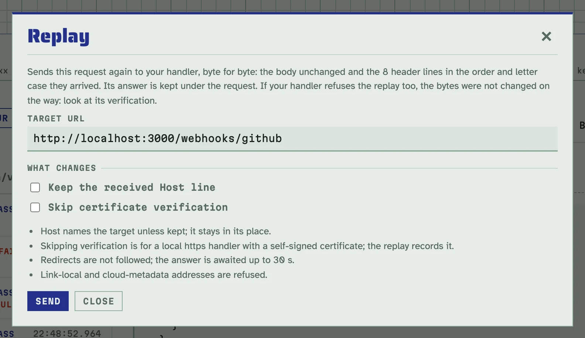
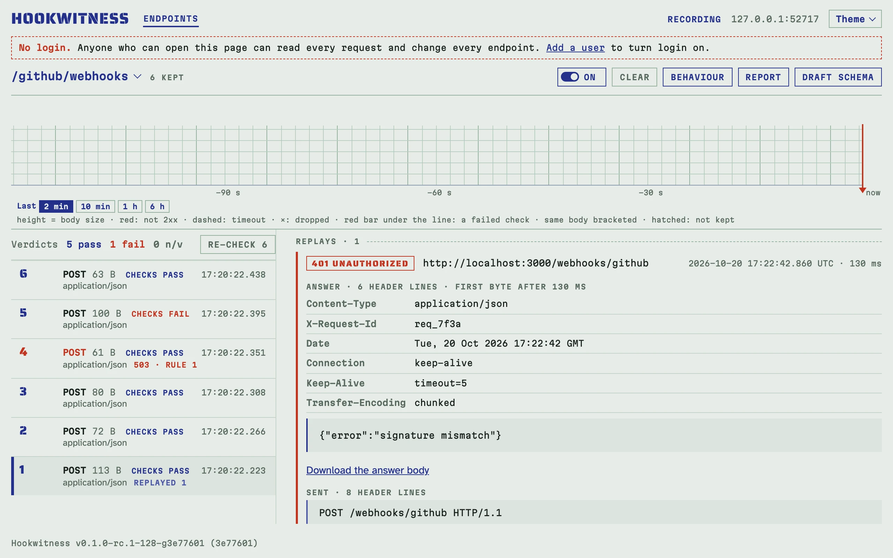

# Replaying a request to your handler

Your handler refuses a provider's webhook: "signature mismatch". Either
something on the way changed the request (a proxy, a relay, a framework
that parsed the body), or the handler checks the signature wrongly.
Hookwitness keeps every caught request as it arrived: the body's bytes and
the header lines in their order and letter case. **Replay** sends it to your
handler exactly like that and keeps what the handler answered. If the
handler refuses the untouched original too, the bytes were not the problem:
look at its verification.

## Replay from a request

Open a caught request and click **Replay**. Type your handler's URL, with
the path and query it listens on, and click **Send**.



The dialog waits for the answer (up to 30 seconds), then the request shows
it under **Replays**, newest first: the status, the answer's header lines as
they came, its body, how long it took, and what was sent. A replayed row in
the register says **replayed** with the count.



This handler answered `401 {"error":"signature mismatch"}` to a delivery
whose signature passes in Hookwitness: it hashes the JSON it parsed and
wrote back, not the bytes that arrived.

Only a request whose body was kept whole can be replayed: not one over
`-max-body`, and not one in the Unmatched register whose body was longer
than the 64 KiB it keeps.

## What is sent, exactly

- The body, byte for byte.
- Every header line as it arrived, in the same order and letter case,
  repeated names kept. Nothing is added: no `User-Agent`, no
  `Accept-Encoding`.
- The request line is the method, the target URL's path and query, and
  `HTTP/1.1`.

Where it can differ, and the replay says so under **Sent**:

- **Host** names the target (its host and port, as typed), in the same
  place. Most handlers route or check by it, and no provider signs it. Tick
  **Keep the received Host line** to send it as caught.
- A body that came **chunked** goes as one chunk; chunk extensions and
  trailers are not kept, so they are not sent.
- A request that came as **HTTP/1.0** goes as HTTP/1.1, with a `Host` line
  added when it had none.

Redirects are not followed: a `3xx` is the answer. The answer's body is
kept as it arrived, never decompressed, up to 1 MiB. A handler that does not
answer, resets the connection or fails TLS is a replay too, with the error
instead of a status.

## Which targets

By default a replay can go to any address except **link-local** ones
(`169.254.0.0/16`, `fe80::/10`) and **cloud metadata** services
(`fd00:ec2::254`, `100.100.100.200`): the address is checked when the
connection is made, so a host name that resolves to one is refused too.
A URL with a user name or password is refused (it would be kept with the
replay); a token in its query is kept as typed.

On a shared server, narrow the targets with `-replay-allow` (or
`HOOKWITNESS_REPLAY_ALLOW`): host names, `host:port`, addresses and CIDR
networks, separated by commas. `none` turns replay off.

<!-- docs-check: skip: starts a long-running server -->
```sh
hookwitness serve -replay-allow 'localhost,host.docker.internal:3000,192.0.2.0/24'
```

With login on, only an **admin** can send a replay (logged in, or with a
personal token): a replay reaches whatever the server can reach, so it is
not for every user. Users read the replays already made. Each replay names
who sent it. While login is off, anyone who can open the admin can replay.

## From a container to your machine

Hookwitness in Docker reaches a handler on your machine as
`host.docker.internal`, e.g. `http://host.docker.internal:3000/webhooks`. On
Linux, start the container with `--add-host=host.docker.internal:host-gateway`.

A local https handler with a self-signed certificate: tick **Skip
certificate verification**. It applies to that replay only and is recorded
with it.

## Through the API

`POST <prefix>/api/v1/requests/{id}/replays` sends one and answers with the
replay. To try it without a handler of your own, replay a GitHub delivery
to a second endpoint of the same Hookwitness that checks the same
signature, `/handler`:

<!-- docs-check: setup: github handler -->
```sh
H=http://127.0.0.1:8080
BODY='{"action":"opened","number":7}'
SIG=$(printf '%s' "$BODY" | openssl dgst -sha256 -hmac gh_test_secret | awk '{print $2}')
curl -s -o /dev/null -d "$BODY" -H "X-Hub-Signature-256: sha256=$SIG" $H/hooks   # pass
REQ=$(curl -s "$H/admin/api/v1/endpoints?path=/hooks" | jq '.endpoints[0].id' |
  xargs -I{} curl -s "$H/admin/api/v1/endpoints/{}/requests?limit=1" | jq '.requests[0].id')
curl -s -X POST "$H/admin/api/v1/requests/$REQ/replays" -H 'Content-Type: application/json' \
  -d "{\"url\":\"$H/handler\"}" | jq -c '{status, line, error}'
# {"status":200,"line":"POST /handler HTTP/1.1","error":null}
curl -s "$H/admin/api/v1/endpoints?path=/handler" | jq '.endpoints[0].id' |
  xargs -I{} curl -s "$H/admin/api/v1/endpoints/{}/requests?limit=1" | jq -r '.requests[0].verdict'
# pass
```

The signature still passes at `/handler`: the replay changed nothing it
covers. The [API reference](api.md#replay-a-request-to-your-handler) has the
routes; agents use the MCP tool `replay_request` (see
[agents](agents.md)).

## Limits

- At most 4 replays run at once; a fifth waits up to 5 seconds, then gets
  "busy".
- A replay's body counts against `-max-inflight` while it is sent.
- The timeout is 30 seconds (or `-max-wait`, if shorter); through the API,
  `timeout_ms` sets another up to `-max-wait`.
- A request keeps its newest 50 replays. Replays go with their request when
  it is cleared, pruned or its endpoint deleted.
