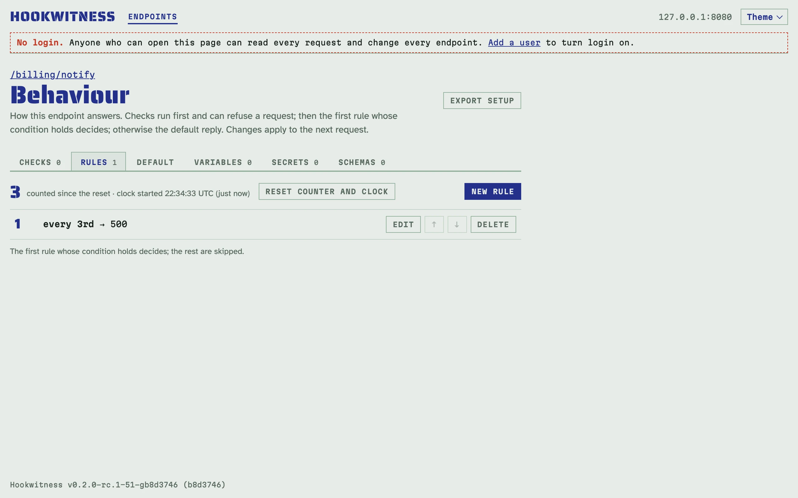
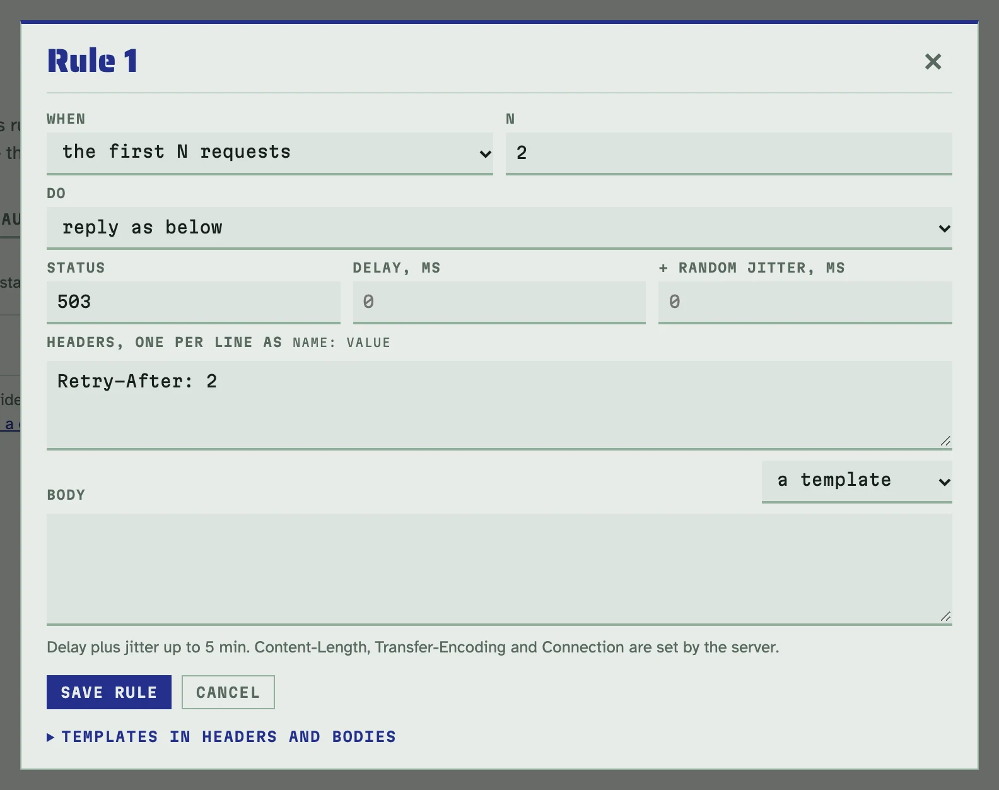
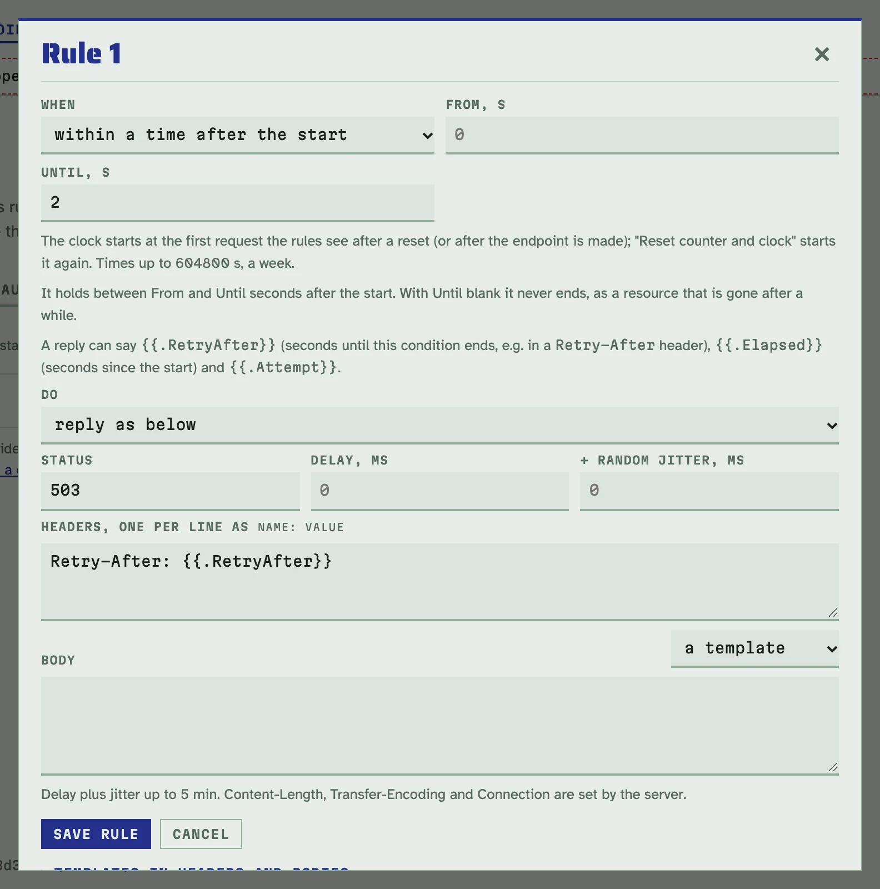
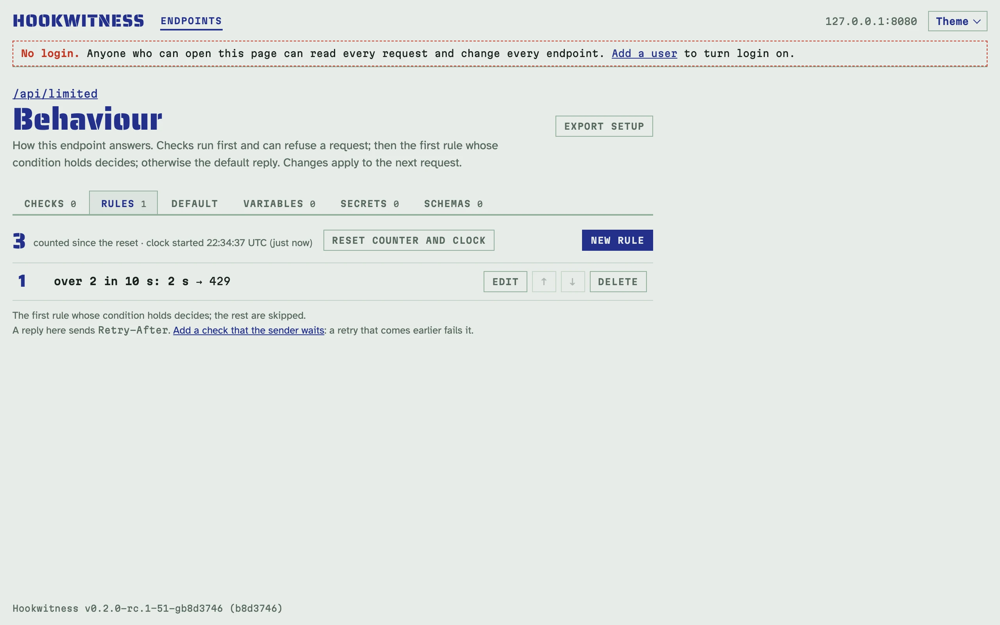
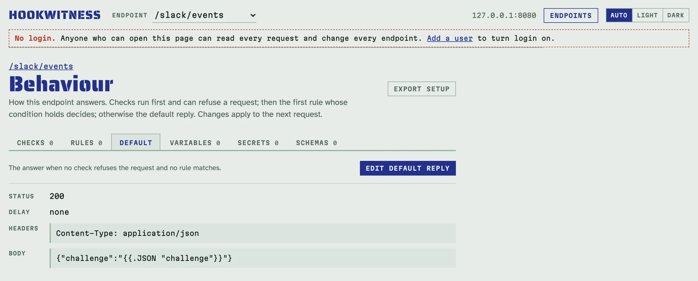

# Scripted replies

A sender has to cope with receivers that are slow, hang, crash or fail now
and then. Each endpoint's **Behaviour** page scripts how it answers, so you
can make it do exactly that on purpose and watch what the sender does.

Open it with **Behaviour** on the Endpoints page or on the register. Its tabs
are **Checks**, **Rules**, **Default**, **Variables**, **Secrets** and
**Schemas**. Changes apply to the next request.

## How a request is answered

1. **Checks** run first. A required header, an enforced
   [authorization check](authorization.md) or an enforced
   [schema check](schemas.md) can refuse the request with `400` or `401`, or
   with your own reply. A refused request does not count towards the rules.
2. **Rules** come next, in order. The first rule whose condition holds
   decides, and the rest are skipped.
3. The **default reply** answers the rest. It starts as `200` with an empty
   body.

For every request, Hookwitness records what it did: the rule or the default
reply, the status and headers sent, the measured delay, or how long the
sender waited for a timeout.

## Rules

On the **Rules** tab, click **New rule**, then choose:

- **When**, by count: `every Nth request`, `the first N requests` (since the
  counter was reset) or `at random, p%`.
- **When**, by time and state:
  - `within a time after the start`: from **From** to **Until** seconds after
    the endpoint's clock started; with **Until** blank it never ends;
  - `flapping: down, then up, again`: a cycle that starts with its **Down**
    part, when the rule takes the requests, then its **Up** part, counted in
    seconds or in requests;
  - `over a rate, then blocked`: more than **N** requests within **Per**
    seconds trip it, and it then takes every request for **Block** seconds;
    it counts every request the rules see, also those an earlier rule
    takes;
  - `the first N attempts of each event`: attempts of the same event, by the
    endpoint's [event id](delivery.md), or of the same body without one.
- **Do**: `reply as below` (a status, headers, a body, a delay with random
  jitter), `time out: hold, never answer` or `drop: reset the connection`.

The arrows move a rule up or down, because order matters. The counter on the
Rules tab counts the requests the rules have seen. The endpoint's clock
starts at the first of them, and the Rules tab shows when. **Reset counter
and clock** starts both again, so "the first 2 requests" or "the first 30
seconds" can be replayed. A rate limit's count and block are cleared with
them. Turning the endpoint off and on keeps them, and so does a change to a
rule, except to that rule's own rate limit.

The request page and the reports name the rule that answered. A rule by
time also says when, as `rule 1 · first 30 s · at 12.4 s`.

### Fail every 3rd delivery

On `/billing/notify`, add a rule: every 3rd request, reply `500`.



<!-- docs-check: setup: every_third -->
```sh
H=http://127.0.0.1:8080/billing/notify
curl -s -d '{"invoice":"in_1"}' $H   # 200
curl -s -d '{"invoice":"in_2"}' $H   # 200
curl -s -d '{"invoice":"in_3"}' $H   # 500 from rule 1
```

### Fail the first two, then recover

On `/billing/retry`, add a rule: the first 2 requests, reply `503` with the
header `Retry-After: 2`. A sender with retries and backoff should deliver on
its third try. The request page then shows `delivery 3 of this body`, and
the report shows the gaps between the deliveries. Click **Reset counter and
clock** to run it again.



<!-- docs-check: setup: first_two -->
```sh
H=http://127.0.0.1:8080/billing/retry
curl -s -d '{"invoice":"in_7"}' $H   # 503
curl -s -d '{"invoice":"in_7"}' $H   # 503
curl -s -d '{"invoice":"in_7"}' $H   # 200
```

### Down for the first seconds after a deploy

A receiver that is restarting answers `503` for a while, then works. On
`/deploy/hook`, add a rule: `within a time after the start`, **Until** `2`
seconds (30 or more in a real test), reply `503` with the header
`Retry-After: {{.RetryAfter}}`. The clock starts with the first request,
so the sender meets the outage however late it starts.
`{{.RetryAfter}}` counts down the seconds until the window ends.



<!-- docs-check: setup: deploy_window -->
```sh
H=http://127.0.0.1:8080/deploy/hook
curl -s -d '{"n":1}' $H   # 503 at 0 s
sleep 2
curl -s -d '{"n":2}' $H   # 200 the window is over
```

### Rate limited, with Retry-After

An API that allows 2 requests in 10 seconds answers the third `429` and
blocks for a while. On `/api/limited`, add a rule: `over a rate, then
blocked`, **N** `2`, **Per** `10` seconds, **Block** `2` seconds, reply `429`
with the header `Retry-After: {{.RetryAfter}}`. After the block the count
starts again.



<!-- docs-check: setup: rate_limited -->
```sh
H=http://127.0.0.1:8080/api/limited
curl -s -d '{}' $H   # 200
curl -s -d '{}' $H   # 200
curl -s -o /dev/null -w '%{http_code} Retry-After: %header{retry-after}\n' -d '{}' $H
# 429 Retry-After: 2
sleep 2
curl -s -d '{}' $H   # 200 the block is over
```

Whether the sender waited as asked is a verdict of its own: add a
[backoff check](delivery.md#retry-backoff) and a retry that comes
before the `Retry-After` fails it. The Rules tab offers the check when a
reply sends `Retry-After`.

### Flapping

An instance that goes down and up again: on `/flaky/hook`, add a rule:
`flapping: down, then up, again`, **Down** `1`, **Up** `1`, counted in
seconds, reply `503`. The cycle starts with the down part at the first
request, then repeats: down from 0 to 1 s, up from 1 to 2 s, down again.
Counted in requests, **Down** `1` and **Up** `2` fail every third request
starting with the first.

<!-- docs-check: setup: flapping -->
```sh
H=http://127.0.0.1:8080/flaky/hook
curl -s -d '{}' $H   # 503 down
sleep 1.5
curl -s -d '{}' $H   # 200 up
sleep 1
curl -s -d '{}' $H   # 503 down again
```

### Gone after a while

A resource that is deleted answers `410` from then on. On `/legacy/gone`,
add a rule: `within a time after the start`, **From** `2` seconds, **Until**
blank, reply `410`.

<!-- docs-check: setup: gone_after -->
```sh
H=http://127.0.0.1:8080/legacy/gone
curl -s -d '{}' $H   # 200
sleep 2
curl -s -d '{}' $H   # 410 gone from now on
```

### A slow receiver

On the **Default** tab, set the delay to `2000` ms (add jitter for a
spread). The delay is measured and recorded with the request.

<!-- docs-check: setup: slow -->
```sh
curl -s -o /dev/null -w '%{http_code} after %{time_total} s\n' -d '{}' http://127.0.0.1:8080/billing/slow
# 200 after 2.…
```

If the sender gives up before the delay ends, it never gets the reply. The
request is recorded as **sender left**, and the strip and reports count it
as a timeout, not as a success.

### A receiver that hangs

Add a rule that times out (with `at random, 10%`, only some requests hang).
Hookwitness holds the connection and never answers, until the sender gives
up or `-max-wait` passes (5 minutes by default). Then it closes the
connection without a response. The request page shows how long the sender
waited.

<!-- docs-check: setup: hang -->
```sh
curl -s -m 2 -o /dev/null -w '%{http_code}\n' -d '{}' http://127.0.0.1:8080/billing/hang
# 000
```

### A crashing receiver

Add a rule that drops. The connection is reset (TCP RST) as soon as the
request is read, as a receiver that crashed would do. The request is still
kept.

<!-- docs-check: setup: crash -->
```sh
curl -s -o /dev/null -w '%{http_code}\n' -d '{}' http://127.0.0.1:8080/billing/crash
# 000
```

## The default reply

The **Default** tab sets the answer for requests that no check refused and
no rule matched. It has a status, headers, a body, a delay and jitter.

### Echo a verification challenge

Some senders check a URL before they use it: Slack sends a `challenge` and
expects it back. On `/slack/events`, set the default reply's header to
`Content-Type: application/json` and its body to
`{"challenge":"{{.JSON "challenge"}}"}`.



<!-- docs-check: setup: challenge -->
```sh
curl -s -d '{"type":"url_verification","challenge":"3eZb"}' http://127.0.0.1:8080/slack/events
# {"challenge":"3eZb"}
```

## Raw bytes

To emulate a receiver that answers something odd, such as invalid UTF-8 or
a binary body, give the body as bytes. Above the body field, switch **a
template** to **bytes, base64**, and paste the bytes in base64. They are sent
exactly as given, never read as a template; line breaks and spaces in the
field are dropped. In the API, that is `body_base64` instead of `body`.

On `/legacy/hook`, a default reply with the bytes `//5vaw==` answers
`ff fe 6f 6b`: two bytes that are not UTF-8, then `ok`.

<!-- docs-check: setup: raw_bytes -->
```sh
curl -s -d '{}' http://127.0.0.1:8080/legacy/hook | od -An -tx1 | xargs
# ff fe 6f 6b
```

The request page shows such a reply's body in base64 under **Answer**, since
it is not text.

## Templates

Header values and bodies of replies are Go templates over the request:

| Template | Gives |
|---|---|
| `{{.Header "X-Request-Id"}}` | a request header (the first one of that name) |
| `{{.Query "name"}}` | a query parameter |
| `{{.JSON "event.items.0.id"}}` | a field of a JSON body, by a dotted path |
| `{{.Var.TOKEN}}` | a variable from the **Variables** tab |
| `{{.N}}` | the request's number since the counter was reset |
| `{{.RetryAfter}}` | whole seconds until the matching rule's condition ends (a window with an end, a flap's down part in seconds, a rate block), at least 1; else 0 |
| `{{.Elapsed}}` | seconds since the endpoint's clock started, such as `12.4` |
| `{{.Attempt}}` | the request's attempt of its event (by the event id, else the body); 1 without one |
| `{{.Method}}`, `{{.Path}}`, `{{.Body}}` | the request itself |

`if`, `with` and the standard functions work; `range` and sub-templates do
not. Rendering is capped at 1 MiB and one second, and the string functions
(`printf`, `print`, `html`…) together may build at most 4 MiB. A template
that fails answers `500`, and the request page shows the error.

**Variables** are test values for templates. On the **Variables** tab, each
has a name and a value, and `{{.Var.NAME}}` puts the value in. They are shown
in plain text, so never put real secrets there; secrets have their own tab
(see [Authorization checks and secrets](authorization.md)).

Response headers go out as Go's HTTP server writes them: sorted by name,
with a repeated header keeping its order. `Content-Length`,
`Transfer-Encoding` and `Connection` belong to the server and cannot be set.
A `204` or `304` reply, or any reply to a `HEAD` request, goes without a body
(and a `304` without `Content-Type`), as HTTP requires; the request page
records what was sent and says what of the configured reply was not.

Every reply also carries `Content-Security-Policy: sandbox` and
`X-Content-Type-Options: nosniff`. A catch path shares its origin with the
web UI, so a reply that echoes the request (`{{.Body}}`) could otherwise run
as a page of the UI when someone opens it in a browser. Webhook senders do not
render pages, so they see no difference. A `Content-Security-Policy` of
your own is sent as well, next to `sandbox` (the browser applies both);
an `X-Content-Type-Options` of your own replaces `nosniff`. A reply never
sets the admin's cookies: a `Set-Cookie` of `hookwitness_session` (the
login) or `hookwitness_oidc` (a sign-in through a provider) is not sent,
whether the endpoint scripts it or its receiver answers with it. The
request page lists the headers sent.

## Required headers

A **Required header** check on the **Checks** tab refuses a request that
lacks a header, or whose header does not equal a value or match a regular
expression. The refusal is `400` naming the header, or your own reply.

To demand an API key like the real client does, add the check on
`/partner/hooks`: `X-Api-Key` must equal `key_test`, and the refusal is your
own reply `401` with a JSON body.

<!-- docs-check: setup: api_key -->
```sh
H=http://127.0.0.1:8080/partner/hooks
curl -s -d '{}' -H 'X-Api-Key: key_test' $H   # 200
curl -s -d '{}' -H 'X-Api-Key: nope' $H       # 401 refused by the check
```

## A real receiver behind it

An endpoint can also pass requests on to a real receiver and answer with
its answer, rules still taking some for faults: see [Recording a live
integration](recorder.md).

## With the API

Everything on this page is the behaviour document of the REST API: `GET` and
`PUT /endpoints/{id}/behaviour`. See the [API reference](api.md#behaviour).
