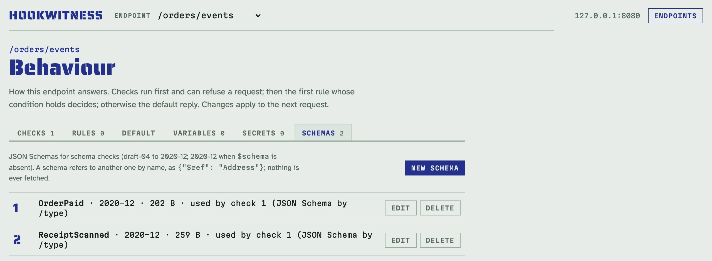
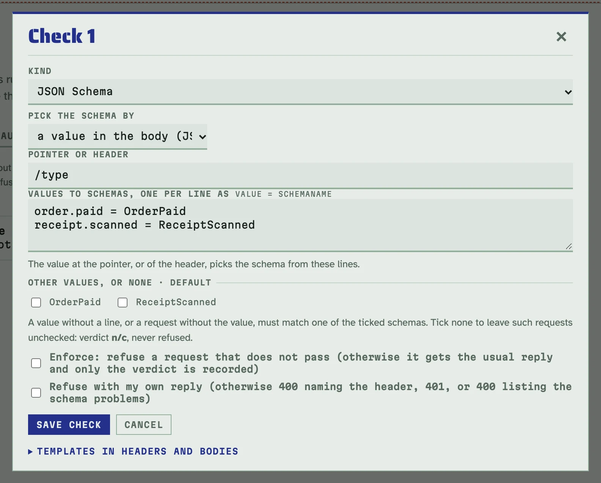
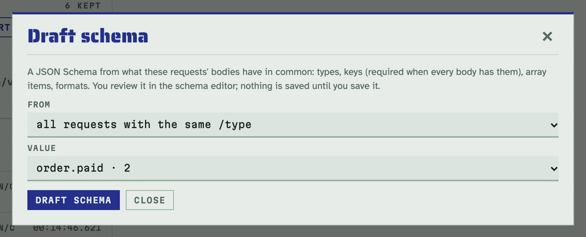
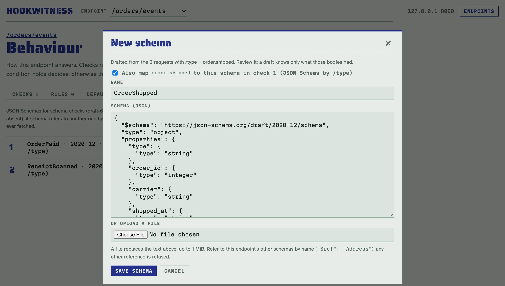
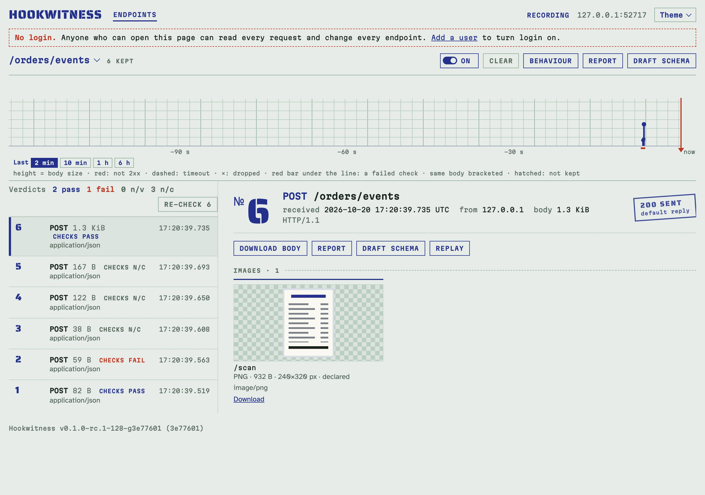

# JSON Schema checks

Does the event keep its contract? A JSON Schema check validates each
request's body and records a verdict next to the authorization ones:

- **pass**;
- **fail**, with up to 20 problems, each a JSON pointer into the body, the
  failing keyword and a message;
- **n/v** when the body was not kept (over the size limit);
- **n/c**, not checked, when no schema applies to the event.

## Add a schema and a check, step by step

The example on this page is an endpoint `/orders/events` whose events carry
their kind in `/type`. Events of the kind `order.paid` must match the schema
`OrderPaid`:

```json
{"type":"object","required":["order_id","amount"],
 "properties":{"order_id":{"type":"integer"},"amount":{"type":"integer","minimum":1},
               "paid_at":{"type":"string","format":"date-time"}}}
```

1. Open the **Behaviour** page of `/orders/events`, its **Schemas** tab, and
   click **New schema**. Name it `OrderPaid`, then paste the schema or upload
   a file. Hookwitness refuses an invalid schema when you save it and says
   why.
2. Open the **Checks** tab, click **New check** and choose the kind **JSON
   Schema**. Under **Pick the schema by**, choose **a value in the body (JSON
   pointer)**, enter `/type`, and map `order.paid = OrderPaid`. Save.

The endpoint in the shots also has a second schema, `ReceiptScanned`, for the
[images](#images-in-the-payload) further down.





Then send three events: one that matches, one that does not, and one of a
kind that has no schema.

<!-- docs-check: setup: orders -->
```sh
H=http://127.0.0.1:8080/orders/events
curl -s -d '{"type":"order.paid","order_id":42,"amount":1999,"paid_at":"2026-10-12T17:28:07Z"}' $H   # pass
curl -s -d '{"type":"order.paid","order_id":"42","paid_at":"yesterday"}' $H                        # fail: 3 errors against OrderPaid
curl -s -d '{"type":"order.created","order_id":43}' $H                                              # n/c: no schema for /type "order.created"
```

The second request's page stamps the verdict (`Schema: fail, 3 errors`),
lists the problems and marks the offending places in the body:


## What the schemas can do

- **Schema versions** follow `$schema`: draft-04 to 2020-12, and 2020-12 when
  it is absent.
- **`format` is asserted.** A `date-time` of `"yesterday"` fails.
- **References by name.** Schemas of one endpoint refer to each other with
  `{"$ref": "Address"}`. Nothing is ever fetched, so a reference to any other
  URL or to a file is refused when you save.
- **A body that is not JSON** fails with the parse error and its byte offset.
  An empty body fails as such.

## Which schema applies

A check uses one of three things.

- **One schema.** Every body must match it.
- **Several**, when the sender may send either shape (v1 or v2). The body
  must match one of them, and the verdict names which. When none matches, the
  verdict gives the problems of the closest one and how far the others were,
  for example `matches none of V1, V2; closest V2 with 1 error (V1: another
  shape)`.
- **A schema picked by a value**, as in the example: a JSON pointer into the
  body (`/type`) or a header (`X-GitHub-Event`), with one mapping per line
  such as `order.paid = OrderPaid`. A value without a mapping, or a request
  without the value, is checked against the default schemas when there are
  any. Without a default, it gets **n/c** and is never refused.

## Enforce

With **Enforce**, a body that fails is refused before the rules, so it is not
counted. The refusal is `400` listing the problems, or your own reply. A body
that could not be checked (n/v) is refused too; n/c never is.

## Draft a schema from what was caught

Writing a schema for every event type by hand is the slow part. Let the
caught bodies draft it:

1. Click **Draft schema** on a request, or on the register for several
   requests. On the register you pick them by number (`3, 5-9`), or take all
   the requests with the same value of the check's discriminator
   (`/type = order.shipped`).

   

2. The schema editor opens on a draft. It has the types seen, the keys
   (required when every body has them), array items, and string formats
   (`date-time`, `date`, `uuid`, `email`, `uri`) when every value has them.
   The name is suggested from the value: `order.shipped` becomes
   `OrderShipped`.

   

3. Review it, because a draft knows only what those bodies had. Enums,
   patterns, ranges and lengths are never guessed. Nothing is stored until
   you click **Save schema**.

With a discriminator check, the editor offers to map the value to the new
schema in that check. When a schema of that name exists, the editor lists
what the draft would change (keys added, keys now optional, types widened),
and saving replaces it. Requests caught before stay **n/c** until you
re-check them (see [Verdicts and re-checking](endpoints.md#verdicts-and-re-checking)).

## Images in the payload

A string declared as an image must really be one:

```json
{"type":"string","contentEncoding":"base64","contentMediaType":"image/png"}
```

`image/jpeg`, `image/gif` and `image/webp` work too, and `image/*` accepts any
of them. A `data:image/...;base64,` URL is accepted as well. The image is
decoded completely, so a truncated picture, a picture of another type than
declared, text or an SVG fails at its path. Images may have up to 40
megapixels. HEIC and AVIF are recognised but cannot be decoded here, so
their verdict is n/v.

Decoding is bounded by memory, not only by pixels: an image that would take
more than 128 MB to decode (a 16-bit PNG of 4000×4000 does), or the images
after the first 256 MB of one request, are checked by their header only and
marked *not checked*; the verdict is then n/v with the reason. Each image is
decoded once per check, and showing a request again does not decode it
again.

The request's page shows the images above the body: those a schema
declares, plain `data:image` strings, and a body that is itself an image. Each
has a full-size viewer and a download. Reports carry them too. In the shot,
the receipt's `scan` is declared as a PNG by `ReceiptScanned`:



## After editing a schema

**Re-check** validates every kept request again with the current schemas;
see [Verdicts and re-checking](endpoints.md#verdicts-and-re-checking).

## With the API

Schemas and schema checks are part of the behaviour document. `POST
/endpoints/{id}/schema-draft` drafts a schema without storing it. See the
[API reference](api.md#behaviour).
