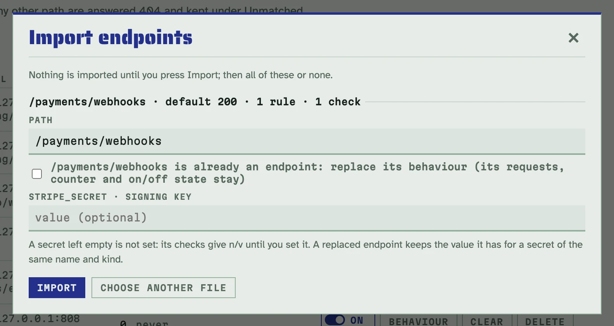
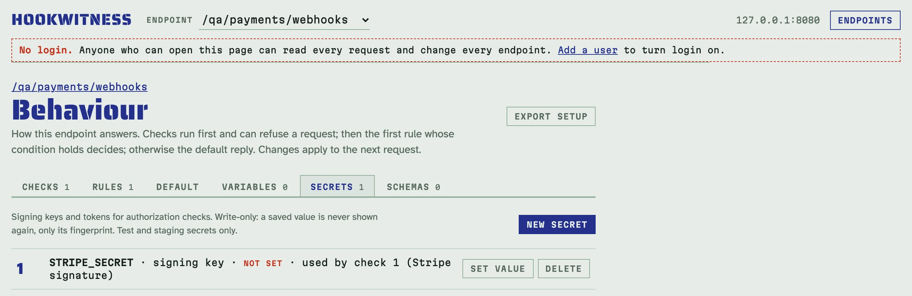

# Sharing an endpoint's setup

An endpoint's setup is everything that makes it answer the way it does: its
path, the default reply, the rules, the checks, the variables, the schemas,
and which secrets it needs. Hookwitness writes it to a file
(`<path>.hookwitness.json`) and builds endpoints from one, on any instance.
Two everyday flows:

- **A developer prepares, QA tests.** The developer knows how the receiver
  must behave (a Stripe signature, two failures before a success to test
  retries), sets the endpoint up once and hands over the file. QA imports
  it and starts testing; nothing is rebuilt by hand.
- **QA attaches it to the ticket.** Next to the [report](reports.md), the
  file says how the sender was tested, and anyone can import it to
  reproduce.

## What the file holds, and what it never does

The file holds the endpoint's path and behaviour, and each secret's **name
and kind** (a signing key, or a token or password). It never holds a
secret's value, its hash, its sealed form or its fingerprint: a value stays
on the instance where it was typed. Requests, the counter, the on/off state
and ids are not part of a setup either.

This is the file of `/payments/webhooks`: an enforced Stripe signature
check over `STRIPE_SECRET`, and the first two deliveries answered `503` so
that the sender's retries show.

```json
{
  "hookwitness": 1,
  "endpoints": [
    {
      "path": "/payments/webhooks",
      "default": {"status": 200},
      "rules": [
        {"when": {"kind": "first", "n": 2}, "do": "reply",
         "reply": {"status": 503, "headers": [{"name": "Retry-After", "value": "2"}]}}
      ],
      "checks": [{"kind": "stripe", "enforce": true, "secret": "STRIPE_SECRET"}],
      "vars": [],
      "schemas": [],
      "secrets": [{"name": "STRIPE_SECRET", "kind": "key"}]
    }
  ]
}
```

`"hookwitness": 1` marks the file and its format. A file from a newer
Hookwitness, a file with a field this one does not know, or one that is not
a setup at all is refused with a message naming the problem, and nothing is
created.

## Export

- One endpoint: open its **Behaviour** page and click **Export setup**.
- All of them at once (a whole integration, such as events and callbacks):
  **Export all** on the Endpoints page.

The browser saves the file. The API gives the same file
(`GET <prefix>/api/v1/setup?id=<id>`, without `id` for all):

<!-- docs-check: setup: payments -->
```sh
ID=$(curl -s 'http://127.0.0.1:8080/admin/api/v1/endpoints?path=/payments/webhooks' | jq '.endpoints[0].id')
curl -s -o payments-webhooks.hookwitness.json "http://127.0.0.1:8080/admin/api/v1/setup?id=$ID"
jq -c '.endpoints[0] | {path, secrets}' payments-webhooks.hookwitness.json
# {"path":"/payments/webhooks","secrets":[{"name":"STRIPE_SECRET","kind":"key"}]}
```

## Import

Click **Import** on the Endpoints page, choose the file (or paste it) and
click **Review**. Nothing is created yet: the review shows each endpoint of
the file with what it does, and asks two things.



- **Where it goes.** Each endpoint keeps its path unless you type another
  one. When the path is already an endpoint here, tick **replace its
  behaviour** (its requests, counter and on/off state stay; a secret of the
  same name and kind keeps its value), or import it under another path.
- **Secret values, if you have them.** Type your own test key now, or leave
  it empty and set it later. A secret left empty is **not set**.

**Import** then creates all of the file's endpoints, or none if anything is
wrong.

### Secrets that are not set

An imported secret without a value is marked *not set* on the endpoint's
**Secrets** tab (with **Set value** instead of Replace), next to each check
that uses it, on its register and on the Endpoints page. A check over it
gives **n/v** with the reason `secret STRIPE_SECRET not set`, and refuses
nothing even when enforced: the request goes on to the rules as if the
check were not there, and the verdict says why it says nothing.



Set the value on the Secrets tab (or through the API) and the checks verify
from the next request; **Re-check** gives the requests caught meanwhile
their verdicts.

The same import through the API, on a fresh instance:

<!-- docs-check: fresh; setup: payments_file -->
```sh
curl -s -X POST http://127.0.0.1:8080/admin/api/v1/setup -H 'Content-Type: application/json' \
  --data-binary @payments-webhooks.hookwitness.json | jq -c '.endpoints[] | {result, path, secrets_not_set}'
# {"result":"created","path":"/payments/webhooks","secrets_not_set":["STRIPE_SECRET"]}
curl -s -o /dev/null http://127.0.0.1:8080/payments/webhooks -d '{"id":"evt_1"}' # n/v: secret STRIPE_SECRET not set
```

A path that is taken is refused (`409`) unless the call says
`?on_conflict=replace`:

<!-- docs-check: setup: payments payments_file -->
```sh
curl -s -X POST http://127.0.0.1:8080/admin/api/v1/setup -H 'Content-Type: application/json' \
  --data-binary @payments-webhooks.hookwitness.json | jq -r .error.message
# /payments/webhooks is already an endpoint; nothing was imported…
curl -s -X POST 'http://127.0.0.1:8080/admin/api/v1/setup?on_conflict=replace' -H 'Content-Type: application/json' \
  --data-binary @payments-webhooks.hookwitness.json | jq -c '.endpoints[] | {result, secrets_not_set}'
# {"result":"unchanged","secrets_not_set":[]}
```

The replace kept the value `STRIPE_SECRET` had, so nothing changed.

## Known endpoints without clicks

A CI job or a `docker run` can start with the endpoints it needs.

**At every start:** `-import <file>` (or `HOOKWITNESS_IMPORT`) applies the
file before the server listens. Its endpoints are created, or their
behaviour replaced, so a restart with the same file changes nothing, and
the values someone set for their secrets stay. A file that cannot be
applied stops the start with one line saying why.

<!-- docs-check: skip: Docker -->
```sh
docker run -d --name hookwitness -p 127.0.0.1:8080:8080 -v hookwitness:/data \
  -v "$PWD/payments-webhooks.hookwitness.json:/setup.json:ro" -e HOOKWITNESS_IMPORT=/setup.json \
  ghcr.io/petroladkin/hookwitness:0.2
```

**On a running server:** `hookwitness apply <file>` does the same through
the API, and says what it did to each endpoint:

<!-- docs-check: fresh; setup: payments_file -->
```sh
hookwitness apply -url http://127.0.0.1:8080 payments-webhooks.hookwitness.json
# created /payments/webhooks (secrets not set: STRIPE_SECRET)
hookwitness apply -url http://127.0.0.1:8080 payments-webhooks.hookwitness.json
# unchanged /payments/webhooks (secrets not set: STRIPE_SECRET)
```

With login on, give it a token: `-token-file` names a file holding one (see
[Users, login and tokens](access.md#tokens-for-scripts-and-agents)); any
user may import. For an admin at the root of its own port, give the API's
full URL: `-url http://127.0.0.1:8081/api/v1`.

An AI agent has the same through MCP: `export_endpoint` and
`import_endpoints` ([Testing a sender with an AI agent](agents.md)).
