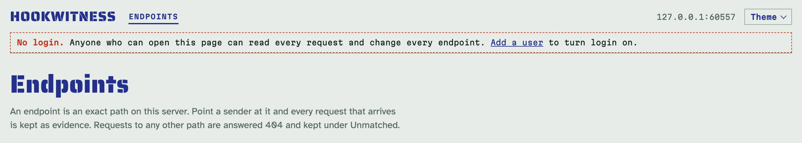
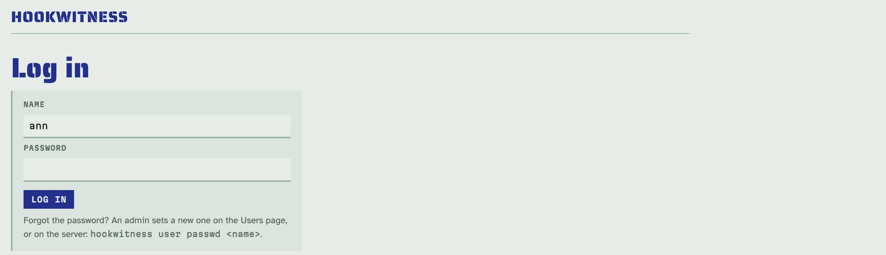
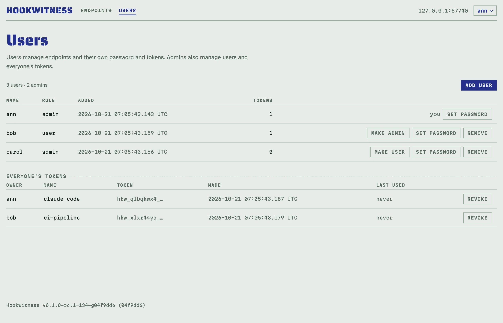
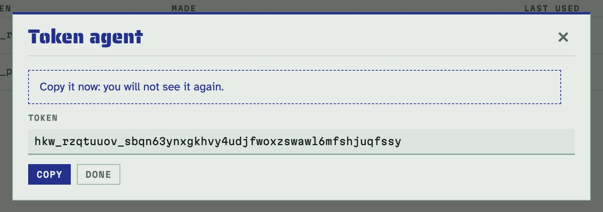

# Користувачі, вхід і токени

Одразу після встановлення в Hookwitness немає ні користувачів, ні входу:
хто може відкрити адмінку (вебінтерфейс, REST API, MCP), той читає кожен
упійманий запит і змінює кожен ендпоінт. На власній машині це нормально. На
сервері команди, у Docker у мережі чи будь-де, куди можуть дістатися чужі,
увімкніть вхід: додайте користувача. Ендпоінти й `/healthz` для відправників
лишаються відкритими в будь-якому разі.

## Вхід вимкнено, доки немає першого користувача

Поки користувачів немає, кожна сторінка адмінки каже про це пунктирним
рядком під шапкою, а сервер на старті попереджає, якщо адмінка слухає не
лише loopback.



Перший користувач вмикає вхід для вебінтерфейсу, REST API і MCP. Він завжди
адміністратор (інакше ніхто не зміг би керувати користувачами). Додати його
можна чотирма способами; обирайте за тим, як працює сервер:

- **Сторінка Users**, коли ви самі можете першим відкрити адмінку (на своїй
  машині або через SSH-тунель). Натисніть *Add a user* у тому пунктирному
  рядку, введіть ім'я і пароль щонайменше з 12 символів і увійдіть з ними.
- **Змінні середовища**, для Docker і compose, щоб адмінка не була
  відкритою навіть хвилину: `HOOKWITNESS_ADMIN_USER` і
  `HOOKWITNESS_ADMIN_PASSWORD_FILE` створюють першого адміністратора на
  старті, але лише в базі без користувачів. Перезапуск чи повторне
  розгортання нічого не створює і пише в лог, що пропустило; зміна файлу з
  паролем потім нічого не змінює (пароль міняють на сторінці акаунта або
  командою нижче). Поки змінна задана, сервер читає файл на кожному старті
  і зупиняється, якщо не може, тож користувач образу (uid 65532) має
  могти його прочитати: `sudo chown 65532 admin_password.txt` або режим 644.

  ```yaml
  services:
    hookwitness:
      image: ghcr.io/petroladkin/hookwitness:0.2
      ports: ["8080:8080"]
      volumes: ["hookwitness:/data"]
      environment:
        HOOKWITNESS_ADMIN_USER: ann
        HOOKWITNESS_ADMIN_PASSWORD_FILE: /run/secrets/admin_password
      secrets: [admin_password]
  secrets:
    admin_password:
      file: ./admin_password.txt   # один рядок, щонайменше 12 символів
  volumes:
    hookwitness:
  ```

  [Сервер для команди](server.md) будує так увесь сервер.

- **Командний рядок**, над базою сервера (сервер може працювати), для
  сервера, до якого ви заходите по SSH:

  <!-- docs-check: skip: works on the server's own database -->
  ```sh
  hookwitness user add ann --admin            # asks for the password twice
  docker exec -it hookwitness /hookwitness user add ann --admin
  ```

- **API**, зі скрипта, що налаштовує свіжий сервер, поки вхід ще вимкнено:

  ```sh
  curl -s -X POST http://127.0.0.1:8080/admin/api/v1/users -H 'Content-Type: application/json' \
    -d '{"name":"ann","role":"admin","password":"correct-horse-battery"}' | jq -r '.name + " " + .role'
  # ann admin
  ```

## Вхід

Відтак адмінка питає ім'я і пароль. Сторінка, яку ви відкрили до входу,
повертається після нього.



- Вхід триває, доки ви не вийдете (*Log out* у меню під вашим ім'ям), або добу без
  активності, або щонайбільше тиждень. Відкритий реєстр рахується як
  активність.
- Десять невдалих спроб з однієї адреси за 15 хвилин зупиняють входи з цієї
  адреси до кінця тих 15 хвилин. Адреса IPv6 рахується разом з усією своєю
  /64, блоком, який дають одному хосту, тож клієнт не розкладе спроби по
  своїх адресах.
- Зміна власного пароля завершує ваші інші входи; скидання пароля
  адміністратором, зміна ролі й видалення користувача завершують усі його
  входи одразу.

## Ролі

Їх дві, інших дозволів немає:

- **user**: робить усе з ендпоінтами (створення, поведінка, секрети, звіти,
  очищення, видалення), змінює власний пароль і керує власними токенами;
- **admin**: ще й додає, змінює й видаляє користувачів, бачить і відкликає
  токени всіх на сторінці **Users** і надсилає
  [повтори](replay.md#які-адреси), що дістаються власної мережі сервера.



Останнього адміністратора не можна ні видалити, ні понизити: спершу зробіть
адміністратором іншого користувача. Адміністратор не може й сам зробити
себе користувачем чи видалити себе: це може інший адміністратор.

## Токени для скриптів і агентів

Скрипти, CI і агенти ШІ працюють з REST API і MCP через особистий токен
замість пароля. Створіть його на сторінці акаунта (натисніть своє ім'я в
шапці, *Account and tokens*, потім *New token*). Його показують один раз: тоді й скопіюйте.



Токен діє від вашого імені, з вашою роллю, якою вона є зараз: понизьте чи
видаліть користувача, і його токени підуть за ним одразу. Відкликати токен
можна на сторінці акаунта (адміністратори — ще й на сторінці Users); те, що
його вживає, отримає відмову з наступного запиту, відкритий з ним реєстр
протягом 25 секунд перезавантажиться на сторінку входу, очікування в MCP
закінчиться протягом 30 секунд, а його сесії MCP буде закрито. Токени не спливають;
кожен показує, коли його востаннє вжили. Токен не може робити токени чи
керувати користувачами: для цього потрібен вхід.

Надсилайте його як `Authorization: Bearer <token>`. Увесь шлях з curl, від
входу до виклику з токеном:

```sh
curl -s -c hw.cookies -o /dev/null -w '%{http_code}\n' http://127.0.0.1:8080/admin/login \
  --data-urlencode name=ann --data-urlencode password=correct-horse-battery
# 303
TOKEN=$(curl -s -b hw.cookies -X POST http://127.0.0.1:8080/admin/api/v1/me/tokens \
  -H 'Content-Type: application/json' -d '{"name":"ci"}' | jq -r .token)
curl -s -o /dev/null -w '%{http_code}\n' http://127.0.0.1:8080/admin/api/v1/endpoints
# 401
curl -s -H "Authorization: Bearer $TOKEN" http://127.0.0.1:8080/admin/api/v1/me | jq -c .
# {"login":true,"name":"ann","role":"admin","via":"token"}
```

Токени мають вигляд `hkw_`, за ним 8 і 40 символів
(`hkw_[a-z2-7]{8}_[a-z2-7]{40}`). Додайте цей шаблон у свій сканер секретів
(у GitHub — власний шаблон у secret scanning), щоб помітити токен,
закомічений помилково.

Запит з дійсним токеном отримує відповідь, хоч на яке ім'я хоста його
надіслано: правило імен хостів ([розгортання](deployment.md#доступ-з-інших-машин))
захищає браузери, а браузер токенів не надсилає.

### MCP з токеном

Коли вхід увімкнено, `/admin/mcp` теж потребує токена. Дайте його Claude Code
заголовком або stdio-мосту файлом:

<!-- docs-check: skip: adds the server to your Claude Code configuration -->
```sh
claude mcp add --transport http hookwitness http://127.0.0.1:8080/admin/mcp \
  --header "Authorization: Bearer $(cat ~/.config/hookwitness/token)"
claude mcp add hookwitness -- hookwitness mcp -url http://127.0.0.1:8080 -token-file ~/.config/hookwitness/token
```

### Машинний токен

Для CI, що сам запускає Hookwitness, `HOOKWITNESS_API_TOKEN_FILE` називає
файл з токеном на ваш вибір (один рядок, щонайменше 32 символи, наприклад
`hkw_machine_$(openssl rand -hex 24)`). Його читають на старті, він має роль
user. Він закриває API і MCP навіть тоді, коли користувачів ще немає (пускає
лише токен); вебінтерфейс тоді лишається відкритим, з рядком «no login»,
доки не з'явиться перший користувач.

## Вхід через Google, Microsoft Entra ID чи іншого провайдера

Люди можуть входити через провайдера OpenID Connect (Google Workspace,
Microsoft Entra ID, Keycloak, Authentik, GitLab, будь-якого провайдера з
discovery), поруч зі своїми паролями.

**Хто входить.** Типово лише ті, кого додав адміністратор: дайте їм email на
сторінці Users (або `hookwitness user add pat -email pat@example.com
-no-password`). Під час першого входу підтверджена провайдером адреса
пов'язує людину з цим користувачем; далі вирішує ідентичність у провайдера
(її issuer і subject), тож змінена в провайдера адреса лишається тим самим
акаунтом. Провайдер може також впускати будь-кого з ваших поштових доменів
(`_ALLOWED_DOMAINS`): нова адреса такого домену стає користувачем із роллю
`user`, названим за адресою, без пароля. Ролі лишаються локальними: їх
змінює адміністратор на сторінці Users. Вхід через провайдера починає
працювати лише тоді, коли вже є перший адміністратор.

Перевіряйте email, коли вписуєте: провайдер, що підтвердив адресу, віддає
акаунт із цією адресою її власникові. Дозволяйте лише домени, якими керуєте
(ніколи `gmail.com`), і лише в провайдерах, що перевіряють адреси.

**Налаштування.** По одній назві на провайдера в
`HOOKWITNESS_OIDC_PROVIDERS`, далі для кожної назви (великими літерами) її
issuer, client id і файл із секретом клієнта; це лише змінні середовища:

<!-- docs-check: skip: needs an OpenID Connect provider -->
```sh
docker run -d --name hookwitness -p 127.0.0.1:8080:8080 -v hookwitness:/data \
  -v ./google-secret.txt:/run/secrets/google:ro \
  -e HOOKWITNESS_ADMIN_URL=https://hooks.example.com \
  -e HOOKWITNESS_OIDC_PROVIDERS=google \
  -e HOOKWITNESS_OIDC_GOOGLE_ISSUER=https://accounts.google.com \
  -e HOOKWITNESS_OIDC_GOOGLE_CLIENT_ID=1234-abc.apps.googleusercontent.com \
  -e HOOKWITNESS_OIDC_GOOGLE_CLIENT_SECRET_FILE=/run/secrets/google \
  -e HOOKWITNESS_OIDC_GOOGLE_ALLOWED_DOMAINS=example.com \
  ghcr.io/petroladkin/hookwitness:0.2
```

| Змінна | Значення |
|---|---|
| `HOOKWITNESS_OIDC_PROVIDERS` | назви через кому, кожна з `a-z0-9`, напр. `google,entra` |
| `HOOKWITNESS_OIDC_<NAME>_ISSUER` | issuer, точно як у документі discovery провайдера (`https://`; `http://` лише на loopback-хості) |
| `HOOKWITNESS_OIDC_<NAME>_CLIENT_ID` | client id, який дав провайдер |
| `HOOKWITNESS_OIDC_<NAME>_CLIENT_SECRET_FILE` | файл із секретом клієнта, один рядок; читається раз на старті, ніде не зберігається й не логується |
| `HOOKWITNESS_OIDC_<NAME>_LABEL` | текст кнопки після "Sign in with" (типово: назва з великої літери) |
| `HOOKWITNESS_OIDC_<NAME>_ALLOWED_DOMAINS` | поштові домени, нові люди з яких стають користувачами, через кому; без них — лише користувачі, яких додав адміністратор |

**Redirect URI.** Провайдер повертає людей на
`<адреса адмінки><префікс>/oidc/<name>/callback`. Адреса адмінки — це
`-admin-url` (`HOOKWITNESS_ADMIN_URL`) або `-public-url`, коли адмінка ділить
із ендпоінтами порт і ця адреса без шляху; без жодної з них сервер із
провайдерами не стартує. Лог старту друкує точний redirect URI кожного
провайдера: вставте його в консоль провайдера. Вхід починається на цій
адресі: кнопка, натиснута на іншій адресі сервера, спершу веде туди.

**Google.** У консолі Google Cloud створіть OAuth-клієнт типу *Web
application* з redirect URI з логу старту; для Workspace поставте екран
згоди *Internal*, щоб входили лише акаунти вашої організації. Issuer:
`https://accounts.google.com`.

**Microsoft Entra ID.** Зареєструйте застосунок *лише для цього каталогу
організації* (single tenant), додайте *Web* redirect URI з логу старту,
створіть секрет клієнта, а в *Token configuration* додайте необов'язкові
claims `email` і `xms_edov` (Entra не надсилає `email_verified`; `xms_edov`
каже, що адреса належить домену). Issuer:
`https://login.microsoftonline.com/<tenant id>/v2.0`, ніколи не `common`.
Нова реєстрація застосунку дає всім нові ідентичності: спершу відв'яжіть
старі, інакше їхні входи відхилятимуться як прив'язані деінде.

**Інший провайдер.** Keycloak (`https://<host>/realms/<realm>`), Authentik
(`https://<host>/application/o/<slug>/`), GitLab (`https://gitlab.com`) або
будь-який провайдер з discovery: конфіденційний клієнт з authorization code
flow і PKCE, scopes `openid email profile` і redirect URI з логу старту.
Налаштовуйте лише провайдерів, що підтверджують поштові адреси.

**Користувачі без пароля** входять лише через провайдера; сторінка Users це
показує. Перший пароль можна задати на сторінці акаунта протягом 10 хвилин
після входу; адміністратор може задати його будь-коли, як і
`hookwitness user passwd` на сервері. Ідентичності користувача видно на його
сторінці акаунта і на сторінці Users; **Unlink** прибирає одну з них і
завершує всі входи цього користувача (власний останній спосіб входу
відв'язати не можна).

**Вихід** завершує вхід лише тут: наступний вхід може пройти через
провайдера без запиту. Людина, яку вимкнули в провайдера, лишається
залогіненою, доки вхід не скінчиться (доба без дій, щонайбільше тиждень):
видаліть або відв'яжіть її тут, щоб завершити одразу. Коли провайдер
недоступний, паролі працюють; тримайте для цього пароль першого
адміністратора (`HOOKWITNESS_ADMIN_USER` разом із `HOOKWITNESS_ADMIN_EMAIL`
дає йому й email).

## За зворотним проксі

- Cookie входу позначено *Secure*, коли браузер дістався адмінки через
  TLS: запит прийшов через TLS, проксі з `-trusted-proxies` каже це в
  `X-Forwarded-Proto` або `-public-url` / `HOOKWITNESS_PUBLIC_URL` — це
  `https://…`, а адмінка ділить порт із вебхуками (за TLS-проксі задайте
  його). Коли адмінка на [окремому
  порту](deployment.md#адмінка-на-окремому-порту), публічна адреса
  `https://` важить лише тоді, коли адмінку відкрито за ім'ям з
  `-admin-hosts`: відкрита за адресою через звичайний HTTP (SSH-тунель,
  локальна мережа), cookie не позначено *Secure*, бо браузер там його
  відкинув би.
- Обмеження входу рахує невдачі за адресою клієнта (для IPv6 — за /64). За
  проксі кожен вхід
  приходить з адреси проксі, тож усі ділили б одне обмеження.
  `-trusted-proxies` / `HOOKWITNESS_TRUSTED_PROXIES` (адреси чи CIDR через
  кому) називає ваші проксі; для запитів від них клієнт — крайня права
  адреса в `X-Forwarded-For`, яка не є проксі. Вказуйте лише власний
  проксі: будь-хто інший може написати цей заголовок.

## Втрачено пароль адміністратора

На сервері задайте новий; усі входи цього користувача завершаться:

<!-- docs-check: skip: works on the server's own database -->
```sh
hookwitness user passwd ann
hookwitness user list
```

`hookwitness user` читає базу і ключ секретів так само, як `serve`
(`-db` / `HOOKWITNESS_DB`, `HOOKWITNESS_SECRET_KEY` або файл `.key` поруч із
базою). Коди виходу, для скриптів: `0` готово, `1` збій (база, ключ), `2`
неправильний виклик (погане ім'я, короткий пароль), `3` немає такого
користувача, `4` відмовлено (ім'я чи email зайняті або це останній
адміністратор). `user add` без `--admin` не може створити першого
користувача. З провайдерами: `user add <name> -email <адреса> [-no-password]`,
`user email <name> [<адреса>]` (без адреси очищує), `user unlink <name>
<провайдер чи issuer>`; `user list` показує email і способи входу кожного.

## Чого ніколи не видно

Паролі й токени зберігаються лише як солені хеші, зроблені з ключем секретів
сервера; вхід зберігає лише хеш свого ідентифікатора. Жодне з них не
потрапляє в логи, відповіді API чи сторінки; логи називають, хто зробив
кожну зміну (`user=ann` або `machine` для машинного токена).

Cookie не зважають на порти, тож браузер, який увійшов в адмінку на іншому
порту того самого хоста, надсилає cookie входу й на шляхи ендпоінтів.
Hookwitness його ніколи не зберігає: у заголовку `Cookie` упійманого запиту
значення `hookwitness_session` (і `hookwitness_oidc` входу через провайдера)
читається як `[hookwitness session]`, а більше нічого не змінено. Нічого з
того, що видає провайдер (коди, токени), не зберігається й не логується;
секрет клієнта провайдера читається з файлу й тримається лише в пам'яті.

## Як знову вимкнути вхід

Увімкнений вхід лишається увімкненим: останнього адміністратора не можна
видалити. Щоб знову відкрити адмінку, зупиніть сервер і видаліть
користувачів з бази разом з їхніми входами й токенами (`sqlite3
hookwitness.db 'PRAGMA foreign_keys=ON; DELETE FROM users'`) або почніть з
новою базою.
