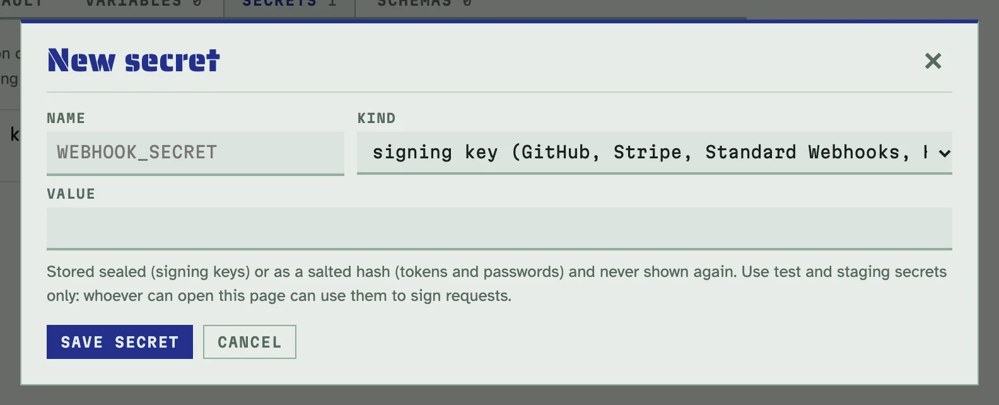
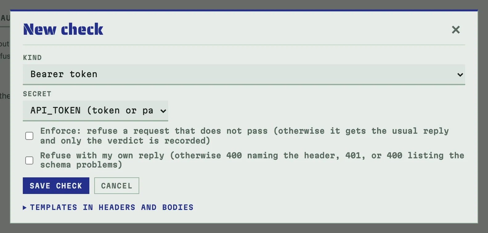
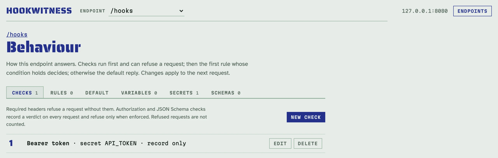
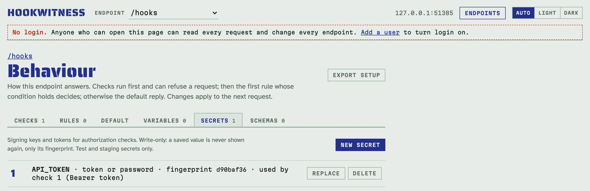

# Перевірки автентичності й секрети

Чи правильно підписано цей вебхук, чи несе він правильний токен? Перевірка
автентичності відповідає на це для кожного запиту **вердиктом**:

- **pass** — пройшов;
- **fail** — провалив, з причиною в один рядок (`signature does not match`,
  `timestamp 601 s old (tolerance 300 s)`, `header Authorization missing`);
- **n/v** — неможливо перевірити: тіло було більше за ліміт і не збережене,
  або секрет неможливо розшифрувати (див. [Розв'язання проблем](troubleshooting.md)).

Перевірці потрібні дві речі на сторінці **Behaviour** ендпоінта: **секрет**
(ключ підпису чи токен) на вкладці **Secrets** і **перевірка**, що ним
користується, на вкладці **Checks**. Сам секрет нічого не робить.

## Захистити ендпоінт токеном, крок за кроком

Відправник надсилає `Authorization: Bearer tok_test_123`; ви хочете бачити
вердикт для кожного запиту.

1. Відкрийте сторінку **Behaviour** ендпоінта і вкладку **Secrets**.
   Натисніть **New secret**.
2. Назвіть його `API_TOKEN`, виберіть **token or password (bearer, basic)**,
   вставте `tok_test_123` і збережіть. Відтепер значення більше ніколи не
   показується, лише його відбиток (fingerprint).

   

3. Відкрийте вкладку **Checks** і натисніть **New check**. Виберіть тип
   **Bearer token** і секрет `API_TOKEN`. Лишіть **Enforce** вимкненим, щоб
   лише записувати вердикти, або ввімкніть, щоб відмовляти запитам, які не
   пройшли.

   

4. Натисніть **Save check**. Наступний запит отримає вердикт:

<!-- docs-check: setup: bearer -->
```sh
H=http://127.0.0.1:8080/hooks
curl -s -d '{"order":42}' -H 'Authorization: Bearer tok_test_123' $H   # pass
curl -s -d '{"order":42}' -H 'Authorization: Bearer wrong' $H          # fail: token does not match
curl -s -d '{"order":42}' $H                                           # fail: header Authorization missing
```

Реєстр рахує вердикти, кожен рядок показує свій, а стрічка малює червону
риску під провальними запитами. Сторінка запиту наводить причину.


## Перевірки

| Перевірка | Що перевіряє |
|---|---|
| **GitHub signature** | `X-Hub-Signature-256: sha256=<hex HMAC-SHA256 сирого тіла>` |
| **Stripe signature** | `Stripe-Signature: t=<unix>,v1=<hex HMAC-SHA256 від "<t>.<body>">`; підійти може будь-який `v1`; позначка часу в межах допуску |
| **Standard Webhooks / Svix** | `webhook-id`, `webhook-timestamp`, `webhook-signature` (або `svix-…`): `v1,<base64 HMAC-SHA256 від "<id>.<timestamp>.<body>">` під base64-ключем `whsec_`; позначка часу в межах допуску |
| **Generic HMAC** | будь-який заголовок: sha1, sha256 чи sha512, hex чи base64, необов'язковий префікс (`sha1=` покриває старий `X-Hub-Signature` GitHub), підписаний вміст як шаблон (типово сире тіло, або напр. `{{.Header "X-Id"}}.{{.Body}}`) |
| **Bearer token** | `Authorization: Bearer <token>` |
| **Basic credentials** | `Authorization: Basic base64(user:password)`, ім'я користувача задано в перевірці |

Підписам потрібен секрет **signing key** (ключ підпису); bearer і basic —
секрет **token or password** (токен чи пароль).



### Як читати провалений підпис

Провалений підпис показує отриманий підпис повністю і перші 8 символів
очікуваного. Цього досить, щоб відрізнити неправильний секрет (провалюються
всі запити, а очікуваний підпис для того самого тіла не змінюється) від
неправильного вмісту (відправник перед підписом заново серіалізує JSON), і
недосить, щоб підробити підпис.

### Позначки часу

Stripe і Standard Webhooks підписують позначку часу. Hookwitness порівнює її
з часом, коли прийшов запит, з типовим допуском 300 с. Коли ви повторно
надсилаєте записані запити, поставте **Accept any timestamp (replayed
captures)**.

## Enforce

Коли **Enforce** вимкнено, перевірка лише записує вердикт, а запит отримує
звичайну відповідь. Коли ввімкнено, запиту, що не пройшов, відмовляють ще
до правил, і він не враховується: `401` з причиною (з `WWW-Authenticate` для
bearer і basic) або ваша власна відповідь. Запиту, який перевірка не може
перевірити (n/v), теж відмовляють.

<!-- docs-check: setup: basic_enforced -->
```sh
H=http://127.0.0.1:8080/hooks
curl -s -o /dev/null -d '{}' -u qa:pw_test $H   # 200
curl -s -o /dev/null -d '{}' -u qa:wrong $H     # 401 refused
```

## Повторна перевірка

Виправили секрет? **Re-check** на реєстрі знову перевіряє всі збережені
запити з поточними перевірками й секретами. Змінюються лише вердикти;
відповіді лишаються такими, як їх надіслали.

## Секрети

Вкладка **Secrets** показує секрети ендпоінта: ім'я, тип, відбиток і
перевірки, що ним користуються.



- **Лише на запис.** Збережене значення більше ніколи не показується: ні в
  UI, ні в API, ні в логах, ні у звітах; лише 8-символьний відбиток, щоб
  можна було побачити, чи мають два ендпоінти той самий секрет. **Replace**
  задає нове значення.
- **Зберігаються безпечно.** Ключі підпису зашифровано (AES-256-GCM);
  токени й паролі зберігаються лише як солоні хеші PBKDF2. Ключ шифрування —
  `HOOKWITNESS_SECRET_KEY` або файл ключа поруч із базою (див.
  [Налаштування й розгортання](deployment.md#ключ-секретів)). Копія бази без
  ключа не розкриває жодного секрету.
- **Лише тестові й staging-секрети.** Хто може відкрити адмінку, той може
  змусити сервер перевіряти підписи цими секретами.
- Упійманий запит зберігає свої заголовки як доказ, тож bearer-токен чи
  Basic-пароль, надісланий відправником, видно в цьому запиті. Звіти можуть
  маскувати такі заголовки ([Звіти](reports.md)).

## Приклади для кожної перевірки

Кожен блок нижче передбачає ендпоінт `/hooks` із секретом і перевіркою,
названими перед блоком. Їх запускає `make docs-check` на свіжому сервері.

**GitHub.** Секрет `GH_SECRET`, ключ підпису, `gh_test_secret`; перевірка
**GitHub signature**.

<!-- docs-check: setup: github -->
```sh
H=http://127.0.0.1:8080/hooks
BODY='{"action":"opened","number":7}'
SIG=$(printf '%s' "$BODY" | openssl dgst -sha256 -hmac gh_test_secret | awk '{print $2}')
curl -s -d "$BODY" -H "X-Hub-Signature-256: sha256=$SIG" $H                         # pass
curl -s -d "$BODY" -H "X-Hub-Signature-256: sha256=$(printf '0%.0s' {1..64})" $H   # fail: signature does not match
```

**Stripe.** Секрет `STRIPE_SECRET`, ключ підпису, `whsec_test_stripe`;
перевірка **Stripe signature**.

<!-- docs-check: setup: stripe -->
```sh
H=http://127.0.0.1:8080/hooks
BODY='{"id":"evt_1","type":"invoice.paid"}'
T=$(date +%s)
V1=$(printf '%s.%s' "$T" "$BODY" | openssl dgst -sha256 -hmac whsec_test_stripe | awk '{print $2}')
curl -s -d "$BODY" -H "Stripe-Signature: t=$T,v1=$V1" $H     # pass
OLD=$((T-600))
V0=$(printf '%s.%s' "$OLD" "$BODY" | openssl dgst -sha256 -hmac whsec_test_stripe | awk '{print $2}')
curl -s -d "$BODY" -H "Stripe-Signature: t=$OLD,v1=$V0" $H   # fail: timestamp
```

**Standard Webhooks / Svix.** Секрет `SW_SECRET`, ключ підпису,
`whsec_MfKQ9r8GKYqrTwjUPD8ILPZIo2LaLaSw`; перевірка **Standard Webhooks**.

<!-- docs-check: setup: standard -->
```sh
H=http://127.0.0.1:8080/hooks
BODY='{"type":"user.created"}'
T=$(date +%s)
KEY=$(printf 'MfKQ9r8GKYqrTwjUPD8ILPZIo2LaLaSw' | base64 -d | xxd -p | tr -d '\n')
SW=$(printf 'msg_1.%s.%s' "$T" "$BODY" | openssl dgst -sha256 -mac HMAC -macopt hexkey:$KEY -binary | base64)
curl -s -d "$BODY" -H "webhook-id: msg_1" -H "webhook-timestamp: $T" -H "webhook-signature: v1,$SW" $H   # pass
curl -s -d "$BODY" -H "webhook-id: msg_2" -H "webhook-timestamp: $T" -H "webhook-signature: v1,$SW" $H   # fail: signature does not match
```

**Generic HMAC.** Секрет `HMAC_KEY`, ключ підпису, `hmac_test_key`;
перевірка **Generic HMAC** із заголовком `X-Signature`, sha512, base64.

<!-- docs-check: setup: hmac -->
```sh
H=http://127.0.0.1:8080/hooks
BODY='{"event":"ping"}'
X=$(printf '%s' "$BODY" | openssl dgst -sha512 -hmac hmac_test_key -binary | base64)
curl -s -d "$BODY" -H "X-Signature: $X" $H            # pass
curl -s -d "$BODY" -H "X-Signature: not-base64!" $H   # fail: not base64
```

**Basic.** Секрет `QA_PASSWORD`, токен чи пароль, `pw_test`; перевірка
**Basic credentials** з користувачем `qa`.

<!-- docs-check: setup: basic -->
```sh
H=http://127.0.0.1:8080/hooks
curl -s -d '{}' -u qa:pw_test $H                      # pass
curl -s -d '{}' -u qa:wrong $H                        # fail: user or password does not match
curl -s -d '{}' -H 'Authorization: Bearer x' $H       # fail: scheme is Bearer, not Basic
```

## Через API

Секрети: `PUT /endpoints/{id}/secrets/{name}`; перевірки — частина
документа поведінки. Див. [довідник API](../api.md#secrets) і його рецепти
[Require Basic credentials](../api.md#require-basic-credentials) та
[Require a GitHub signature](../api.md#require-a-github-signature).
