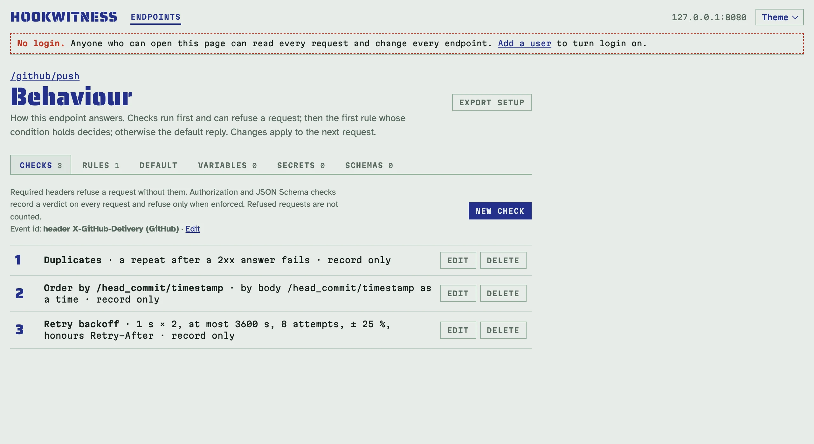
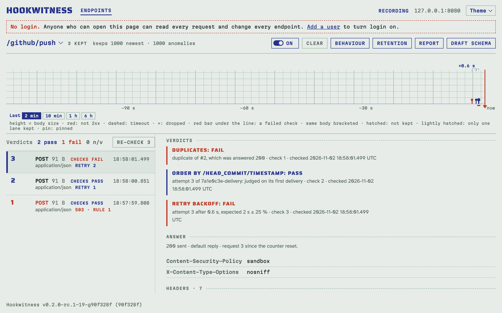

# Перевірка повторів, дублів і порядку від відправника

Відправники повторюють доставки, доставляють двічі й переплутують порядок
подій, і нічого з цього не видно до продакшну. Три перевірки оцінюють, як
відправник доставляє, запит за запитом, порівнюючи з раніше збереженими
запитами ендпоінта:

- **Duplicates**: повтор події після відповіді 2xx провалюється: отримувач
  її вже прийняв. Повтор після збою, тайм-ауту чи обірваного з'єднання
  проходить: так відправник і має робити.
- **Order**: порядковий номер чи час, нижчий за раніший в іншої події,
  провалюється.
- **Retry backoff**: інтервал кожного повтору проти задокументованого
  розкладу відправника і проти `Retry-After`, якого просила попередня
  відповідь.

Вони дають вердикти, як і інші перевірки (у реєстрі, на сторінці запиту, у
звітах, у фільтрі `verdict=`), і ніколи не відхиляють запит: що отримувач
відповідає на дубль — справа [правил](replies.md).

## Назвіть event id

Відправник зберігає id на кожному повторі події. На вкладці **Checks** рядок
**Event id** над перевірками каже, звідки ендпоінт його бере; **Edit**
пропонує місця провайдерів або ваше власне:

| Відправник | Event id |
|---|---|
| GitHub | заголовок `X-GitHub-Delivery` |
| Stripe | тіло `/id` |
| Standard Webhooks | заголовок `webhook-id` |
| Svix | заголовок `svix-id` |

Коли ендпоінт уже перевіряє підпис GitHub, Stripe чи Standard Webhooks,
діалог одразу пропонує місце цього провайдера; нічого не змінюється, доки ви
його не збережете.



З event id за ним ідуть спроби, мітки **retry** у реєстрі, дужки на стрічці
й групи повторів у звіті, тож відправник, що змінює поле на кожній спробі
(лічильник, час у тілі), усе одно видно як одну подію з повторами. Сторінка
запиту каже, наприклад, `attempt 2 of event d-1`. Без event id та сама
подія — це те саме тіло, як і раніше. Запит без event id отримує n/v від
перевірок дублів і backoff.

Спроби рахують збережені запити: коли старіші видалено, найстаріша
збережена спроба — спроба 1 (див. [Зберігання запитів](keeping.md)).

## Дублі

Відправник у стилі GitHub, чию першу доставку відхилено з `503`, і повтор,
що потім приходить утретє:

<!-- docs-check: setup: duplicates -->
```sh
H='X-GitHub-Delivery: 7a1e0c3e-delivery'
curl -s -o /dev/null -w '%{http_code}\n' -X POST http://127.0.0.1:8080/github/push -H "$H" -d '{"ref":"main"}'
# 503
curl -s -o /dev/null -w '%{http_code}\n' -X POST http://127.0.0.1:8080/github/push -H "$H" -d '{"ref":"main"}'   # pass
# 200
curl -s -o /dev/null -X POST http://127.0.0.1:8080/github/push -H "$H" -d '{"ref":"main"}'   # fail: duplicate of #2, which was answered 200
```



## Порядок

**Order by** — значення в тілі чи заголовку, прочитане як порядковий номер
чи час (RFC 3339 або секунди unix). **Within each value of** оцінює порядок
окремо для кожного об'єкта, наприклад Stripe `/data/object/id`. Значення,
нижче за раніше в іншої події, провалюється з її назвою; рівні проходять;
повтор ранішої події оцінено за її першою доставкою.

## Backoff повторів

**First gap**, **Factor** і **Longest gap** описують розклад відправника:
спроба *k* очікується через перший інтервал × factor<sup>k−2</sup> після
кінця попередньої, щонайбільше найдовший інтервал, у межах **Tolerance**
(25 % за замовчуванням); спроби понад **At most attempts** провалюються.
Інтервал міряється від кінця попередньої спроби: її прибуття плюс затримка
відповіді або час утримання, бо відправники починають backoff, коли спроба
провалилась.

Повтор раніше за `Retry-After`, якого просила попередня відповідь,
провалюється за будь-якого розкладу, а `Retry-After`, довший за інтервал
розкладу, — це інтервал, якого треба дотриматись. Без першого інтервалу
перевірка оцінює лише `Retry-After`. Правила, що відповідають `429` чи
`503` з `Retry-After`, — у [Сценаріях відповідей](replies.md).

## Через API і MCP

Поведінка приймає `event` (`{"from": "header", "key": "X-GitHub-Delivery"}`)
і перевірки `{"kind": "duplicates"}`, `{"kind": "order", "order": {"from",
"key", "as"}, "group": {…}}` та `{"kind": "backoff", "first_s", "factor",
"max_s", "max_attempts", "tolerance_pct", "retry_after"}`. Запит несе
`event` і `attempt`, а `?event=<id>` показує всі спроби події:

<!-- docs-check: setup: duplicates -->
```sh
api=http://127.0.0.1:8080/admin/api/v1
id=$(curl -s "$api/endpoints?path=/github/push" | jq '.endpoints[0].id')
curl -s "$api/endpoints/$id/requests?event=7a1e0c3e-delivery" | jq -c '[.requests[] | {no, attempt, status, verdict}]'
# [{"no":3,"attempt":3,"status":200,"verdict":"fail"},{"no":2,"attempt":2,"status":200,"verdict":"pass"},{"no":1,"attempt":1,"status":503,"verdict":"pass"}]
```

Агент питає те саме через MCP: `expect` з `event` і `count: 3` перевіряє, що
за певний час прийдуть три спроби однієї події; див. [Тестування
відправника з AI-агентом](agents.md). Перевірки їдуть у [файлах
налаштування](sharing.md) (формат 2).
