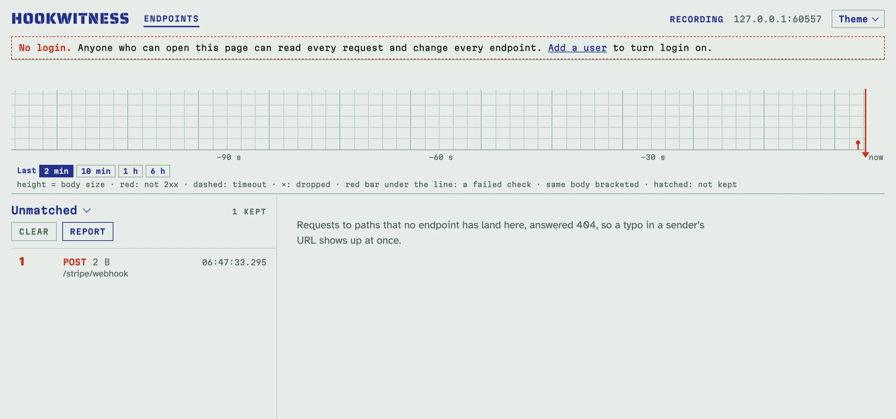

# Ендпоінти й живий перегляд

## Ендпоінти

Ендпоінт — це **точний шлях** на сервері, наприклад `/github/webhooks`.
Кожен запит на нього зберігається як доказ і отримує ту відповідь, яку
задано для ендпоінта (`200` з порожнім тілом, доки ви нічого не задали).

- `/a` і `/a/` — різні ендпоінти. Query-рядок не входить у шлях: `/a?x=1`
  потрапляє на `/a`.
- Шлях складається з літер, цифр і `. _ ~ -` між скісними рисками. Залиште
  шлях порожнім у **New endpoint**, щоб отримати випадковий: зручно, коли
  адресу не мають вгадати.
- `/healthz` і префікс адмінки (типово `/admin`) належать самому
  Hookwitness; будь-який інший шлях може бути ендпоінтом, тож відправник
  може лишити свої справжні шляхи.

Сторінка **Endpoints** показує їх разом із catch URL, кількістю збережених
запитів і часом останнього. **Behaviour** відкриває
[сценарії відповідей](replies.md) і перевірки ендпоінта, **Clear** видаляє
його запити, **Delete** видаляє ендпоінт разом із запитами.

## Запити без ендпоінта

Запит на шлях, який не є ендпоінтом, отримує `404` і зберігається в реєстрі
**Unmatched**; посилання на нього вгорі сторінки Endpoints. Помилка в URL
відправника, зайва чи пропущена скісна риска в кінці, забутий суфікс
`/webhooks`: усе це одразу видно там, а не губиться.

<!-- docs-check: setup: stripe_endpoint -->
```sh
curl -s -X POST http://127.0.0.1:8080/stripe/webhook -d '{}'   # 404: kept under Unmatched
```



## Реєстр

Натисніть ендпоінт, щоб відкрити його реєстр: запити ендпоінта, найновіші
вгорі. Він живий: нові запити з'являються без перезавантаження, а напис
**RECORDING** у шапці означає, що потік підключено.


- Кожен рядок показує номер запиту, метод, розмір тіла, тип вмісту і час
  (UTC, до мілісекунди). Рядок червоний, якщо відповідь не 2xx; примітка
  каже, як відповіли, коли це не звичайна типова відповідь (`503 · rule 1`,
  `401 refused`, `timeout`, `dropped`, `sender left`).
- Якщо налаштовано перевірки, кожен рядок має свій вердикт (`CHECKS PASS`,
  `CHECKS FAIL`), а реєстр їх рахує; **Re-check** знову перевіряє всі
  збережені запити, коли ви змінили секрет чи схему.
- **Show older** довантажує рядки; **Clear** видаляє запити ендпоінта.
- Номер — це місце запиту від створення ендпоінта; він ніколи не
  використовується повторно, тож «запит 7» лишається запитом 7 і у звіті.

### Стрічка

Над реєстром стрічка малює останні дві хвилини, як папір самописця: одна
позначка на запит, її висота — розмір тіла. Червона позначка — відповідь не
2xx, пунктирна — таймаут, хрестик — обірване з'єднання, червона риска під
лінією — провалена перевірка, а те саме тіло, доставлене кілька разів,
узято в дужки. Як відправник повторює (backoff, сплески, дублікати), видно
з першого погляду.

### Повтори

Те саме тіло, доставлене ще раз, — це повтор: сторінка запиту пише
`delivery 2 of this body`, стрічка бере доставки в дужки, а звіти групують
їх із проміжками між доставками, тож можна перевірити backoff відправника.

## Запит повністю

Натисніть рядок, щоб відкрити запит праворуч:

- **Штамп** (праворуч угорі): відповідь і що її визначило: `200 sent ·
  default reply`, `503 sent · rule 1 · every 4th`, `401 refused · check 1`,
  `timeout`, `dropped` або `sender left` (відправник здався під час затримки
  відповіді, тож так її і не отримав).
- **Body**: JSON гарно відформатований, інший текст як є, бінарні дані як
  hex-дамп; **Raw view** показує байт у байт, **Download body** зберігає
  тіло. Тіло понад ліміт розміру (типово 10 MiB) отримує `413` і
  зберігається без тіла.
- **Зображення** з тіла показано над ним, з переглядом у повний розмір
  ([Перевірки JSON Schema](schemas.md#зображення-в-даних)).
- **Verdicts**: вердикти перевірок ендпоінта з причинами.
- **Answer**: що надіслав Hookwitness, яке правило чи типова відповідь це
  вирішили, виміряна затримка.
- **Headers**: у тому порядку й регістрі, як їх написав відправник, з
  повторами.

**Report** (на запиті чи на реєстрі) експортує докази: див. [Звіти](reports.md).
**Draft schema** складає чернетку JSON Schema з тіла: див.
[Перевірки JSON Schema](schemas.md#чернетка-схеми-з-упійманого).

## Скільки запитів зберігається

Кожен ендпоінт зберігає 1000 найновіших запитів (`-retention`), реєстр
Unmatched так само; старіші видаляються, коли приходять нові. Див.
[Налаштування й розгортання](deployment.md).
