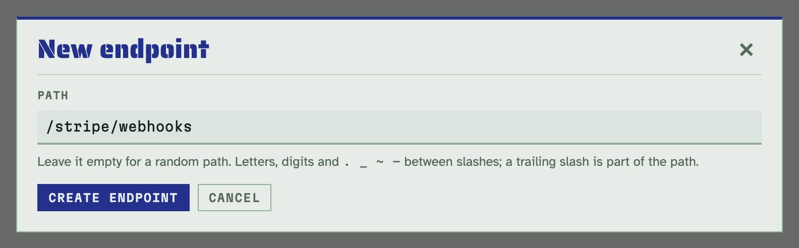
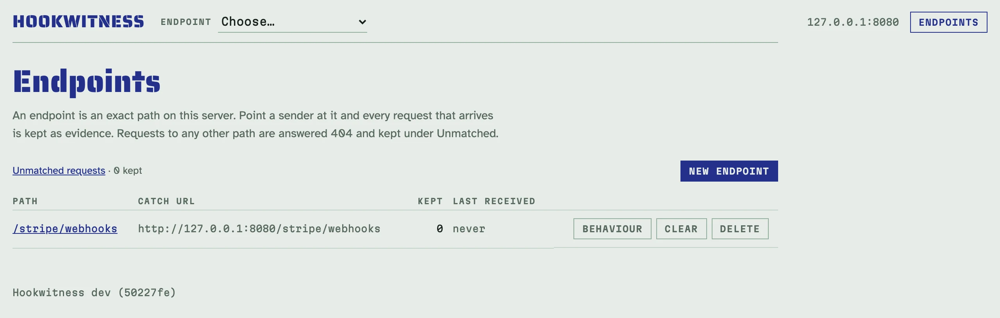
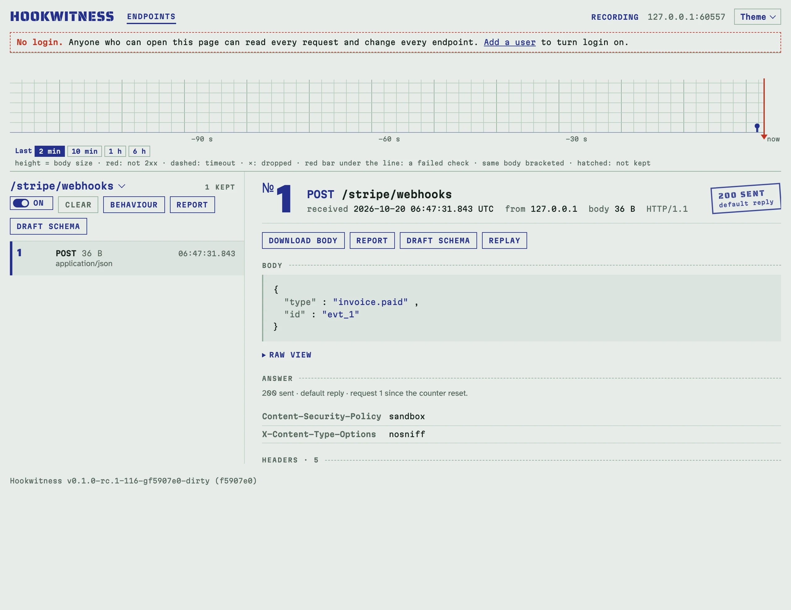

# Перші кроки

За десять хвилин: запустити Hookwitness, створити ендпоінт, надіслати йому
вебхук і прочитати, що прийшло.

## 1. Запустіть його

У Docker:

<!-- docs-check: skip: starts a long-running container; scripts/docker-smoke.sh runs this command in CI -->
```sh
docker run -d --name hookwitness -p 127.0.0.1:8080:8080 -v hookwitness:/data \
  ghcr.io/petroladkin/hookwitness:edge
```

Або з вихідного коду (Go 1.27 або новіший):

<!-- docs-check: skip: builds and starts the server this check already runs -->
```sh
make build
bin/hookwitness serve
```

В обох випадках він слухає порт 8080 лише цієї машини. Перевірте, що він
працює:

```sh
curl -s http://127.0.0.1:8080/healthz
# {"status":"ok","version":…
```

Частина `-v hookwitness:/data` важлива: вона зберігає ваші ендпоінти, запити
й секрети в іменованому томі, тож вони переживуть видалення і повторне
створення контейнера. Докладніше в
[Налаштуваннях і розгортанні](deployment.md).

## 2. Створіть ендпоінт

Відкрийте <http://127.0.0.1:8080/admin/>. Сторінка **Endpoints** показує
шляхи, які ловить Hookwitness; спершу вона порожня.

1. Натисніть **New endpoint**.
2. Введіть шлях, на який має слати відправник, наприклад `/stripe/webhooks`,
   або залиште порожнім, щоб отримати випадковий.
3. Натисніть **Create endpoint**.



Тепер у списку є ендпоінт зі своїм **catch URL**: це адреса, яку треба дати
відправнику.



## 3. Надішліть йому вебхук

Спрямуйте на catch URL справжнього відправника або надішліть запит вручну:

<!-- docs-check: setup: stripe_endpoint -->
```sh
curl -s -X POST http://127.0.0.1:8080/stripe/webhooks \
  -H 'Content-Type: application/json' \
  -d '{"type":"invoice.paid","id":"evt_1"}'   # 200
```

Hookwitness відповідає `200` з порожнім тілом. Це типова відповідь;
[сценарії відповідей](replies.md) її змінюють.

## 4. Прочитайте, що прийшло

Натисніть шлях ендпоінта. Його сторінка називається **реєстром**: кожен
запит, найновіші вгорі, з'являються наживо, без перезавантаження. Натисніть
запит, щоб побачити його повністю: метод, шлях і query, заголовки в тому
порядку, як їх написав відправник, тіло (гарний JSON, сирий текст або
hex-перегляд для бінарних даних) і що відповів Hookwitness.



## Далі

- [Ендпоінти й живий перегляд](endpoints.md): реєстр, стрічка, реєстр
  Unmatched, повтори.
- [Сценарії відповідей](replies.md): провалювати кожну третю доставку,
  відповідати повільно, зависати, обривати з'єднання.
- [Перевірки автентичності й секрети](authorization.md): чи правильно
  підписано?
- [Перевірки JSON Schema](schemas.md): чи тримає подія свій контракт?
- [Звіти](reports.md): додайте докази до тікета.
