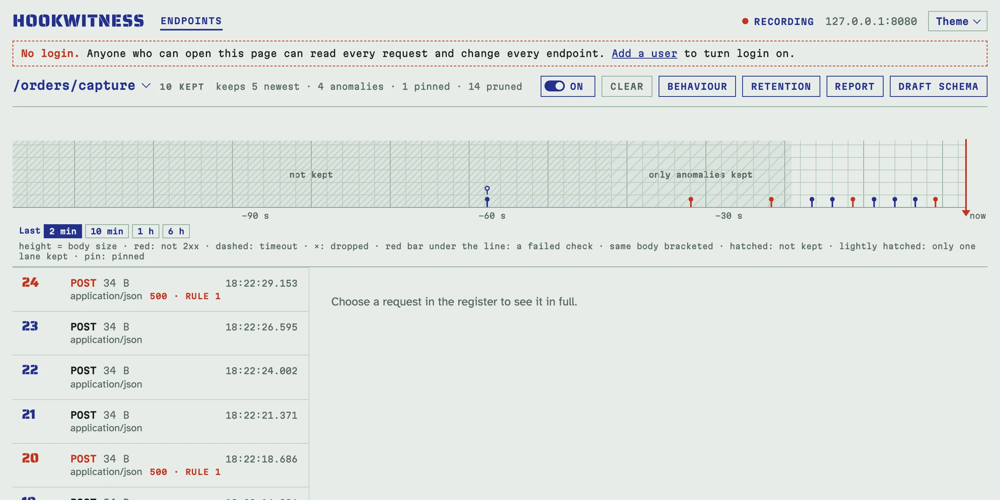
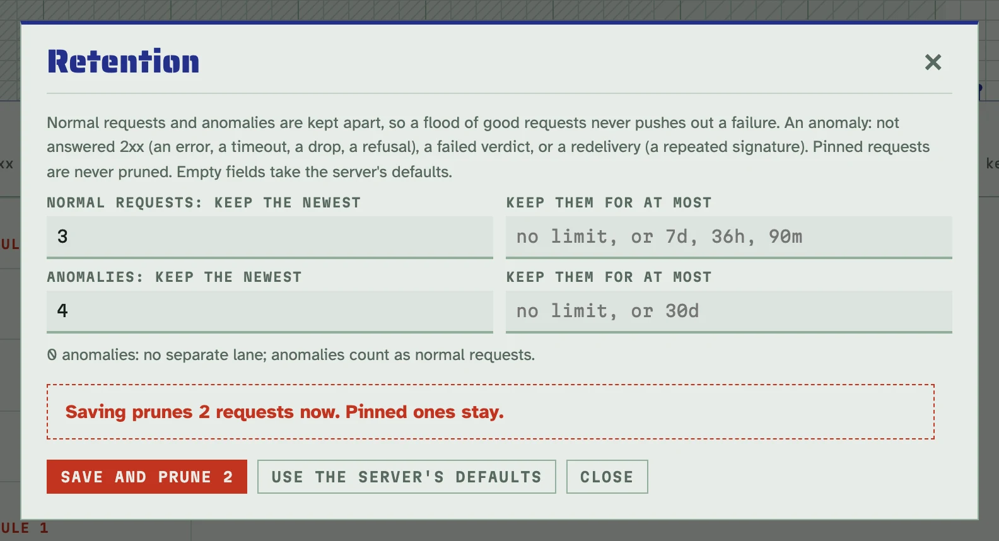
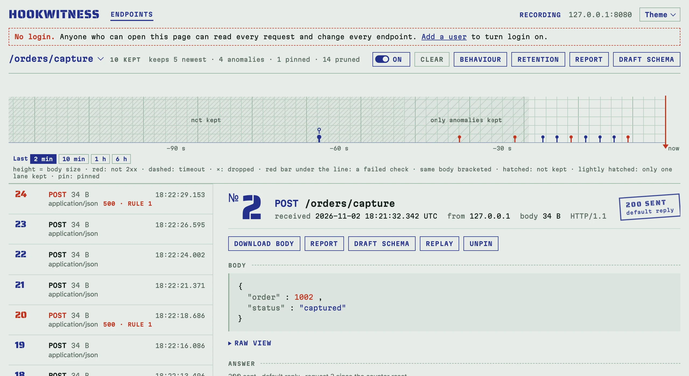

# Зберігання запитів

Запис, що триває днями, не має ні заповнити диск, ні втратити той один
запит, який важить. Кожен реєстр тримає запити у двох смугах, і кожна
смуга видаляє найстаріші сама по собі:

- **звичайні запити**: відповідь 2xx, кожна перевірка пройшла або не дала
  вердикту;
- **аномалії**: відповідь не 2xx (статус помилки, тайм-аут, обірване
  з'єднання, відмова перевірки, тіло понад ліміт), провалений вердикт або
  повторна доставка, тобто запит, чий підпис уже ніс раніший збережений
  запит (рахуються обидві доставки).

Тож тисячі добрих доставок ніколи не витіснять збою. **Закріплені** запити
не належать до жодної смуги: ліміти їх ніколи не видаляють.

## Що зберігає реєстр

Це каже заголовок реєстру, наприклад
`keeps 1000 newest · 1000 anomalies · 2 pinned · 41 208 pruned`. За
замовчуванням кожен ендпоінт зберігає 1000 найновіших звичайних запитів
(`-retention`) і 1000 найновіших аномалій (`-retention-anomalies`); реєстр
Unmatched зберігає 1000 найновіших запитів в одній смузі.



Стрічка показує, що прибрали ліміти. До найновішого видаленого запиту обох
смуг не збережено нічого, крім закріплених: там штрихування з підписом
**not kept**. Там, де видалено лише звичайні запити, аномалії того часу
ще намальовано поверх світлішого штрихування з підписом **only anomalies
kept**.

## Власні ліміти ендпоінта

Натисніть **Retention** у реєстрі. Кожна смуга має кількість (зберігати
стільки найновіших) і вік (нічого старшого: `90m`, `36h`, `7d`, від 1 год
до 3650 днів). Порожнє поле бере типове значення сервера. **0** аномалій
означає без окремої смуги: аномалії тоді рахуються як звичайні запити, як
до появи смуг.



Менший ліміт діє одразу, тож діалог спершу питає, наприклад
**Saving prunes 2 requests now**, з кнопкою **Save and prune 2**. Обмеження
віку застосовує щохвилинне прибирання, тож запит може пробути до хвилини
довше за свій вік. **Use the server's defaults** скидає власні ліміти
ендпоінта.

Через API: `PATCH /endpoints/{id}` з `retention` (або `null` для типових);
`to_prune` у відповіді каже, скільки запитів пішло. Довгий запис
`/orders/capture`, чия вкладка Rules відповідає на кожен 4-й запит `500`,
який зберігає 3 найновіші звичайні запити і 2 аномалії:

<!-- docs-check: setup: capture -->
```sh
api=http://127.0.0.1:8080/admin/api/v1
id=$(curl -s "$api/endpoints?path=/orders/capture" | jq '.endpoints[0].id')
curl -s -X PATCH "$api/endpoints/$id" -H 'Content-Type: application/json' \
  -d '{"retention":{"normal":{"count":3},"anomalies":{"count":2}}}' | jq -c .retention_effective
# {"normal":{"count":3,"max_age":null},"anomalies":{"count":2,"max_age":null}}
for i in $(seq 12); do curl -s -o /dev/null -X POST http://127.0.0.1:8080/orders/capture -d "{\"order\":$i}"; done
curl -s "$api/endpoints/$id" | jq -c '{kept, pruned: .pruned.count}'
# {"kept":{"normal":3,"anomalies":2,"pinned":0},"pruned":7}
curl -s "$api/endpoints/$id/requests?anomaly=true" | jq -c '[.requests[] | {no, status}]'
# [{"no":12,"status":500},{"no":8,"status":500}]
```

Дванадцять доставок: дев'ять із відповіддю 200 і три з відповіддю 500.
Реєстр зберігає три найновіші перші й дві найновіші другі: №4 пішов разом
із шістьма найстарішими 200, а №8 лишається, скільки б 200 не прийшло далі.

Реєстр Unmatched має одну смугу: `PATCH /unmatched` з
`{"retention": {"normal": {"count": 200, "max_age": "7d"}}}`.

## Закріпіть запит, що важить

**Pin** на сторінці запиту зберігає його, що б не прийшло: ліміти ніколи
його не видаляють, а рядок у реєстрі каже `pinned`. **Unpin** повертає його
в смугу, де ліміти застосує наступний запит або щохвилинне прибирання.



Через API: `PUT /requests/{id}/pin` і `DELETE /requests/{id}/pin` (обидва з
`Content-Type: application/json`), а `?pinned=true` показує закріплені:

<!-- docs-check: setup: capture -->
```sh
api=http://127.0.0.1:8080/admin/api/v1
id=$(curl -s "$api/endpoints?path=/orders/capture" | jq '.endpoints[0].id')
oldest=$(curl -s "$api/endpoints/$id/requests" | jq '[.requests[] | select(.anomaly | not)] | last | .id')
curl -s -o /dev/null -w '%{http_code}\n' -X PUT "$api/requests/$oldest/pin" -H 'Content-Type: application/json'
# 204
for i in $(seq 13 24); do curl -s -o /dev/null -X POST http://127.0.0.1:8080/orders/capture -d "{\"order\":$i}"; done
curl -s "$api/endpoints/$id/requests?pinned=true" | jq -c '[.requests[] | .no]'
# [9]
```

Очищення реєстру прибирає й закріплені запити, і його підтвердження каже,
скільки їх; видалення ендпоінта прибирає їх разом із ним.

## Ліміт розміру бази

Ліміти зберігання обмежують кожен реєстр за кількістю й віком. Ліміт
розміру обмежує всю базу: запустіть сервер з `-max-db-size` (або
`HOOKWITNESS_MAX_DB_SIZE`), як-от `-max-db-size 4GiB`, щонайменше 64 MiB.
Раз на хвилину і одразу після тіла понад 1 MiB сервер перевіряє розмір
бази. Понад ліміт він скидає найстаріше по всіх ендпоінтах, поки база не
стане меншою за 95 % ліміту, у такому порядку:

1. тіла звичайних запитів;
2. звичайні запити, чиї тіла вже скинуто;
3. тіла аномалій;
4. аномалії.

Закріплені запити і їхні тіла не скидаються ніколи. Запит зі скинутим тілом
зберігає все інше: розмір і дайджест тіла, рядки заголовків, відповідь і
вердикти; повтори й далі групуються за ним. Його сторінка каже «Body not
kept: dropped to stay under the database size limit». Його не можна
повторити; повторна перевірка лишає його вердикти й зазначає, що його не
перевіряли знову; сире тіло й зображення відповідають `404 not_kept`; API
каже `body_dropped`, і звіти теж.

Ліміт м'який: між двома перевірками база може вирости понад нього приблизно
на хвилину трафіку. Закріплені запити можуть займати більше за ліміт; тоді
скинути більше нічого, і про це каже кожна сторінка.

Сторінка ендпоінтів називає розмір бази, ліміт, скільки займають закріплені
запити, і вільне місце тому (на Linux і macOS). Кожна сторінка попереджає
на 90 % ліміту, коли самі закріплені запити більші за нього, і коли на томі
менше 1 GiB або 5 % вільного. `GET <prefix>/api/v1/storage` дає ті самі
числа, а MCP `list_endpoints` їх називає.

Тут сервер з лімітом 64 MiB отримує 80 MiB тілами по 2 MiB: найстаріші тіла
скидаються, а 40 запитів лишаються.

<!-- docs-check: fresh -->
```sh
D=$(mktemp -d); head -c 2097152 /dev/urandom > "$D/body"   # a 2 MiB body
hookwitness serve -addr 127.0.0.1:18490 -db "$D/hw.db" -max-db-size 64MiB >/dev/null 2>&1 & HWPID=$!
H=http://127.0.0.1:18490; API=$H/admin/api/v1
until curl -fs -o /dev/null $H/healthz; do sleep 0.2; done
curl -s -o /dev/null -X POST $API/endpoints -H 'Content-Type: application/json' -d '{"path":"/big"}'
for i in $(seq 40); do curl -s -o /dev/null --data-binary @"$D/body" $H/big; done   # 80 MiB sent
sleep 1
curl -s $API/storage | jq -c '{under: (.used_bytes < .limit_bytes), limit_bytes}'
# {"under":true,"limit_bytes":67108864}
curl -s "$API/endpoints?path=/big" | jq '.endpoints[0].id' |
  xargs -I{} curl -s "$API/endpoints/{}/requests?limit=50" | jq -c '{kept: (.requests | length), bodies_dropped: ([.requests[] | select(.body_dropped)] | length > 0)}'
# {"kept":40,"bodies_dropped":true}
kill $HWPID
```

## У звітах, файлах налаштування і MCP

- Звіт, чий проміжок утратив запити через ліміти, каже це в підсумку і
  позначає закріплені запити.
- Власні ліміти ендпоінта їдуть у його файлі налаштування (`retention`,
  формат файлу 2; файл без них бере типові ліміти сервера, куди його
  імпортують). Заміна, що зменшує ліміт, видаляє одразу, а перегляд
  імпорту каже, скільки запитів піде. Див. [Як поділитися налаштуванням
  ендпоінта](sharing.md).
- Агенти користуються інструментами MCP `set_retention` і `pin_request`; див.
  [Тестування відправника з AI-агентом](agents.md).

Розмір бази випливає з лімітів або з ліміту розміру вище: див.
[Налаштування й розгортання](deployment.md#параметри).
