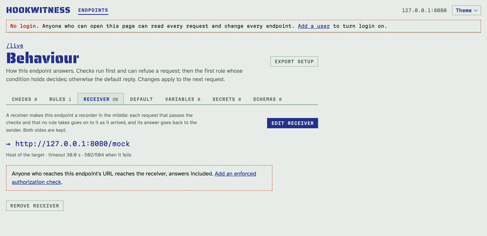
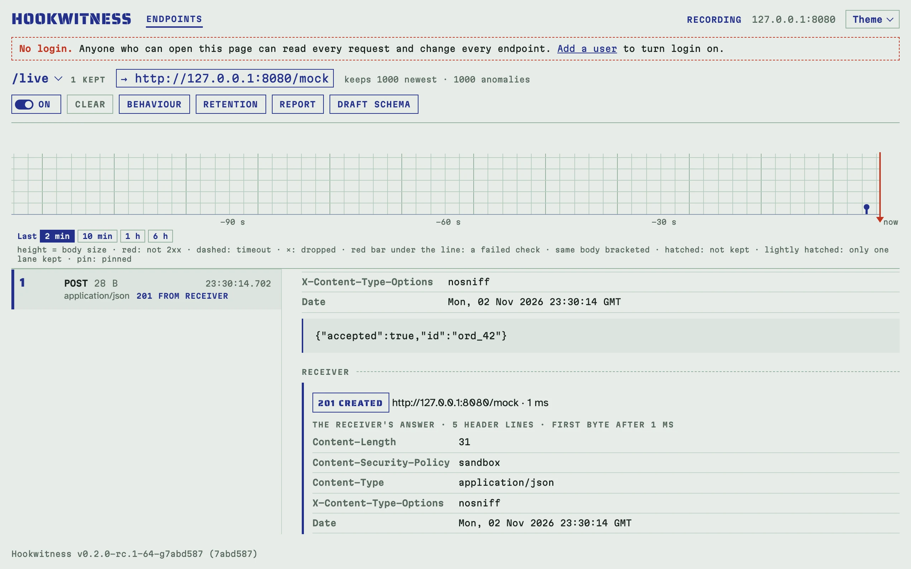

# Запис живої інтеграції

Деякі вади видно лише в живій інтеграції: подія губиться раз на ніч, підпис
не сходиться один раз на тисячу, отримувач часом повільніший за таймаут
свого відправника. Мок такого не впіймає: відправника має обслуговувати
справжній отримувач, день у день, а докази обох сторін мають зберігатися.
Поставте Hookwitness посередині. Кожен запит записується з вердиктами,
передається справжньому отримувачу таким, яким прийшов, а відповідь
отримувача повертається відправнику й зберігається разом із запитом.

## Поставте Hookwitness посередині

1. На сторінці **Behaviour** ендпоінта відкрийте вкладку **Receiver** і
   натисніть **Set receiver**.
2. Введіть URL отримувача, наприклад `https://api.example.com/webhooks`, і
   збережіть.
3. Направте відправника на catch URL ендпоінта замість отримувача.

Відтепер кожен запит, що пройшов перевірки ендпоінта і якого не забрало
жодне правило, іде далі отримувачу. Ендпоінт має бейдж **→ отримувач** на
сторінці Endpoints і над своїм реєстром, тож видно, що його трафік виходить
за межі сервера.



Щоб спробувати без власного отримувача, нехай `/live` пересилає на другий
ендпоінт того самого сервера, `/mock`, який сам відповідає `201`:

<!-- docs-check: setup: recorder -->
```sh
H=http://127.0.0.1:8080
curl -s -o /dev/null -w '%{http_code}\n' -d '{"order":42}' $H/live
# 201
curl -s "$H/admin/api/v1/endpoints?path=/live" | jq '.endpoints[0].id' |
  xargs -I{} curl -s "$H/admin/api/v1/endpoints/{}/requests?limit=1" | jq -c '.requests[0].forward | {status, target}'
# {"status":201,"target":"http://127.0.0.1:8080/mock"}
```

## Що отримує отримувач

Запит іде так, як його надсилає [Replay](replay.md#що-саме-надсилається):
тіло байт у байт, кожен рядок заголовка в своєму порядку й регістрі, нічого
не додано, як HTTP/1.1, chunked-тіло одним шматком. Рядок запиту — шлях
отримувача, а за ним query, яку надіслав відправник. Сам URL отримувача не
може містити query чи ім'я користувача й пароль. Деякі отримувачі, як-от
вебхуки чатів, тримають секрет у шляху: його бачить кожен, хто може читати
ендпоінт, і його зберігають файли налаштувань. Звіти показують лише схему й
хост отримувача.

**Host** за замовчуванням називає отримувача: отримувачі маршрутизують за
ним, а постачальники його не підписують. Виберіть **Host sent: as received**,
щоб передати Host відправника. Для отримувача з самопідписаним сертифікатом
позначте **Accept any TLS certificate**.

## Що отримує відправник

Відповідь отримувача: його статус, рядки заголовків і тіло, до 1 MiB, ніколи
не розпаковане, без переходу за редиректами. Сервер сам її обрамлює, тож
`Content-Length`, `Transfer-Encoding`, `Connection` та інші рядки
з'єднання — його власні. Як і кожна відповідь на catch-шляху, вона несе
`Content-Security-Policy: sandbox` і `nosniff` і ніколи не ставить cookie
входу в адмінку. Рядки, що діяли б на весь origin, спільний для
catch-шляхів і адмінки (`Clear-Site-Data`, `Strict-Transport-Security`,
`Alt-Svc`), не передаються.

Коли отримувач збоїть, відправник отримує помилку шлюзу, що простим текстом
називає збій:

- `502`, коли до отримувача не дістатися, TLS-рукостискання провалюється,
  з'єднання обривається, відповідь понад 1 MiB або він перемикає протокол
  (`101`);
- `504`, коли він не відповідає за таймаут.

Виберіть **When the receiver fails: answer the default reply**, щоб
відправник був задоволений, поки отримувач перевстановлюється. Тоді
отримувач пропускає ці запити: їхні рядки кажуть **receiver down**, і вони
зберігаються як аномалії.

Одночасно йде щонайбільше 64 пересилання. Запит, який не знаходить вільного,
чекає до 5 секунд, а потім отримує `503` з `Retry-After: 5`. Запит, що
повертається на ендпоінт, який пересилає, власним з'єднанням Hookwitness для
пересилання, — це петля, і він отримує `508`.

## Таймаути

Пересилання за замовчуванням чекає отримувача 30 секунд, щонайбільше
`-max-wait`. Ставте його не меншим за власний таймаут відправника.
Відправник, що здається першим, не обриває обмін: він триває, і запит
записує обидва часи, як-от «the sender gave up after 10.0 s; the exchange
went on for 14.2 s». Це доказ отримувача, надто повільного для свого
відправника.

## Збої на живій інтеграції

[Правила](replies.md#правила) забирають запити на ендпоінті, що пересилає,
так само, як на будь-якому іншому: «кожен 3-й запит відповідає `503`»
вносить збої в живий трафік, а ви дивитесь, як відправник повторює. Запит,
який забрало правило, **не пересилається**: отримувач його не бачить, і
його рядок про це каже.

Позначте в правилі **The receiver gets these requests too**, щоб пересилати
й ті запити, які воно забирає. Отримувач обробляє подію, а відправник бачить
збій і повторює. Це класична подвійна доставка, яку отримувач має пережити.

## Тримайте закритим

Отримувач робить catch URL входом: хто дістається до нього, дістається й до
отримувача, разом із відповідями. Вкладка Receiver попереджає, поки ендпоінт
не має перевірки автентичності, яку примусово застосовано. Додайте таку,
як-от [підпис постачальника](authorization.md), щоб проходив лише справжній
відправник.

Коли вхід увімкнено, задати, змінити чи прибрати отримувача може лише
**адміністратор** — в UI, API, MCP та імпорті налаштувань. Користувачі
його бачать і змінюють решту поведінки.

Пересилання підлягають тій самій політиці адрес, що й повтори,
[`-replay-allow`](replay.md#які-адреси): link-local і адреси метаданих хмари
ніколи не набираються, а вужчий список обмежує, де можуть бути отримувачі.
`-replay-allow none` вимикає й пересилання: збережений отримувач лишається,
його запити отримують відповідь про збій, а сервер називає ці ендпоінти під
час запуску.

## Як прочитати, що сталося

Рядки реєстру показують, що отримав відправник (**201 from receiver**,
**502 receiver down**, **504 receiver timeout**), а поруч із відповіддю
правила — позначку сторони отримувача: **receiver 200** або **not
forwarded**. Стрічка показує погляд відправника. Сторінка запиту має розділ
**Receiver**: куди він пішов, скільки тривав, надіслані рядки (з вибраним
Host), рядки заголовків отримувача і його тіло (перші 64 KiB), і коли пішов
відправник.



[Звіти](reports.md) містять кожен обмін і рахують у підсумку пересилання,
відповіді отримувача за класами, його збої за видами, відправників, що
пішли, і непереслані запити.

## Довгі записи

Кожен пересланий запит зберігає сам запит, до 64 KiB відповіді отримувача
і до 64 KiB відповіді, яку отримав відправник. Розрахуйте зберігання для
днів трафіку на сторінці [Зберігання запитів](keeping.md): збої отримувача,
перехід на відповідь за замовчуванням і непереслані запити — аномалії, що
зберігаються окремо від звичайних.

## Через API і MCP

Документ поведінки приймає `forward` (`url`, `keep_host`,
`insecure_tls`, `timeout_ms`, `on_failure`) і перемикач `forward` кожного
правила. Запити несуть `forward`, сторону отримувача; `forward=ok`,
`failed` чи `none` фільтрує список; `GET <prefix>/api/v1/requests/{id}/forward`
дає весь обмін. Див. [довідник API](../api.md#recorder-in-the-middle).
Агенти використовують `configure_endpoint` з `forward` (див. [агенти](agents.md)).
