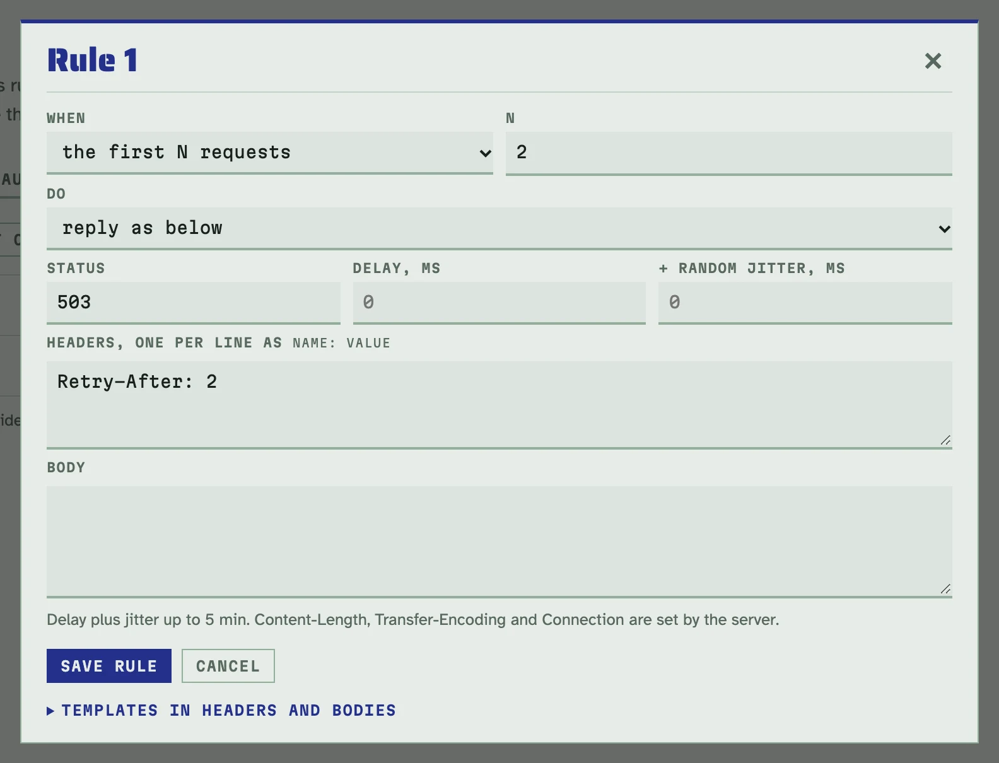
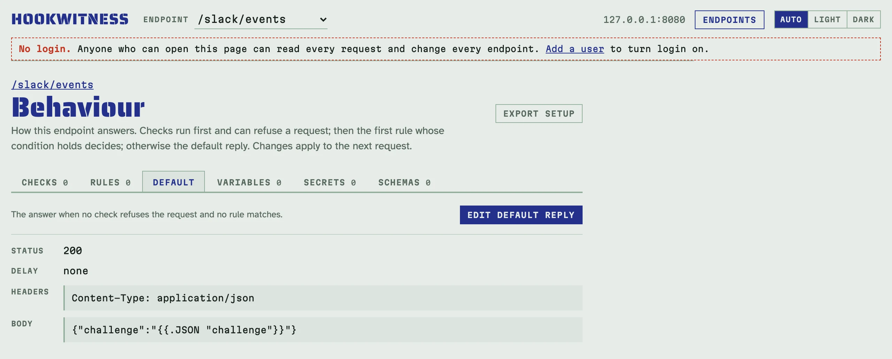

# Сценарії відповідей

Відправник має витримувати отримувачів, які відповідають повільно,
зависають, падають або час від часу дають збій. Сторінка **Behaviour**
кожного ендпоінта задає, як він відповідає, тож можна навмисно відтворити
саме це і подивитися, що робитиме відправник.

Відкрийте її кнопкою **Behaviour** на сторінці Endpoints або на реєстрі. Її
вкладки: **Checks**, **Rules**, **Default**, **Variables**, **Secrets** і
**Schemas**. Зміни діють з наступного запиту.

## Як обирається відповідь

1. Спершу працюють **перевірки**. Обов'язковий заголовок, примусова
   [перевірка автентичності](authorization.md) або примусова
   [перевірка схеми](schemas.md) можуть відмовити запиту з `400` чи `401` або
   вашою власною відповіддю. Запит, якому відмовили, правила не враховують.
2. Далі **правила**, по черзі. Вирішує перше правило, чия умова виконується,
   а решта пропускаються.
3. Решті запитів відповідає **типова відповідь**. Спершу це `200` з порожнім
   тілом.

Для кожного запиту записано, що з ним зробив Hookwitness: правило чи типова
відповідь, статус і надіслані заголовки, виміряна затримка або скільки
відправник чекав на таймауті.

## Правила

На вкладці **Rules** натисніть **New rule** і виберіть:

- **When**: `every Nth request` (кожен N-й), `the first N requests` (перші N
  від скидання лічильника) або `at random, p%` (випадково, з імовірністю).
- **Do**: `reply as below` (статус, заголовки, тіло, затримка з випадковим
  розкидом), `time out: hold, never answer` (тримати і не відповідати) або
  `drop: reset the connection` (обірвати з'єднання).

Стрілки пересувають правило вгору чи вниз, бо порядок має значення.
Лічильник на вкладці Rules рахує запити, які бачили правила. **Reset
counter** запускає його знову, тож «перші 2 запити» можна відтворити ще раз.

### Збій на кожній третій доставці

На `/billing/notify` додайте правило: кожен 3-й запит, відповідь `500`.


<!-- docs-check: setup: every_third -->
```sh
H=http://127.0.0.1:8080/billing/notify
curl -s -d '{"invoice":"in_1"}' $H   # 200
curl -s -d '{"invoice":"in_2"}' $H   # 200
curl -s -d '{"invoice":"in_3"}' $H   # 500 from rule 1
```

### Збій на перших двох, потім відновлення

На `/billing/retry` додайте правило: перші 2 запити, відповідь `503` із
заголовком `Retry-After: 2`. Відправник із повторами й backoff має доставити
з третьої спроби. Сторінка запиту тоді покаже `delivery 3 of this body`, а
звіт — проміжки між доставками. Натисніть **Reset counter**, щоб прогнати
знову.



<!-- docs-check: setup: first_two -->
```sh
H=http://127.0.0.1:8080/billing/retry
curl -s -d '{"invoice":"in_7"}' $H   # 503
curl -s -d '{"invoice":"in_7"}' $H   # 503
curl -s -d '{"invoice":"in_7"}' $H   # 200
```

### Повільний отримувач

На вкладці **Default** задайте затримку `2000` мс (додайте розкид, щоб час
різнився). Затримка вимірюється і записується разом із запитом.

<!-- docs-check: setup: slow -->
```sh
curl -s -o /dev/null -w '%{http_code} after %{time_total} s\n' -d '{}' http://127.0.0.1:8080/billing/slow
# 200 after 2.…
```

Якщо відправник здасться раніше, ніж мине затримка, відповіді він не
отримає. Запит запишеться як **sender left**, а стрічка і звіти рахуватимуть
його як таймаут, не як успіх.

### Отримувач, що зависає

Додайте правило з таймаутом (з `at random, 10%` зависатиме лише частина
запитів). Hookwitness тримає з'єднання і не відповідає, доки відправник не
здасться або не мине `-max-wait` (типово 5 хвилин). Тоді він закриває
з'єднання без відповіді. Сторінка запиту показує, скільки чекав відправник.

<!-- docs-check: setup: hang -->
```sh
curl -s -m 2 -o /dev/null -w '%{http_code}\n' -d '{}' http://127.0.0.1:8080/billing/hang
# 000
```

### Отримувач, що падає

Додайте правило з обривом. З'єднання скидається (TCP RST), щойно запит
прочитано, як це зробив би отримувач, що впав. Запит усе одно зберігається.

<!-- docs-check: setup: crash -->
```sh
curl -s -o /dev/null -w '%{http_code}\n' -d '{}' http://127.0.0.1:8080/billing/crash
# 000
```

## Типова відповідь

Вкладка **Default** задає відповідь запитам, яким не відмовила жодна
перевірка і не підійшло жодне правило. У неї є статус, заголовки, тіло,
затримка і розкид.

### Повернути challenge для перевірки адреси

Деякі відправники перевіряють URL, перш ніж ним користуватися: Slack
надсилає `challenge` і чекає його назад. На `/slack/events` задайте типовій
відповіді заголовок `Content-Type: application/json` і тіло
`{"challenge":"{{.JSON "challenge"}}"}`.



<!-- docs-check: setup: challenge -->
```sh
curl -s -d '{"type":"url_verification","challenge":"3eZb"}' http://127.0.0.1:8080/slack/events
# {"challenge":"3eZb"}
```

## Сирі байти

Щоб відтворити отримувача, який відповідає чимось дивним, наприклад
невалідним UTF-8 чи бінарним тілом, задайте тіло як байти. Над полем тіла
перемкніть **a template** на **bytes, base64** і вставте байти в base64.
Вони надсилаються точно як задано і ніколи не читаються як шаблон; переноси
рядків і пробіли в полі відкидаються. В API це `body_base64` замість `body`.

На `/legacy/hook` типова відповідь із байтами `//5vaw==` дає
`ff fe 6f 6b`: два байти, що не є UTF-8, а потім `ok`.

<!-- docs-check: setup: raw_bytes -->
```sh
curl -s -d '{}' http://127.0.0.1:8080/legacy/hook | od -An -tx1 | xargs
# ff fe 6f 6b
```

Сторінка запиту показує тіло такої відповіді в base64 під **Answer**, бо це
не текст.

## Шаблони

Значення заголовків і тіла відповідей — шаблони Go над запитом:

| Шаблон | Дає |
|---|---|
| `{{.Header "X-Request-Id"}}` | заголовок запиту (перший із цим іменем) |
| `{{.Query "name"}}` | параметр query |
| `{{.JSON "event.items.0.id"}}` | поле JSON-тіла за шляхом через крапку |
| `{{.Var.TOKEN}}` | змінну з вкладки **Variables** |
| `{{.N}}` | номер запиту від скидання лічильника |
| `{{.Method}}`, `{{.Path}}`, `{{.Body}}` | сам запит |

Працюють `if`, `with` і стандартні функції; `range` і вкладені шаблони — ні.
Рендер обмежено 1 MiB і однією секундою, а рядкові функції (`printf`,
`print`, `html`…) разом можуть зібрати щонайбільше 4 MiB. Шаблон, що не
спрацював, дає відповідь `500`, а сторінка запиту показує помилку.

**Змінні** — тестові значення для шаблонів. На вкладці **Variables** кожна
має ім'я і значення, а `{{.Var.NAME}}` підставляє значення. Їх видно
відкритим текстом, тож ніколи не кладіть туди справжніх секретів; для
секретів є окрема вкладка (див. [Перевірки автентичності й секрети](authorization.md)).

Заголовки відповіді йдуть так, як їх пише HTTP-сервер Go: відсортовані за
іменем, повторений заголовок зберігає свій порядок. `Content-Length`,
`Transfer-Encoding` і `Connection` належать серверу, задати їх не можна.
Відповідь `204` чи `304`, як і будь-яка відповідь на запит `HEAD`, іде без
тіла (а `304` ще й без `Content-Type`), як вимагає HTTP; сторінка запиту
записує те, що надіслано, і каже, чого з налаштованої відповіді не було.

Кожна відповідь також несе `Content-Security-Policy: sandbox` і
`X-Content-Type-Options: nosniff`. Шлях перехоплення має той самий origin, що
й веб-інтерфейс, тож відповідь, яка повторює запит (`{{.Body}}`), інакше могла
б виконатися як сторінка інтерфейсу, якщо відкрити її в браузері. Відправники
вебхуків сторінок не рендерять, для них нічого не змінюється. Щоб надіслати
інші значення, задайте ці заголовки самі: тоді відповідь несе ваші. Сторінка
запиту показує їх серед надісланих заголовків.

## Обов'язкові заголовки

Перевірка **Required header** на вкладці **Checks** відмовляє запиту без
заголовка або з заголовком, що не дорівнює значенню чи не відповідає
регулярному виразу. Відмова — `400` із назвою заголовка або ваша власна
відповідь.

Щоб вимагати API-ключ, як справжній клієнт, додайте перевірку на
`/partner/hooks`: `X-Api-Key` має дорівнювати `key_test`, а відмова — ваша
власна відповідь `401` з JSON-тілом.

<!-- docs-check: setup: api_key -->
```sh
H=http://127.0.0.1:8080/partner/hooks
curl -s -d '{}' -H 'X-Api-Key: key_test' $H   # 200
curl -s -d '{}' -H 'X-Api-Key: nope' $H       # 401 refused by the check
```

## Через API

Усе на цій сторінці — документ поведінки в REST API: `GET` і
`PUT /endpoints/{id}/behaviour`. Див. [довідник API](../api.md#behaviour).
