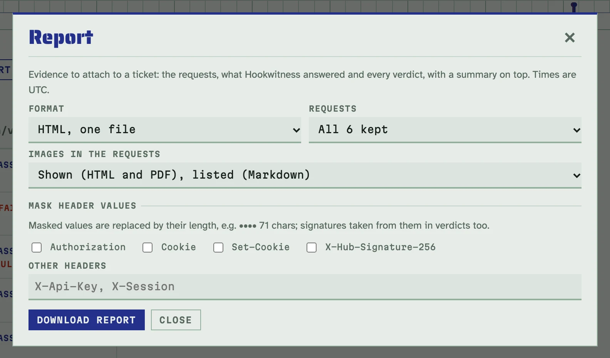
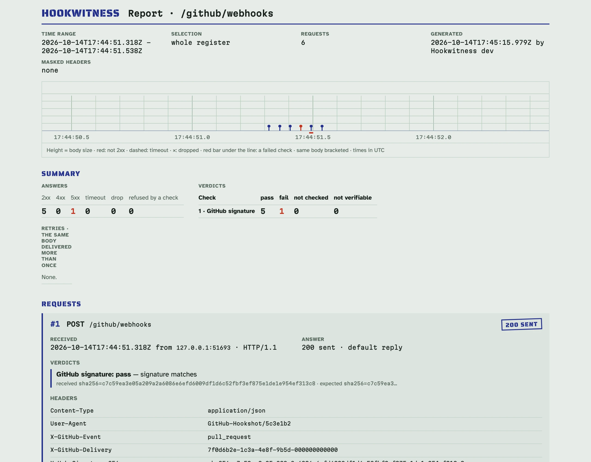

# Звіти

Додайте докази до тікета: звіт показує, які запити прийшли, що відповів
Hookwitness і кожен вердикт, з підсумком угорі.

## Завантажити звіт

1. Натисніть **Report** на реєстрі ендпоінта (або на одному запиті — тоді
   лише для нього).
2. Виберіть:
   - **Format**: **HTML, one file**, **Markdown** або **PDF, A4**;
   - **Requests**: усі збережені, отримані в проміжку часу (UTC) або вибрані
     за номерами (`3, 5-9`);
   - **Images in the requests**: показані в HTML і PDF або лише перелічені,
     щоб файл був меншим. Markdown завжди лише перелічує їх;
   - **Mask header values**: які заголовки сховати (нижче).
3. Натисніть **Download report**.



## Що в ньому

- **Угорі**: ендпоінт, проміжок, коли і якою збіркою Hookwitness
  (`<версія> (<коміт>)`, див. [Яка збірка працює](deployment.md#яка-збірка-працює))
  написано звіт.
- **Підсумок**: відповіді за класами (2xx, 4xx, 5xx, таймаут, обрив,
  відмова перевірки); вердикти за перевірками (pass, fail, не перевірено,
  неможливо перевірити); тіла, доставлені більше одного разу, з проміжками
  між доставками (backoff відправника); стрічка за проміжок.
- **Кожен запит**: номер, час, метод, шлях і query, адреса відправника,
  заголовки, тіло (відформатований JSON; бінарне — розміром і SHA-256; обрізане на
  64 KiB з повним розміром і SHA-256), що відповів Hookwitness, кожен
  вердикт із причиною і проблемами схеми, і його зображення.

Час — UTC з мілісекундами. Ті самі запити й параметри завжди дають той
самий Markdown і HTML, крім часу створення.



## Формати

- **HTML** — один самодостатній файл: шрифти вбудовано, жодних мережевих
  запитів, світла чи темна тема за налаштуванням читача. Він охайно
  друкується.
- **Markdown** відображається в issues GitHub і GitLab: вставте його в
  коментар.
- **PDF** малює сервер (без браузера), A4, з колонтитулом і номерами
  сторінок; запит ніколи не розривається до кінця своїх заголовків.

Уривок Markdown-звіту:

````markdown
## Summary

**Answers**

| 2xx | 4xx | 5xx | timeout | drop | refused by a check |
|---:|---:|---:|---:|---:|---:|
| 5 | 1 | 0 | 2 | 1 | 1 |

**Verdicts**

| Check | pass | fail | not checked | not verifiable |
|---|---:|---:|---:|---:|
| 1 · GitHub signature | 6 | 3 | 0 | 1 |
| 2 · JSON Schema by header X-GitHub-Event | 5 | 1 | 3 | 1 |
````

Сам звіт англійською, як і інтерфейс.

## Маскування

Типово маскування вимкнене: значення тестові. Коли звіт виходить за межі
вашої команди, позначте `Authorization`, `Cookie`, `Set-Cookie`, заголовки
підписів перевірок ендпоінта або назвіть інші заголовки. Їхні значення
стають довжиною (`•••• 71 chars`), так само підписи, взяті з них у
вердиктах, а звіт каже, які заголовки замасковано.

## Через API

`GET /endpoints/{id}/report?format=html|md|pdf` приймає ті самі параметри,
що й діалог; див. [довідник API](../api.md#reports). У прикладі `1` — id
ендпоінта; на свіжому сервері перший ендпоінт має id 1.

<!-- docs-check: setup: stripe_endpoint -->
```sh
API=http://127.0.0.1:8080/admin/api/v1
curl -s -d '{"type":"invoice.paid"}' http://127.0.0.1:8080/stripe/webhooks   # 200
curl -s "$API/endpoints/1/report?format=md" | head -1
# # Hookwitness report · /stripe/webhooks
```
